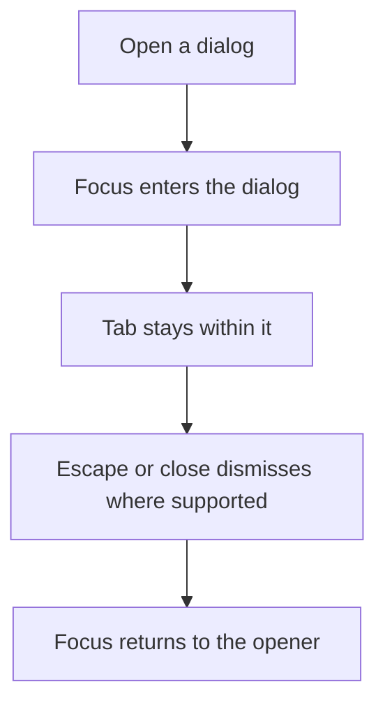
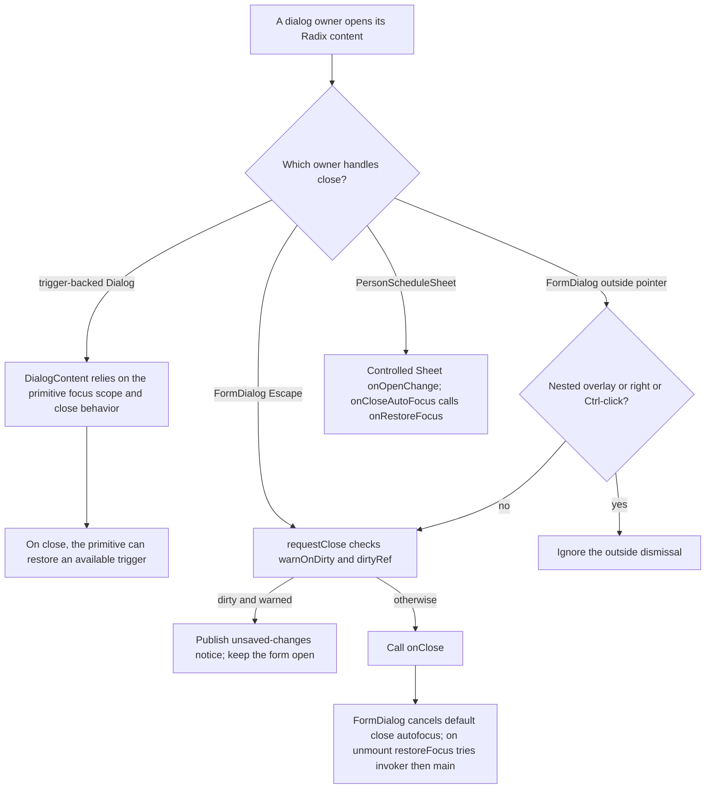

# US-KBD-02 — Use dialogs with a keyboard

As a keyboard user, I want focus managed within dialogs so that I can complete or dismiss them without losing my place.

**Status:** Current

**Access:** Owner, Admin, Editor, Viewer; actions remain role-gated

**Entry:** Any dialog open, Tab, Escape, and close action

**Documentation:** [Help](../../docs-src/using/help.md)

**Source:** [dialog.tsx](../../apps/frontend/src/components/ui/dialog.tsx)

## Acceptance criteria

- Opening moves focus into the dialog, Tab stays within it, Escape closes where supported, and focus returns to the opener.

## User flow

## Code flow

**Code references:** [dialog.tsx:54](../../apps/frontend/src/components/ui/dialog.tsx#L54) · [dialogs.tsx:73](../../apps/frontend/src/components/common/dialogs.tsx#L73) · [dialogs.tsx:109](../../apps/frontend/src/components/common/dialogs.tsx#L109) · [dialogs.tsx:152](../../apps/frontend/src/components/common/dialogs.tsx#L152) · [PersonScheduleSheet.tsx:30](../../apps/frontend/src/components/person-schedule/PersonScheduleSheet.tsx#L30)
