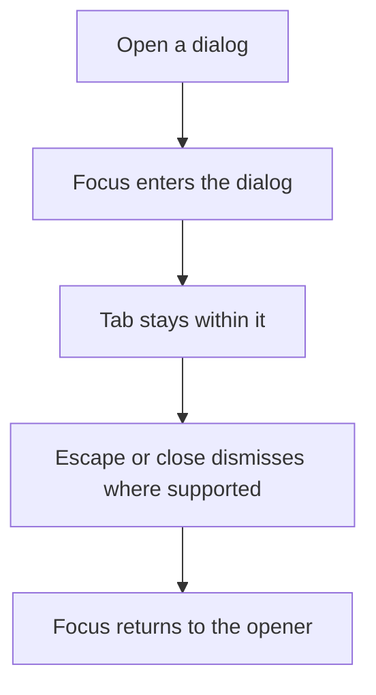
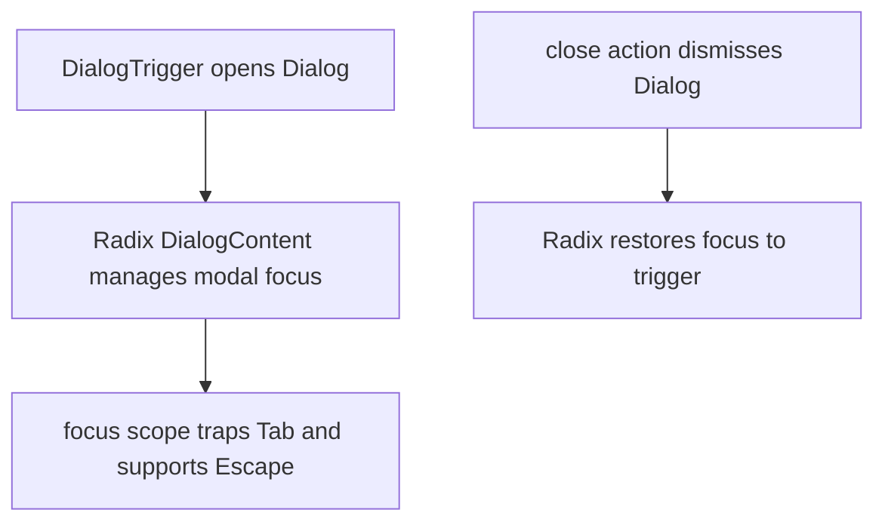

# US-KBD-02 — Use dialogs with a keyboard

As a keyboard user, I want focus managed within dialogs so that I can complete or dismiss them without losing my place.

**Status:** Current

**Access:** Owner, Admin, Editor, Viewer; actions remain role-gated

**Entry:** Any dialog open, Tab, Escape, and close action

**Documentation:** [Help](../../docs-src/using/help.md)

**Source:** [dialog.tsx](../../apps/frontend/src/components/ui/dialog.tsx)

## Acceptance criteria

- Opening moves focus into the dialog, Tab stays within it, Escape closes where supported, and focus returns to the opener.

## User flow

## Code flow

**Code references:** [dialog.tsx](../../apps/frontend/src/components/ui/dialog.tsx); [alert-dialog.tsx](../../apps/frontend/src/components/ui/alert-dialog.tsx)
