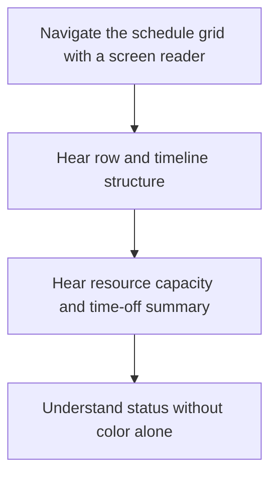
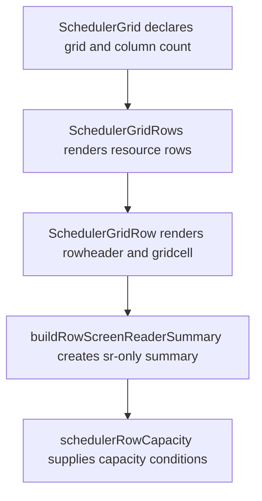

# US-KBD-03 — Understand the schedule grid with assistive technology

As a screen-reader user, I want schedule rows and capacity summaries exposed semantically so that I can understand the schedule without colour cues.

**Status:** Current

**Access:** Owner, Admin, Editor, Viewer

**Entry:** Schedule grid accessibility tree

**Documentation:** [Read The Schedule](../../docs-src/using/read-the-schedule.md)

**Source:** [SchedulerGrid.tsx](../../apps/frontend/src/components/scheduler/SchedulerGrid.tsx)

## Acceptance criteria

- The grid exposes row and cell relationships and each resource row announces applicable capacity and time-off information.

## User flow

## Code flow

**Code references:** [SchedulerGrid.tsx](../../apps/frontend/src/components/scheduler/SchedulerGrid.tsx); [SchedulerGridRows.tsx](../../apps/frontend/src/components/scheduler/SchedulerGridRows.tsx); [SchedulerGridRow.tsx](../../apps/frontend/src/components/scheduler/SchedulerGridRow.tsx); [buildRowScreenReaderSummary.ts](../../apps/frontend/src/components/scheduler/buildRowScreenReaderSummary.ts); [schedulerRowCapacity.ts](../../apps/frontend/src/components/scheduler/schedulerRowCapacity.ts)
