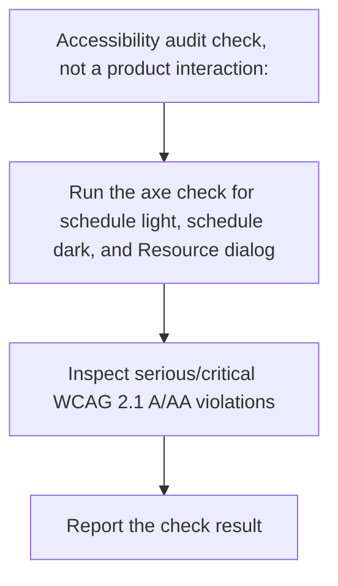
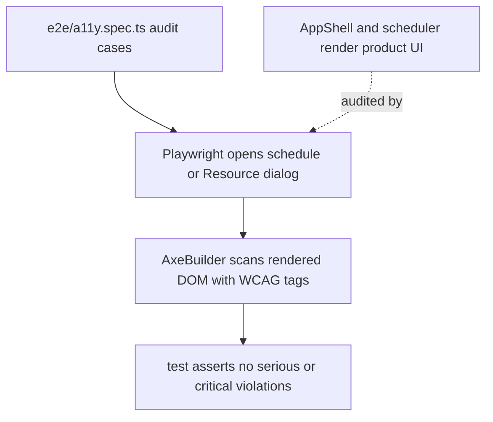

# US-KBD-04 — Keep key screens accessible

As an accessibility reviewer, I want key schedule and form screens checked against WCAG criteria so that serious barriers are detected.

**Status:** Current

**Access:** Owner, Admin, Editor, Viewer

**Entry:** Schedule in light/dark appearance; Resource form dialog

**Documentation:** [Help](../../docs-src/using/help.md)

**Source:** [a11y.spec.ts](../../e2e/a11y.spec.ts)

## Acceptance criteria

- Automated axe checks report no serious or critical WCAG 2.1 A/AA violations on the covered screens.

## User flow

## Code flow

**Code references:** [a11y.spec.ts](../../e2e/a11y.spec.ts); [AppShell.tsx](../../apps/frontend/src/components/AppShell.tsx); [SchedulerGrid.tsx](../../apps/frontend/src/components/scheduler/SchedulerGrid.tsx); [ResourceForm.tsx](../../apps/frontend/src/components/resources/ResourceForm.tsx)
