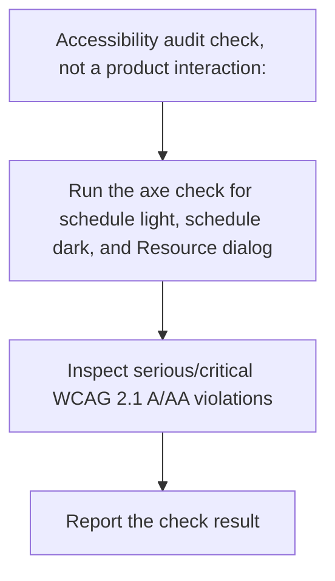
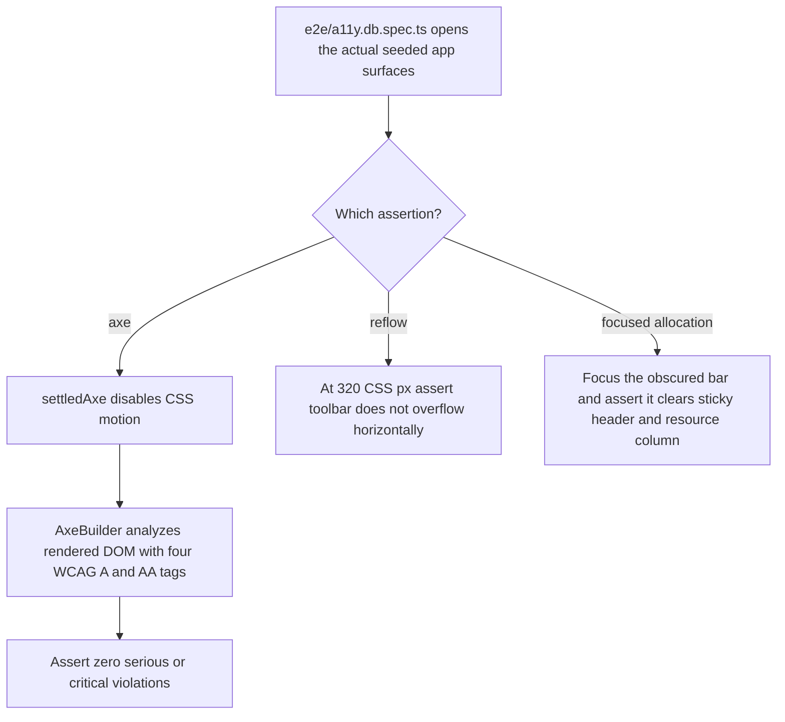

# US-KBD-04 — Keep key screens accessible

As an accessibility reviewer, I want key schedule and form screens checked against WCAG criteria so that serious barriers are detected.

**Status:** Current

**Access:** Owner, Admin, Editor, Viewer

**Entry:** Schedule in light/dark appearance; Resource form dialog

**Documentation:** [Help](../../docs-src/using/help.md)

**Source:** [a11y.spec.ts](../../e2e/a11y.db.spec.ts)

## Acceptance criteria

- Automated axe checks report no serious or critical WCAG 2.1 A/AA violations on the covered screens.

## User flow

## Code flow

The axe cases cover Schedule and Time off draw modes, dark theme, the allocation editor, resource form, destructive confirmation, empty Schedule and Diagnostics. This chart traces existing test definitions.

**Code references:** [a11y.db.spec.ts:14](../../e2e/a11y.db.spec.ts#L14) · [a11y.db.spec.ts:74](../../e2e/a11y.db.spec.ts#L74) · [a11y.db.spec.ts:136](../../e2e/a11y.db.spec.ts#L136) · [a11y.db.spec.ts:156](../../e2e/a11y.db.spec.ts#L156) · [a11y.db.spec.ts:188](../../e2e/a11y.db.spec.ts#L188) · [a11y.db.spec.ts:214](../../e2e/a11y.db.spec.ts#L214) · [a11y.db.spec.ts:225](../../e2e/a11y.db.spec.ts#L225) · [a11y.db.spec.ts:251](../../e2e/a11y.db.spec.ts#L251)
