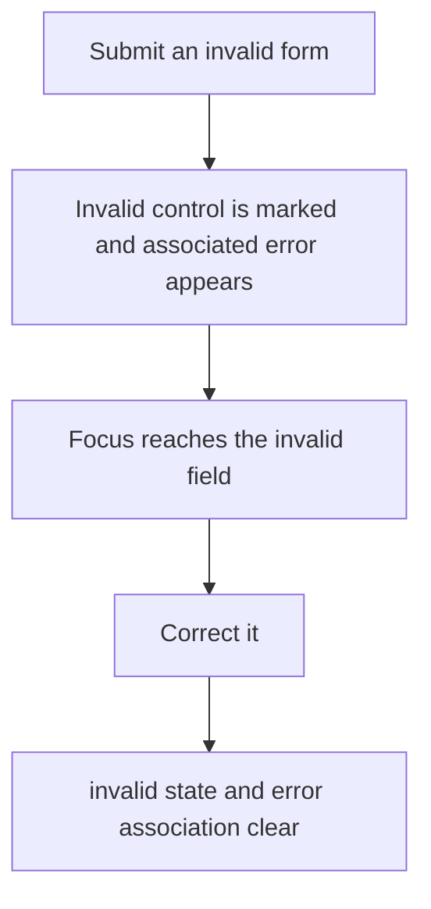
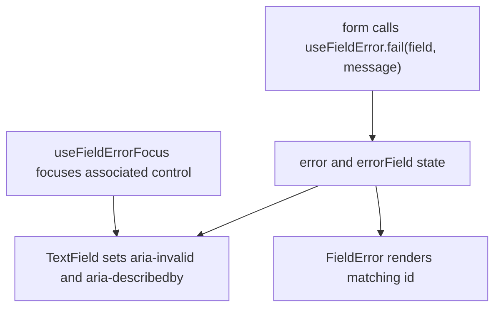

# US-KBD-05 — Associate validation errors with fields

As a screen-reader user, I want invalid fields connected to their error messages so that I can locate and correct them.

**Status:** Current

**Access:** Owner, Admin, Editor; forms accessible to Viewer remain read-only

**Entry:** Invalid form control and its validation message

**Documentation:** [Help](../../docs-src/using/help.md)

**Source:** [useFieldError.ts](../../apps/frontend/src/hooks/useFieldError.ts)

## Acceptance criteria

- Invalid controls expose aria-invalid and reference their visible error; the association clears when corrected.

## User flow

## Code flow

**Code references:** [useFieldError.ts](../../apps/frontend/src/hooks/useFieldError.ts); [textFields.tsx](../../apps/frontend/src/components/common/fields/textFields.tsx); [field.tsx](../../apps/frontend/src/components/ui/field.tsx)
