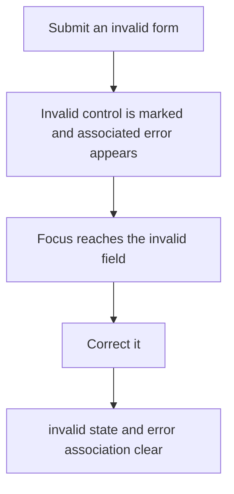
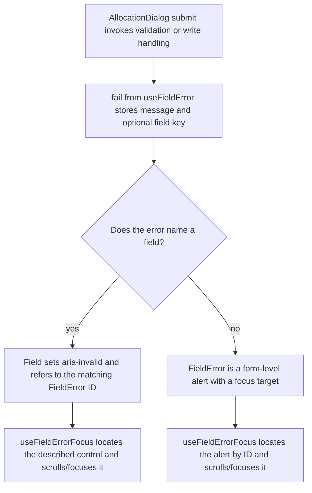

# US-KBD-05 — Associate validation errors with fields

As a screen-reader user, I want invalid fields connected to their error messages so that I can locate and correct them.

**Status:** Current

**Access:** Owner, Admin, Editor; forms accessible to Viewer remain read-only

**Entry:** Invalid form control and its validation message

**Documentation:** [Help](../../docs-src/using/help.md)

**Source:** [useFieldError.ts](../../apps/frontend/src/hooks/useFieldError.ts)

## Acceptance criteria

- Invalid controls expose aria-invalid and reference their visible error; the association clears when corrected.

## User flow

## Code flow

This focus trace applies to forms that call useFieldErrorFocus. The Add client browser test checks field-to-alert association, independently of whether the form calls that hook.

**Code references:** [allocationSubmit.ts:222](../../apps/frontend/src/components/scheduler/allocationSubmit.ts#L222) · [useAllocationDialogState.ts:123](../../apps/frontend/src/components/scheduler/useAllocationDialogState.ts#L123) · [AllocationScheduleFields.tsx:270](../../apps/frontend/src/components/scheduler/AllocationScheduleFields.tsx#L270) · [textFields.tsx:60](../../apps/frontend/src/components/common/fields/textFields.tsx#L60) · [useFieldError.ts:18](../../apps/frontend/src/hooks/useFieldError.ts#L18) · [useFieldError.ts:34](../../apps/frontend/src/hooks/useFieldError.ts#L34) · [dialog-layout.db.spec.ts:124](../../e2e/dialog-layout.db.spec.ts#L124)
