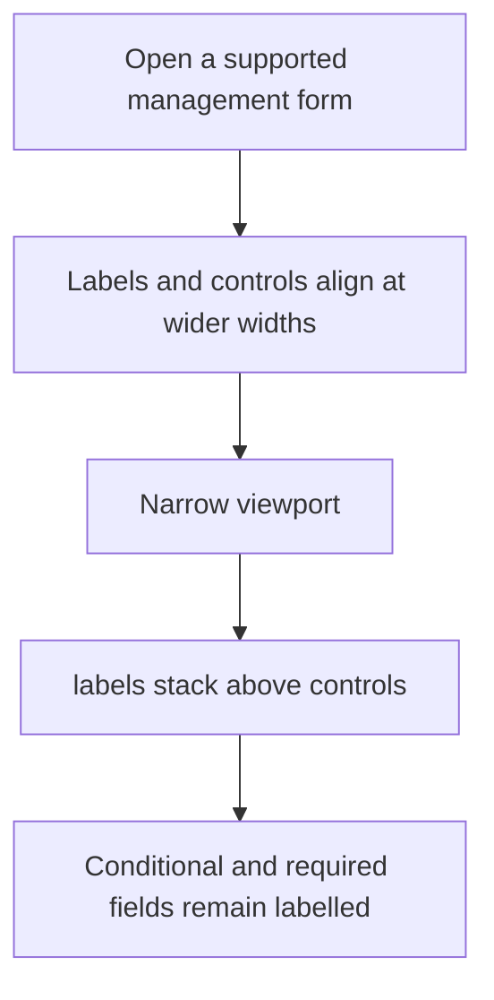
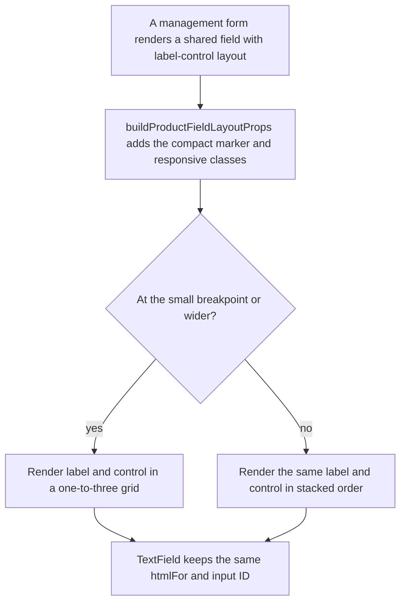

# US-KBD-06 — Scan management forms at different widths

As a company member, I want labelled form controls to remain clear on desktop and narrow screens so that I can complete supported forms.

**Status:** Current

**Access:** Owner, Admin, Editor; visibility and writes are role-gated

**Entry:** Resource, External party, Discipline, Client, Project, Activity, and Time off forms

**Documentation:** [Help](../../docs-src/using/help.md)

**Source:** [dialog-layout.spec.ts](../../e2e/dialog-layout.db.spec.ts)

## Acceptance criteria

- Fields use aligned labels at wider widths and stacked labels on narrow screens; required and conditional fields remain associated.

## User flow

## Code flow

Resource is the layout reference. The comparison tests exercise Client, Project, Activity, External party, Discipline and Time off forms.

**Code references:** [buildProductFieldLayoutProps.ts:4](../../apps/frontend/src/components/common/fields/buildProductFieldLayoutProps.ts#L4) · [textFields.tsx:95](../../apps/frontend/src/components/common/fields/textFields.tsx#L95) · [dialog-layout.db.spec.ts:33](../../e2e/dialog-layout.db.spec.ts#L33) · [dialog-layout.db.spec.ts:65](../../e2e/dialog-layout.db.spec.ts#L65) · [dialog-layout.db.spec.ts:124](../../e2e/dialog-layout.db.spec.ts#L124)
