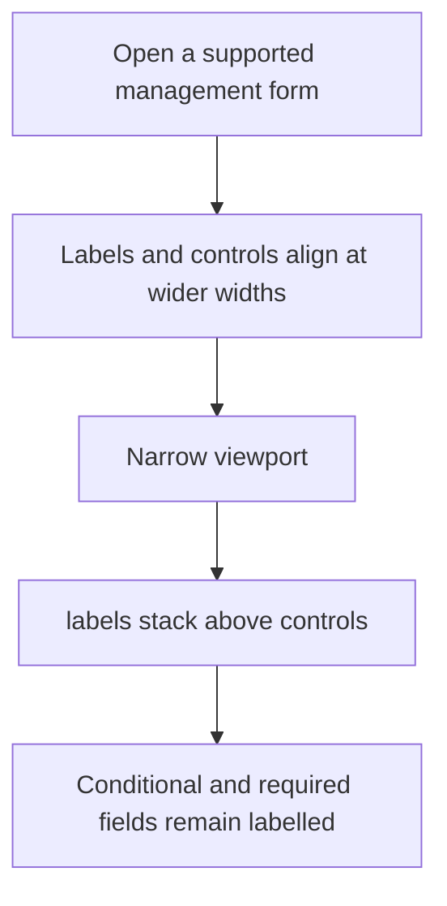
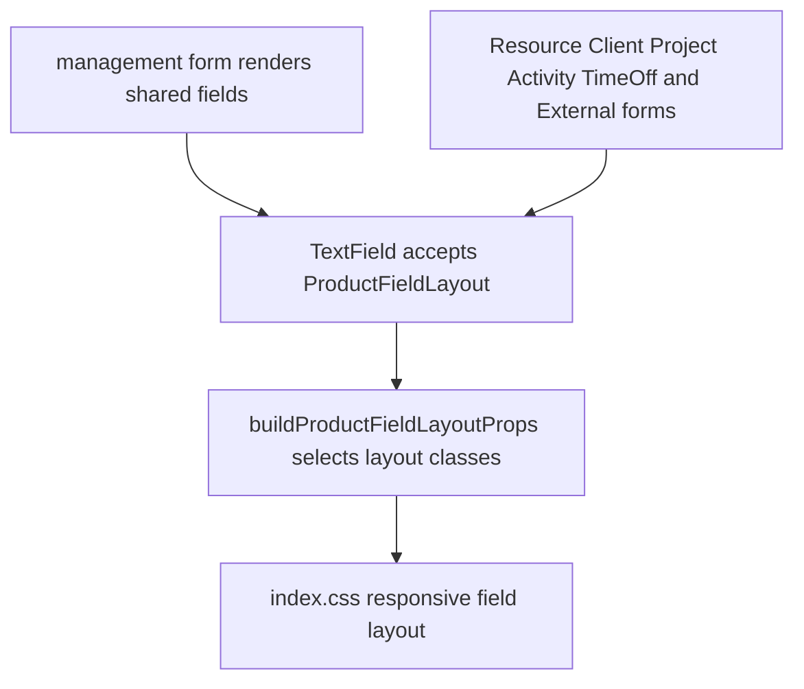

# US-KBD-06 — Scan management forms at different widths

As a company member, I want labelled form controls to remain clear on desktop and narrow screens so that I can complete supported forms.

**Status:** Current

**Access:** Owner, Admin, Editor; visibility and writes are role-gated

**Entry:** Resource, External party, Discipline, Client, Project, Activity, and Time off forms

**Documentation:** [Help](../../docs-src/using/help.md)

**Source:** [modal-layout.spec.ts](../../e2e/modal-layout.db.spec.ts)

## Acceptance criteria

- Fields use aligned labels at wider widths and stacked labels on narrow screens; required and conditional fields remain associated.

## User flow

## Code flow

**Code references:** [textFields.tsx](../../apps/frontend/src/components/common/fields/textFields.tsx); [buildProductFieldLayoutProps.ts](../../apps/frontend/src/components/common/fields/buildProductFieldLayoutProps.ts); [fieldLayout.tsx](../../apps/frontend/src/components/common/fields/fieldLayout.tsx); [ResourceForm.tsx](../../apps/frontend/src/components/resources/ResourceForm.tsx); [ExternalForm.tsx](../../apps/frontend/src/components/external/ExternalForm.tsx); [DisciplineForm.tsx](../../apps/frontend/src/components/disciplines/DisciplineForm.tsx); [ClientForm.tsx](../../apps/frontend/src/components/clients/ClientForm.tsx); [ProjectForm.tsx](../../apps/frontend/src/components/projects/ProjectForm.tsx); [ActivityForm.tsx](../../apps/frontend/src/components/activities/ActivityForm.tsx); [TimeOffForm.tsx](../../apps/frontend/src/components/timeoff/TimeOffForm.tsx); [index.css](../../apps/frontend/src/index.css)
