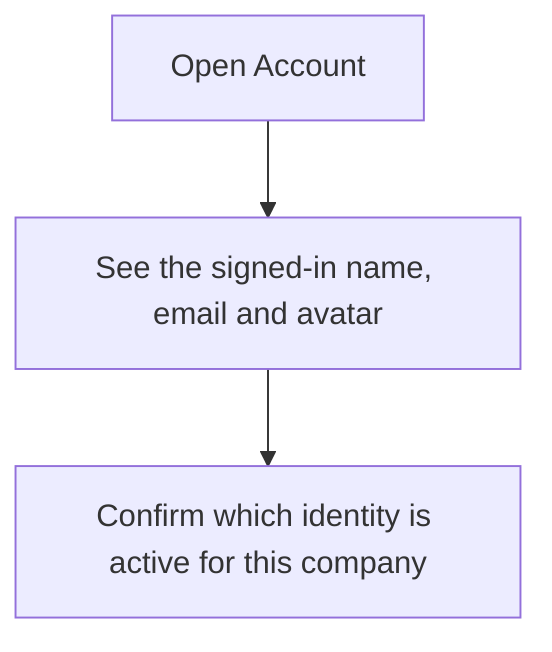
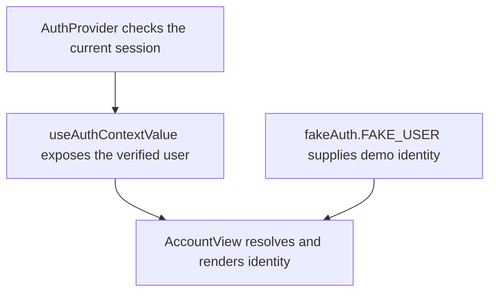

# US-ACCOUNT-01 — Check my signed-in identity

As a signed-in person, I want to check which identity I am using so that I can confirm the account behind my company access.

**Status:** Current
**Access:** Any signed-in person; demo mode shows its demo identity.
**Entry:** Account
**Documentation:** [Account](../../docs-src/using/account.md)
**Source:** [AccountView.tsx](../../apps/frontend/src/components/account/AccountView.tsx); [en.json](../../apps/frontend/messages/en.json)

## Acceptance criteria

- Account shows the identity's avatar, name and email in the identity table. A shortened email can be hovered or focused to read it in full; narrow screens can scroll the row sideways.
- When server authentication is active, the row offers **Change password**, **Delete account** and **Sign out**. Demo mode shows the demo identity without these account actions.

## User flow

## Code flow

**Code references:** [AuthProvider.tsx](../../apps/frontend/src/auth/AuthProvider.tsx), [fetchAuthStatus.ts](../../apps/frontend/src/auth/fetchAuthStatus.ts), [useAuthContextValue.ts](../../apps/frontend/src/auth/useAuthContextValue.ts), [AccountView.tsx](../../apps/frontend/src/components/account/AccountView.tsx), [fakeAuth.ts](../../apps/frontend/src/lib/fakeAuth.ts)
