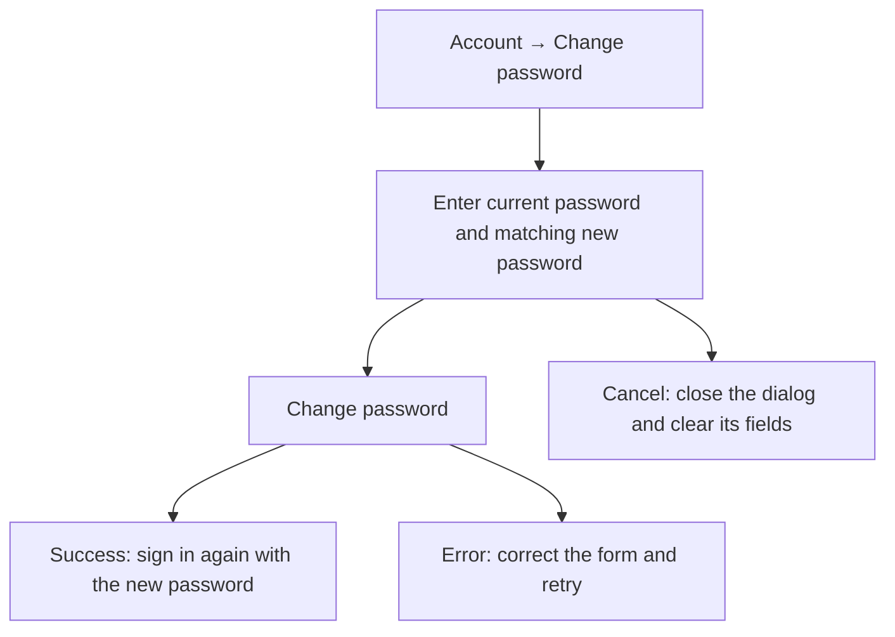
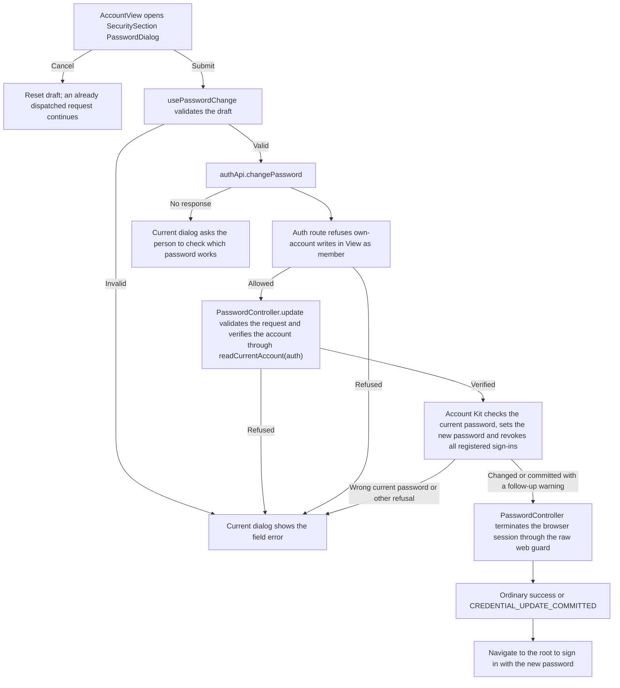

# US-ACCOUNT-02 — Change my password

As a signed-in person, I want to change my password so that I can keep my account protected with a new credential.

**Status:** Current
**Access:** Any signed-in person.
**Entry:** Account → Change password
**Documentation:** [Account](../../docs-src/using/account.md)
**Source:** [SecuritySection.tsx](../../apps/frontend/src/components/settings/SecuritySection.tsx); [useSecurityViewModel.ts](../../apps/frontend/src/components/settings/useSecurityViewModel.ts); [en.json](../../apps/frontend/messages/en.json)

## Acceptance criteria

| Field                | Control        | Required/default/conditions        |
| -------------------- | -------------- | ---------------------------------- |
| Current password     | Password input | Required.                          |
| New password         | Password input | Required; 15–128 characters.       |
| Confirm new password | Password input | Required; must match New password. |

- **Change password** submits the form; **Cancel** closes it and clears its fields. On success, the fields clear and the person signs in again with the new password. Validation or rejected changes leave the password unchanged.

## User flow

## Code flow

See [Signed-in requests](../REFERENCE.md#signed-in-requests) for the raw guard and account check.

**Code references:** [AccountView.tsx](../../apps/frontend/src/components/account/AccountView.tsx#L88) · [SecuritySection.tsx](../../apps/frontend/src/components/settings/SecuritySection.tsx#L75) · [useSecurityViewModel.ts](../../apps/frontend/src/components/settings/useSecurityViewModel.ts#L36) · [password_controller.ts](../../apps/backend/app/controllers/password_controller.ts#L14) · [route_middleware.ts](../../apps/backend/start/route_middleware.ts#L50) · [password_sessions.spec.ts](../../apps/backend/tests/functional/auth/password_sessions.spec.ts#L153)
