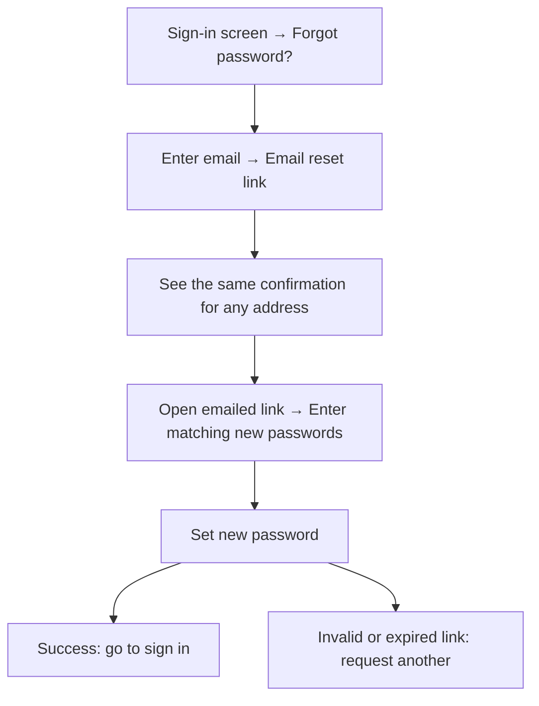
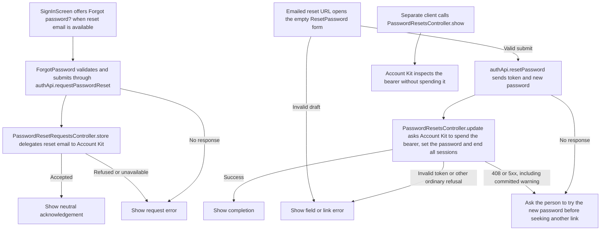

# US-ACCOUNT-03 — Recover a forgotten password

As a person with an account, I want to reset a forgotten password so that I can sign in again.

**Status:** Current
**Access:** Anyone can request a link; a person with a valid reset link can set a new password.
**Entry:** [Sign-in screen](../navigation/US-NAV-10-sign-in-screen.md) → Forgot password?; emailed reset link
**Documentation:** [Account](../../docs-src/using/account.md)
**Source:** [ForgotPassword.tsx](../../apps/frontend/src/auth/ForgotPassword.tsx); [ResetPassword.tsx](../../apps/frontend/src/auth/ResetPassword.tsx); [en.json](../../apps/frontend/messages/en.json)

## Acceptance criteria

| Field | Control     | Required/default/conditions       |
| ----- | ----------- | --------------------------------- |
| Email | Email input | Required to request a reset link. |

- **Email reset link** requests a link. The confirmation says **If an account uses that address, we've emailed a reset link.** so it does not reveal whether the address is registered.

| Field            | Control        | Required/default/conditions        |
| ---------------- | -------------- | ---------------------------------- |
| New password     | Password input | Required; 15–128 characters.       |
| Confirm password | Password input | Required; must match New password. |

- **Set new password** uses the emailed link. A successful reset asks the person to sign in with the new password; invalid or expired links direct them to request another. The bearer is not displayed or stored by the product.

## User flow

## Code flow

**Code references:** [SignInScreen.tsx](../../apps/frontend/src/auth/SignInScreen.tsx#L83) · [ForgotPassword.tsx](../../apps/frontend/src/auth/ForgotPassword.tsx#L18) · [password_reset_requests_controller.ts](../../apps/backend/app/controllers/password_reset_requests_controller.ts#L15) · [ResetPassword.tsx](../../apps/frontend/src/auth/ResetPassword.tsx#L164) · [password_resets_controller.ts](../../apps/backend/app/controllers/password_resets_controller.ts#L11) · [recovery.spec.ts](../../apps/backend/tests/functional/auth/recovery.spec.ts#L77)
