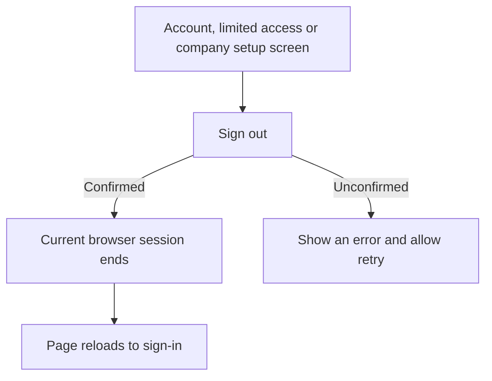
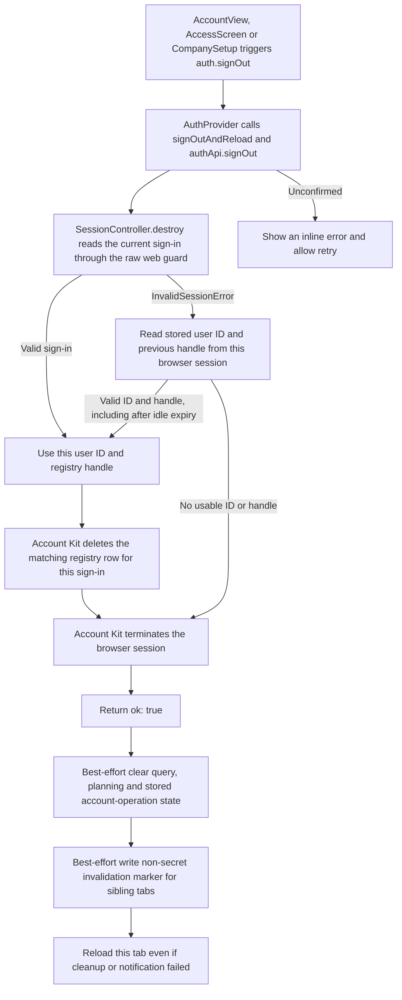

# US-ACCOUNT-04 — Sign out of this browser

As a signed-in person, I want to sign out of this browser so that this session ends when I am done.

**Status:** Current
**Access:** Any signed-in person.
**Entry:** Account, limited account access screen or Set up your company → Sign out
**Documentation:** [Account](../../docs-src/using/account.md)
**Source:** [AccountView.tsx](../../apps/frontend/src/components/account/AccountView.tsx); [AccessScreens.tsx](../../apps/frontend/src/auth/AccessScreens.tsx)

## Acceptance criteria

- Selecting **Sign out** ends the current browser session and returns to sign-in. Company records and other sign-ins are preserved. If the request fails, the screen shows an inline error and offers a retry.

## User flow

## Code flow

**Code references:** [AccountView.tsx](../../apps/frontend/src/components/account/AccountView.tsx#L104) · [AccessScreens.tsx](../../apps/frontend/src/auth/AccessScreens.tsx#L46) · [CompanySetup.tsx](../../apps/frontend/src/auth/CompanySetup.tsx#L138) · [SignOutButton.tsx](../../apps/frontend/src/auth/SignOutButton.tsx#L14) · [signOut.ts](../../apps/frontend/src/auth/signOut.ts#L17) · [Cleanup and notification](../../apps/frontend/src/auth/signOut.ts#L24) · [session_controller.ts](../../apps/backend/app/controllers/session_controller.ts#L98) · [Separate sign-ins](../../apps/backend/tests/functional/auth/password_sessions.spec.ts#L44) · [Idle-expired registry cleanup](../../apps/backend/tests/functional/auth/password_sessions.spec.ts#L202)
