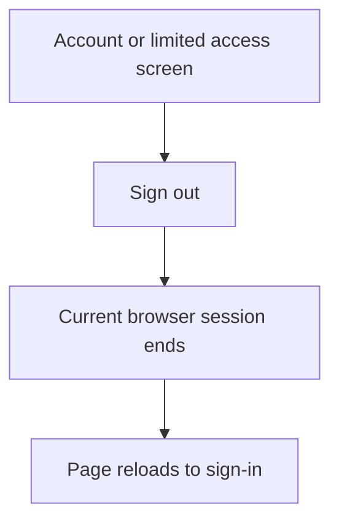
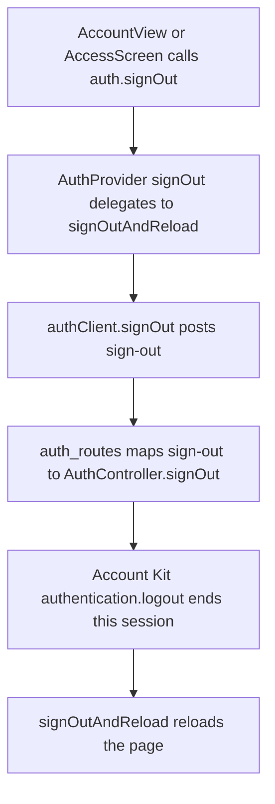

# US-ACCOUNT-04 — Sign out of this browser

As a signed-in person, I want to sign out of this browser so that this session ends when I am done.

**Status:** Current
**Access:** Any signed-in person.
**Entry:** Account → Sign out; limited account access screen → Sign out
**Documentation:** [Account](../../docs-src/using/account.md)
**Source:** [AccountView.tsx](../../apps/frontend/src/components/account/AccountView.tsx); [AccessScreens.tsx](../../apps/frontend/src/auth/AccessScreens.tsx)

## Acceptance criteria

- Selecting **Sign out** ends the current browser session and returns to sign-in. It does not delete company membership or scheduling records, and other sessions remain signed in unless the password is changed or reset.

## User flow

## Code flow

**Code references:** [AccountView.tsx](../../apps/frontend/src/components/account/AccountView.tsx), [AccessScreens.tsx](../../apps/frontend/src/auth/AccessScreens.tsx), [AuthProvider.tsx](../../apps/frontend/src/auth/AuthProvider.tsx), [signOut.ts](../../apps/frontend/src/auth/signOut.ts), [authClient.ts](../../apps/frontend/src/auth/authClient.ts), [auth_routes.ts](../../apps/backend/start/auth_routes.ts), [auth_controller.ts](../../apps/backend/app/controllers/auth_controller.ts)
