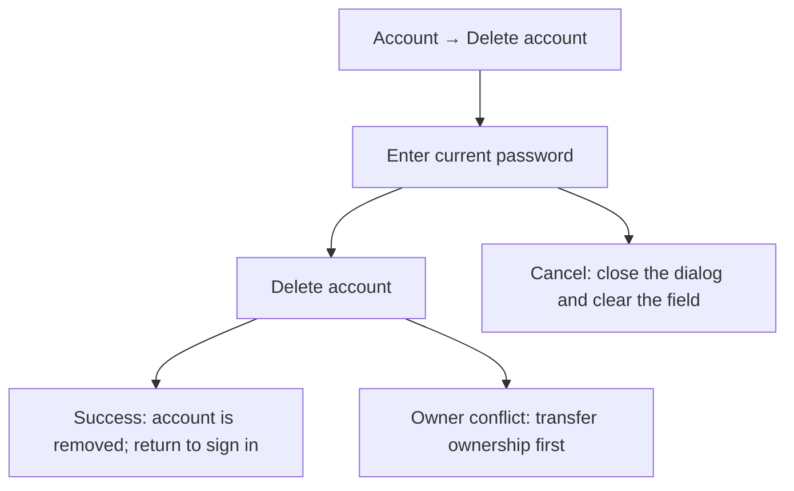
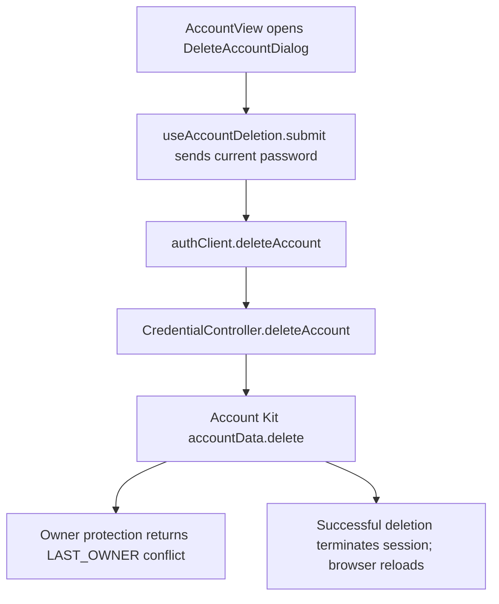

# US-ACCOUNT-05 — Delete my account

As a signed-in person, I want to delete my account so that my sign-in and company memberships are removed.

**Status:** Current
**Access:** Any signed-in person; an Owner must transfer ownership first.
**Entry:** Account → Delete account
**Documentation:** [Account](../../docs-src/using/account.md)
**Source:** [AccountView.tsx](../../apps/frontend/src/components/account/AccountView.tsx); [SecuritySection.tsx](../../apps/frontend/src/components/settings/SecuritySection.tsx); [useSecurityController.ts](../../apps/frontend/src/components/settings/useSecurityController.ts)

## Acceptance criteria

| Field            | Control        | Required/default/conditions |
| ---------------- | -------------- | --------------------------- |
| Current password | Password input | Required.                   |

- The dialog explains that deletion cannot be undone and removes the sign-in and company memberships; the person Resource remains on past schedules, while audit history retains the former user ID.
- **Delete account** submits the form; **Cancel** closes the dialog and clears its field. An Owner must transfer ownership before deletion. On success, the browser returns to sign-in.

## User flow

## Code flow

**Code references:** [AccountView.tsx](../../apps/frontend/src/components/account/AccountView.tsx), [SecuritySection.tsx](../../apps/frontend/src/components/settings/SecuritySection.tsx), [useSecurityController.ts](../../apps/frontend/src/components/settings/useSecurityController.ts), [authClient.ts](../../apps/frontend/src/auth/authClient.ts), [auth_routes.ts](../../apps/backend/start/auth_routes.ts), [credential_controller.ts](../../apps/backend/app/controllers/credential_controller.ts)
