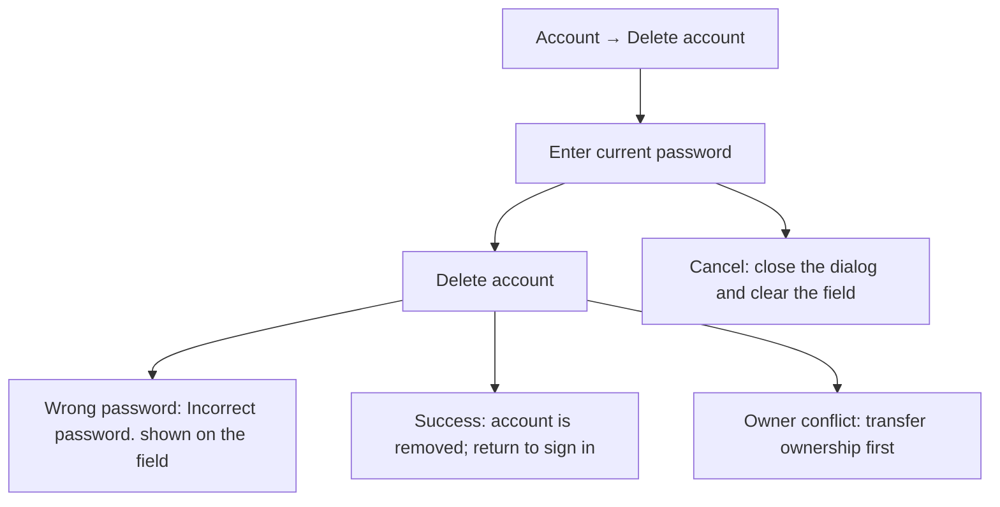
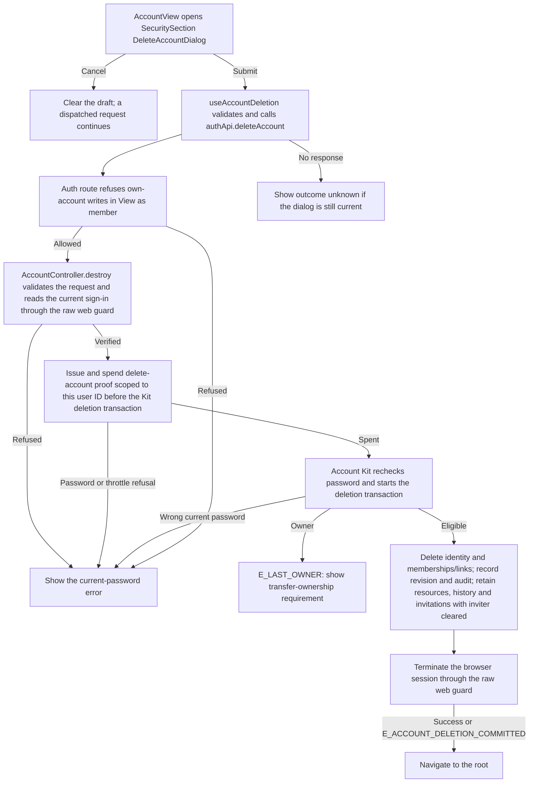

# US-ACCOUNT-05 — Delete my account

As a signed-in person, I want to delete my account so that my sign-in and company memberships are removed.

**Status:** Current
**Access:** Any signed-in person; an Owner must transfer ownership first.
**Entry:** Account → Delete account
**Documentation:** [Account](../../docs-src/using/account.md)
**Source:** [AccountView.tsx](../../apps/frontend/src/components/account/AccountView.tsx); [SecuritySection.tsx](../../apps/frontend/src/components/settings/SecuritySection.tsx); [useSecurityViewModel.ts](../../apps/frontend/src/components/settings/useSecurityViewModel.ts)

## Acceptance criteria

| Field            | Control        | Required/default/conditions                                         |
| ---------------- | -------------- | ------------------------------------------------------------------- |
| Current password | Password input | Required. Confirms this one deletion through password confirmation. |

- The dialog explains that deletion cannot be undone and removes the sign-in and company memberships; the person Resource remains on past schedules, while audit history retains the former user ID.
- **Delete account** submits the form; **Cancel** closes the dialog and clears its field. An Owner must transfer ownership before deletion. On success, the browser returns to sign-in.
- The password is checked through a single-use `delete-account` password confirmation, with the same wrong-password limit as ownership transfer, import and company anonymisation. A wrong password shows **Incorrect password.** against the field and deletes nothing.

## User flow

## Code flow

See [Package callbacks](../REFERENCE.md#package-callbacks) for confirmation authorization and the transaction callbacks used by deletion.

**Code references:** [AccountView.tsx](../../apps/frontend/src/components/account/AccountView.tsx#L88) · [SecuritySection.tsx](../../apps/frontend/src/components/settings/SecuritySection.tsx#L112) · [useSecurityViewModel.ts](../../apps/frontend/src/components/settings/useSecurityViewModel.ts#L112) · [account_controller.ts](../../apps/backend/app/controllers/account_controller.ts#L28) · [auth.ts](../../apps/backend/start/routes/auth.ts#L34) · [password_confirmation_service.ts](../../apps/backend/app/services/auth/password_confirmation_service.ts#L50) · [package_callbacks_provider.ts](../../apps/backend/providers/package_callbacks_provider.ts#L44) · [account_kit.ts](../../apps/backend/config/account_kit.ts#L34) · [membership_effect_service.ts](../../apps/backend/app/services/account_kit/membership_effect_service.ts#L29) · [account_deletion.spec.ts](../../apps/backend/tests/functional/auth/account_deletion.spec.ts#L85)
