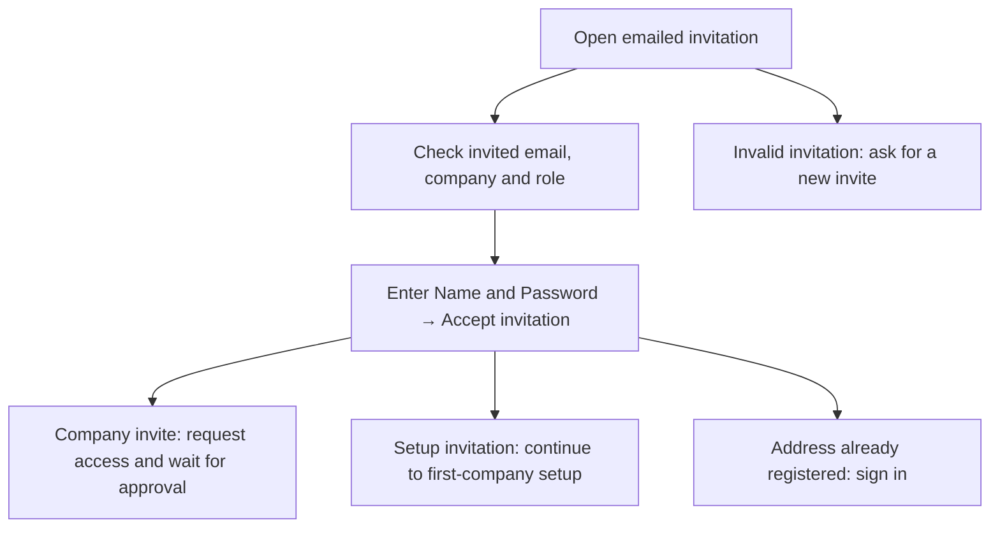
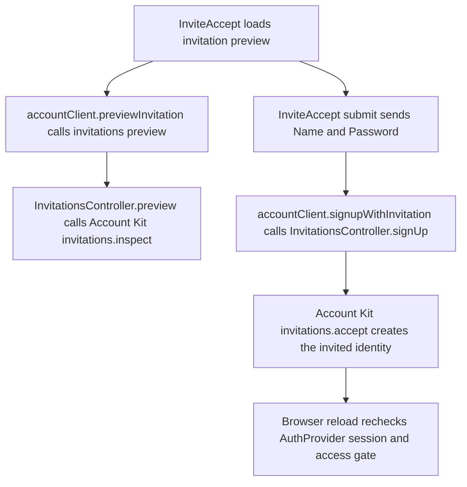

# US-ACCOUNT-06 — Create my account from an invitation

As an invited person, I want to create my sign-in from the emailed invitation so that I can begin joining the company.

**Status:** Current
**Access:** Person with a valid invitation for an address that does not already have an account.
**Entry:** Emailed invitation link → Accept invitation
**Documentation:** [Join your team](../../docs-src/using/join-your-team.md)
**Source:** [InviteAccept.tsx](../../apps/frontend/src/components/invites/InviteAccept.tsx); [en.json](../../apps/frontend/messages/en.json)

## Acceptance criteria

| Field    | Control        | Required/default/conditions                                 |
| -------- | -------------- | ----------------------------------------------------------- |
| Name     | Text input     | Required; surrounding whitespace is trimmed when submitted. |
| Password | Password input | Required; 15–128 characters.                                |

- The invitation page shows the invited email, company and proposed role as context; the email is fixed by the invitation.
- **Accept invitation** creates the account from those details. An already-registered email is directed to sign in; an invalid or expired invitation directs the person to ask for a new one. A company invitee continues to request access and await approval before seeing company data; the bootstrap invitation proceeds to first-company setup.

## User flow

## Code flow

**Code references:** [InviteAccept.tsx](../../apps/frontend/src/components/invites/InviteAccept.tsx), [accountClient.ts](../../apps/frontend/src/account/accountClient.ts), [invitations_controller.ts](../../apps/backend/app/controllers/invitations_controller.ts), [AuthProvider.tsx](../../apps/frontend/src/auth/AuthProvider.tsx), [auth_controller.ts](../../apps/backend/app/controllers/auth_controller.ts)
