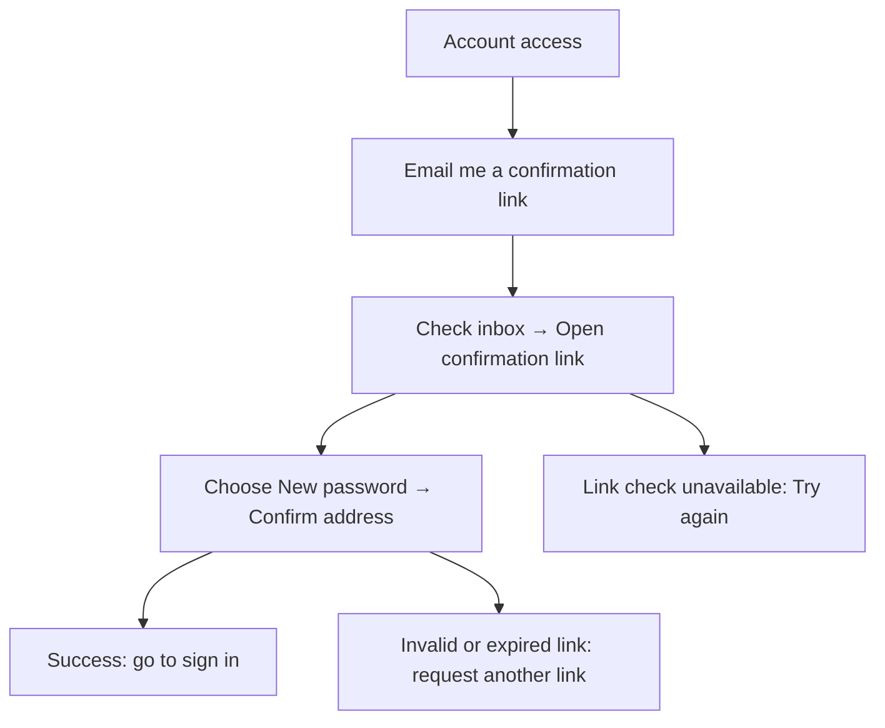
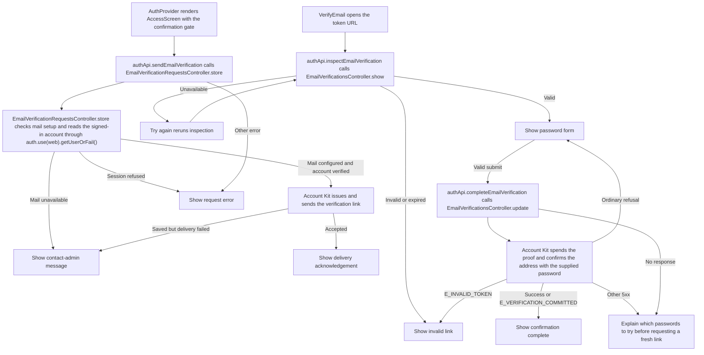

# US-ACCOUNT-07 — Confirm my email address

As a signed-in person with an unconfirmed address, I want to confirm my email so that I can continue toward company access.

**Status:** Current
**Access:** Signed-in person at the email-confirmation gate; a valid emailed confirmation link is required to complete confirmation.
**Entry:** Account access → Email me a confirmation link; emailed link
**Documentation:** [Sign-in and access](../../docs-src/sign-in/index.md)
**Source:** [AccessScreens.tsx](../../apps/frontend/src/auth/AccessScreens.tsx); [VerifyEmail.tsx](../../apps/frontend/src/auth/VerifyEmail.tsx); [en.json](../../apps/frontend/messages/en.json)

## Acceptance criteria

- **Email me a confirmation link** sends the link and shows **Check your inbox for the confirmation link.** If mail is unavailable, the screen explains that the administrator must confirm the address.

| Field        | Control        | Required/default/conditions  |
| ------------ | -------------- | ---------------------------- |
| New password | Password input | Required; 15–128 characters. |

- **Confirm address** submits the password with the valid confirmation link. A successful confirmation asks the person to sign in with the chosen password; **Try again** rechecks a link when its status could not be checked. Invalid or expired links direct the person to sign in and request a new one. The bearer is not displayed or stored by the product.

## User flow

## Code flow

See [Signed-in requests](../REFERENCE.md#signed-in-requests) for the raw guard and account check used to send the link.

**Code references:** [AuthProvider.tsx](../../apps/frontend/src/auth/AuthProvider.tsx#L257) · [AccessScreens.tsx](../../apps/frontend/src/auth/AccessScreens.tsx#L115) · [VerifyEmail.tsx](../../apps/frontend/src/auth/VerifyEmail.tsx#L37) · [VerifyEmail.tsx](../../apps/frontend/src/auth/VerifyEmail.tsx#L66) · [email_verification_requests_controller.ts](../../apps/backend/app/controllers/email_verification_requests_controller.ts#L15) · [email_verifications_controller.ts](../../apps/backend/app/controllers/email_verifications_controller.ts#L14) · [admission.spec.ts](../../apps/backend/tests/functional/auth/admission.spec.ts#L298)
