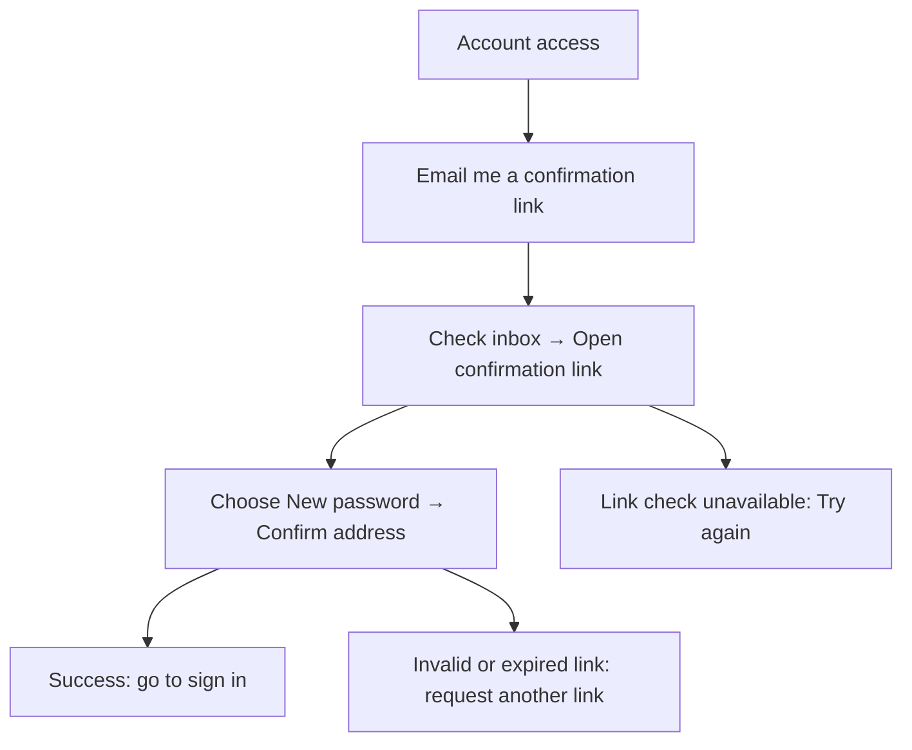
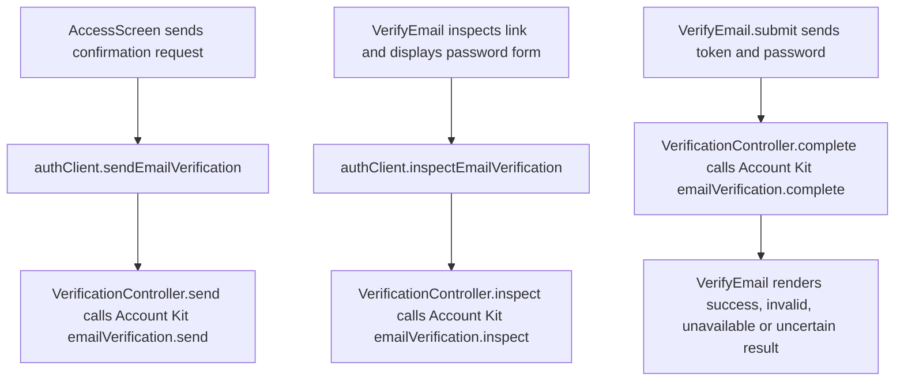

# US-ACCOUNT-07 — Confirm my email address

As a signed-in person with an unconfirmed address, I want to confirm my email so that I can continue toward company access.

**Status:** Current
**Access:** Signed-in person at the email-confirmation gate; a valid emailed confirmation link is required to complete confirmation.
**Entry:** Account access → Email me a confirmation link; emailed link
**Documentation:** [Sign-in and access](../../docs-src/company-login/index.md)
**Source:** [AccessScreens.tsx](../../apps/frontend/src/auth/AccessScreens.tsx); [VerifyEmail.tsx](../../apps/frontend/src/auth/VerifyEmail.tsx); [en.json](../../apps/frontend/messages/en.json)

## Acceptance criteria

- **Email me a confirmation link** sends the link and shows **Check your inbox for the confirmation link.** If mail is unavailable, the screen explains that the administrator must confirm the address.

| Field        | Control        | Required/default/conditions  |
| ------------ | -------------- | ---------------------------- |
| New password | Password input | Required; 15–128 characters. |

- **Confirm address** submits the password with the valid confirmation link. A successful confirmation asks the person to sign in with the chosen password; **Try again** rechecks a link when its status could not be checked. Invalid or expired links direct the person to sign in and request a new one. The bearer is not displayed or stored by the product.

## User flow

## Code flow

**Code references:** [AccessScreens.tsx](../../apps/frontend/src/auth/AccessScreens.tsx), [VerifyEmail.tsx](../../apps/frontend/src/auth/VerifyEmail.tsx), [authClient.ts](../../apps/frontend/src/auth/authClient.ts), [auth_routes.ts](../../apps/backend/start/auth_routes.ts), [verification_controller.ts](../../apps/backend/app/controllers/verification_controller.ts)
