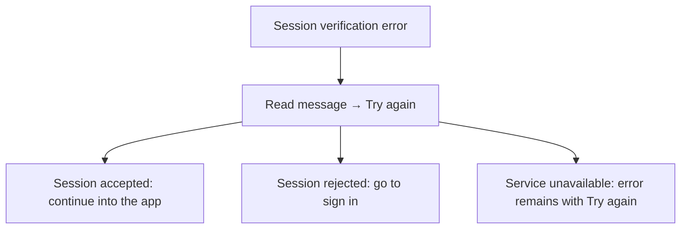
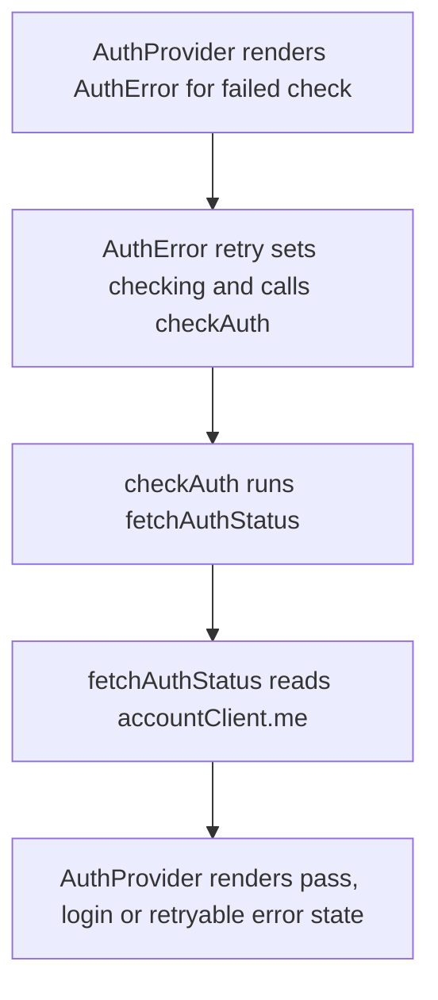

# US-ACCOUNT-08 — Retry session verification

As a person whose session could not be checked, I want to retry verification so that I can continue when the service is available.

**Status:** Current
**Access:** Person whose session verification failed.
**Entry:** Session verification error → Try again
**Documentation:** [Sign-in and access](../../docs-src/company-login/index.md)
**Source:** [AuthProvider.tsx](../../apps/frontend/src/auth/AuthProvider.tsx); [en.json](../../apps/frontend/messages/en.json)

## Acceptance criteria

- The error screen says **Unable to verify your session**, shows the failure message and offers **Try again**.
- **Try again** checks the session again. If verification still fails, the error remains visible; a successful check continues through the appropriate signed-in or sign-in screen.

## User flow

## Code flow

**Code references:** [AuthProvider.tsx](../../apps/frontend/src/auth/AuthProvider.tsx), [fetchAuthStatus.ts](../../apps/frontend/src/auth/fetchAuthStatus.ts), [accountClient.ts](../../apps/frontend/src/account/accountClient.ts)
