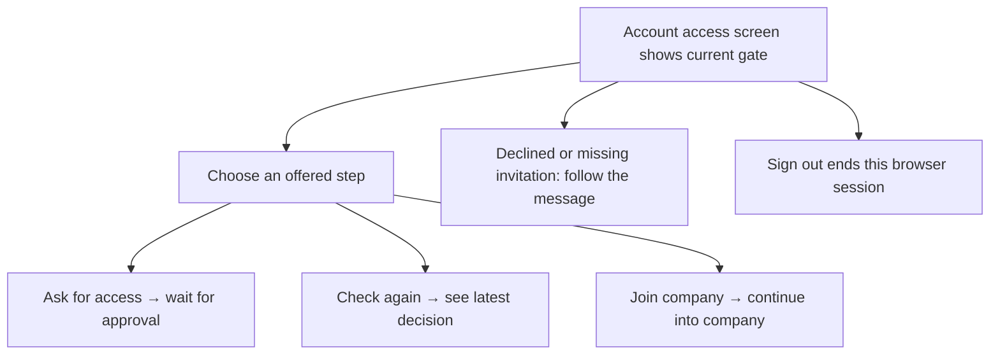
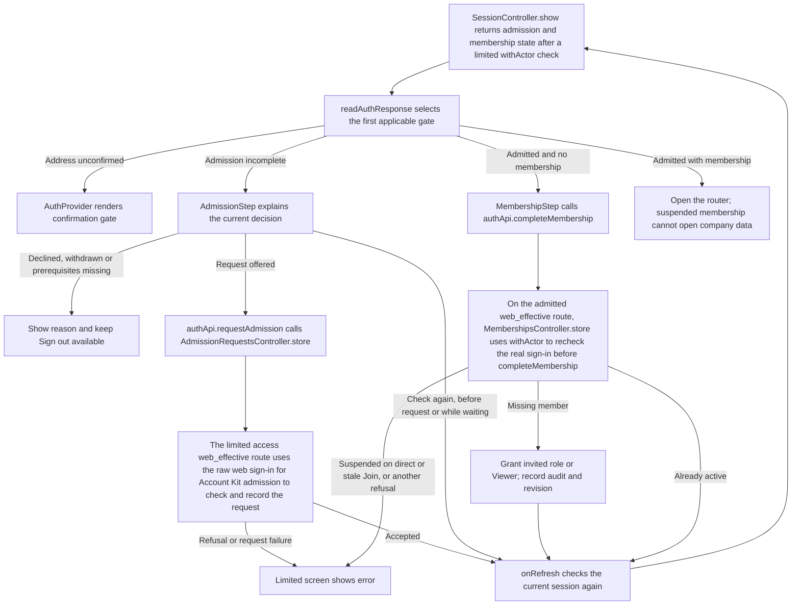

# US-ACCOUNT-09 — Resolve my limited account access

As a signed-in person who cannot yet open company data, I want to see and complete the next available access step so that I can join when eligible.

**Status:** Current
**Access:** Signed-in person at an admission or membership gate.
**Entry:** Account access screen
**Documentation:** [Sign-in and access](../../docs-src/sign-in/index.md)
**Source:** [AccessScreens.tsx](../../apps/frontend/src/auth/AccessScreens.tsx); [en.json](../../apps/frontend/messages/en.json)

## Acceptance criteria

- The screen shows the signed-in email when available and the applicable state: waiting for approval, access declined or withdrawn, invitation required, email domain refused, or approved and ready to join.
- When eligible to request admission, **Ask for access** sends the request and the screen reports that it is waiting for approval. **Check again** refreshes the state after an Owner or Admin responds.
- When approved without a membership, **Join company** joins with the invited role or Viewer. Company data opens after the next access check.
- **Sign out** ends the current session from the limited screen.

## User flow

## Code flow

The manager’s decision controls are documented in [Approve or decline company admission](../settings/US-SET-19-company-admission.md#code-flow).

See [Signed-in requests](../REFERENCE.md#signed-in-requests) for the two guards and the transaction check.

**Code references:** [session_controller.ts](../../apps/backend/app/controllers/session_controller.ts#L47) · [authResponse.ts](../../apps/frontend/src/auth/authResponse.ts#L73) · [AccessScreens.tsx](../../apps/frontend/src/auth/AccessScreens.tsx#L142) · [AccessScreens.tsx](../../apps/frontend/src/auth/AccessScreens.tsx#L192) · [admission.ts](../../apps/backend/start/routes/admission.ts#L39) · [admission_requests_controller.ts](../../apps/backend/app/controllers/admission_requests_controller.ts#L19) · [memberships_controller.ts](../../apps/backend/app/controllers/memberships_controller.ts#L18) · [admission_membership_service.ts](../../apps/backend/app/services/membership/admission_membership_service.ts#L37) · [admission.spec.ts](../../apps/backend/tests/functional/auth/admission.spec.ts#L186)
