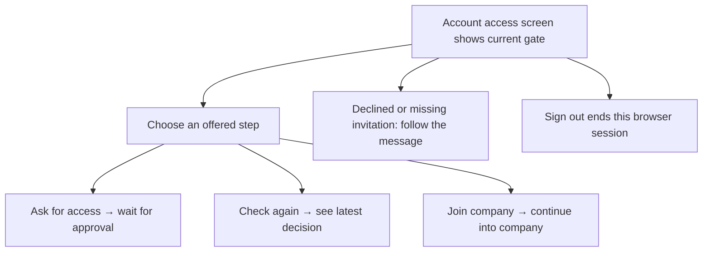
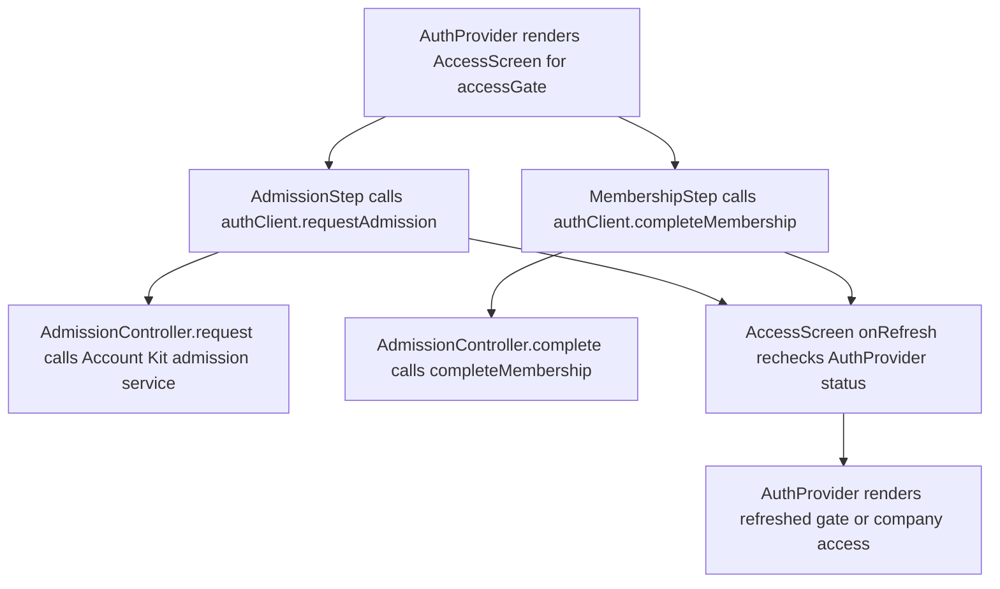

# US-ACCOUNT-09 — Resolve my limited account access

As a signed-in person who cannot yet open company data, I want to see and complete the next available access step so that I can join when eligible.

**Status:** Current
**Access:** Signed-in person at an admission or membership gate.
**Entry:** Account access screen
**Documentation:** [Sign-in and access](../../docs-src/company-login/index.md)
**Source:** [AccessScreens.tsx](../../apps/frontend/src/auth/AccessScreens.tsx); [en.json](../../apps/frontend/messages/en.json)

## Acceptance criteria

- The screen shows the signed-in email when available and the applicable state: waiting for approval, access declined or withdrawn, invitation required, email domain refused, or approved and ready to join.
- When eligible to request admission, **Ask for access** sends the request and the screen reports that it is waiting for approval. **Check again** refreshes the state after an Owner or Admin responds.
- When approved without a membership, **Join company** joins with the invited role or Viewer. Company data opens after the next access check.
- **Sign out** ends the current session from the limited screen.

## User flow

## Code flow

**Code references:** [AuthProvider.tsx](../../apps/frontend/src/auth/AuthProvider.tsx), [AccessScreens.tsx](../../apps/frontend/src/auth/AccessScreens.tsx), [authClient.ts](../../apps/frontend/src/auth/authClient.ts), [admission_routes.ts](../../apps/backend/start/admission_routes.ts), [admission_controller.ts](../../apps/backend/app/controllers/admission_controller.ts), [admission_membership.ts](../../apps/backend/app/services/membership/admission_membership.ts)
