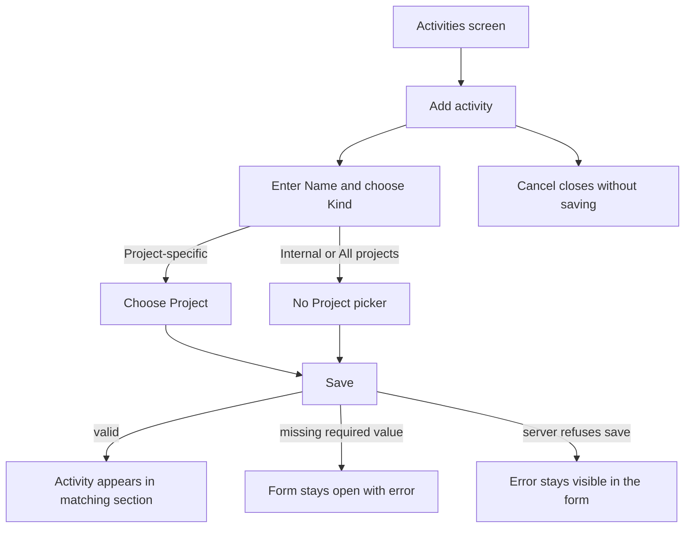
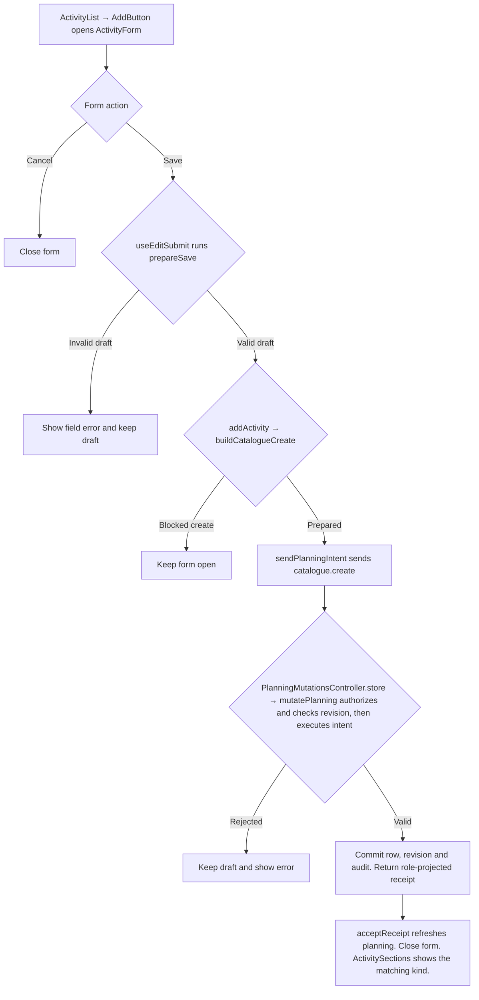

# US-ACT-01 — Add an activity (internal, all-projects, or project-specific)

As an Editor, I want to add an activity as Project-specific, Internal or All projects so that work is categorised correctly.

**Status:** Current
**Access:** Editor and above (Editor, Admin, Owner)
**Entry:** Activities screen → Add activity
**Documentation:** [Guide](../../docs-src/using/activities.md)
**Source:** [ActivityList.tsx](../../apps/frontend/src/components/activities/ActivityList.tsx) · [ActivityForm.tsx](../../apps/frontend/src/components/activities/ActivityForm.tsx)

## Acceptance criteria

| Field   | Control          | Required/default/conditions                                                                        |
| ------- | ---------------- | -------------------------------------------------------------------------------------------------- |
| Name    | Text field       | Required; initially blank                                                                          |
| Kind    | Segmented choice | Defaults to Project-specific; options in order: Internal, All projects, Project-specific           |
| Project | Picker           | Shown and required for Project-specific only; active projects; switching to another kind clears it |

- **Save** adds the activity. Invalid required values keep the form open with an error. **Cancel** closes without saving.

## User flow

## Code flow

Owner, Admin and Editor can write planning data. Viewer and view-as-member lack write authority. The write goes through `POST /api/v1/companies/:companyId/planning/mutations` with admitted company access. The planning cache refreshes on a stale revision and reconciles an uncertain write before another attempt. Footer Cancel closes the form, including during a pending save. The dispatched save can still settle. Project-specific is the initial kind. `prepareSave` requires a Project for that kind and supplies an empty phase. For the other kinds it omits both links, and `buildCatalogueCreate` sends them as null. Server validation checks activity kind and scoped references.

**Code references:** [ActivityList.tsx](../../apps/frontend/src/components/activities/ActivityList.tsx#L190) · [ActivityForm.tsx](../../apps/frontend/src/components/activities/ActivityForm.tsx#L154) · [refs.ts](../../packages/shared/src/domain/assertions/refs.ts#L157) · [ActivityForm.tsx](../../apps/frontend/src/components/activities/ActivityForm.tsx#L34) · [catalogue.ts](../../apps/backend/app/validators/planning/catalogue.ts#L99) · [Write controls](../../apps/frontend/src/components/common/crudButtons.tsx#L7) · [Cancel button](../../apps/frontend/src/components/common/FormButtons.tsx#L17) · [useEditSubmit.ts](../../apps/frontend/src/hooks/useEditSubmit.ts#L44) · [Row checks](../../apps/backend/app/services/planning/entity_write_service.ts#L91) · [typedPlanningActions.ts](../../apps/frontend/src/store/typedPlanningActions.ts#L193) · [planningIntents.ts](../../apps/frontend/src/data/planning/planningIntents.ts#L426) · [sendPlanningIntent](../../apps/frontend/src/store/slices/planningSessionSlice.ts#L139) · [Planning transport](../../apps/frontend/src/data/planning/planningTransport.ts#L64) · [Planning route](../../apps/backend/start/routes/planning.ts#L16) · [Mutation controller](../../apps/backend/app/controllers/planning_mutations_controller.ts#L19) · [Planning transaction](../../apps/backend/app/services/planning_service.ts#L222) · [Company write authority](../../apps/backend/app/services/planning/planning_access_service.ts#L31) · [Receipt and refresh](../../apps/frontend/src/data/planning/planningCache.ts#L469)
