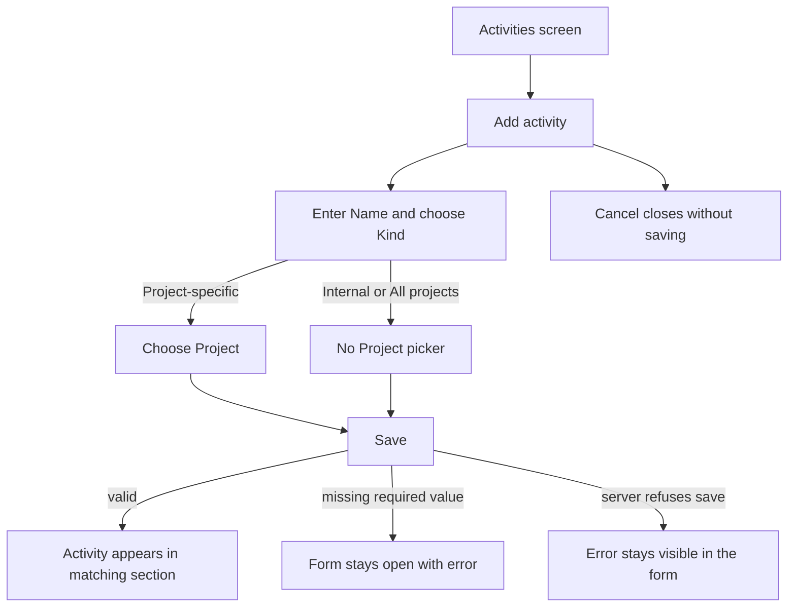
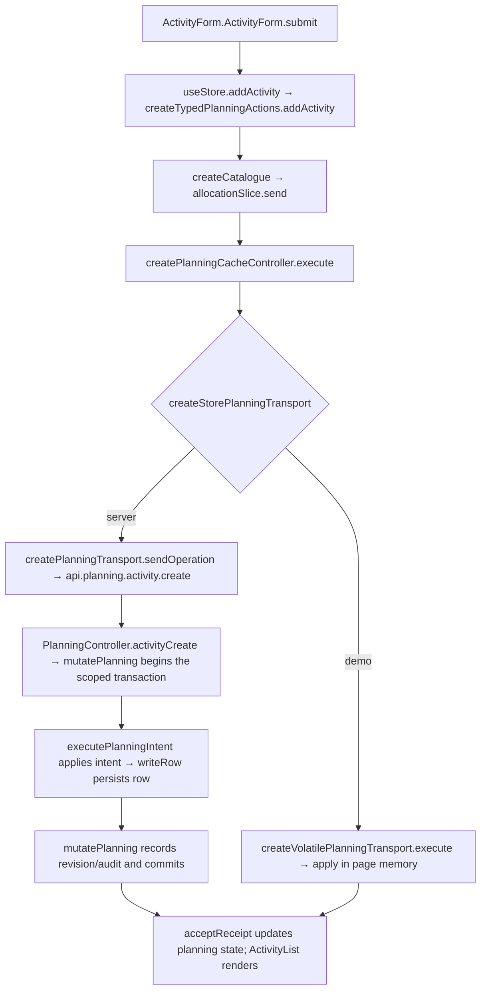

# US-ACT-01 — Add an activity (internal, all-projects, or project-specific)

As an Editor, I want to add an activity as Project-specific, Internal or All projects so that work is categorized correctly.

**Status:** Current
**Access:** Editor and above (Editor, Admin, Owner)
**Entry:** Activities screen → Add activity
**Documentation:** [Guide](../../docs-src/using/activities.md)
**Source:** [ActivityList.tsx](../../apps/frontend/src/components/activities/ActivityList.tsx) · [ActivityForm.tsx](../../apps/frontend/src/components/activities/ActivityForm.tsx)

## Acceptance criteria

| Field   | Control          | Required/default/conditions                                                               |
| ------- | ---------------- | ----------------------------------------------------------------------------------------- |
| Name    | Text field       | Required; initially blank                                                                 |
| Kind    | Segmented choice | Required; defaults to Project-specific; options: Project-specific, Internal, All projects |
| Project | Picker           | Required for Project-specific only; active projects                                       |

- **Save** adds the activity. Invalid required values keep the form open with an error. **Cancel** closes without saving.

## User flow

## Code flow

**Code references:** [ActivityForm.tsx](../../apps/frontend/src/components/activities/ActivityForm.tsx) · [typedPlanningActions.ts](../../apps/frontend/src/store/typedPlanningActions.ts) · [allocationSlice.ts](../../apps/frontend/src/store/slices/allocationSlice.ts) · [planningCacheController.ts](../../apps/frontend/src/data/planning/planningCacheController.ts) · [storePlanningTransport.ts](../../apps/frontend/src/data/planning/storePlanningTransport.ts) · [planningTransport.ts](../../apps/frontend/src/data/planning/planningTransport.ts) · [volatilePlanningTransport.ts](../../apps/frontend/src/data/planning/volatilePlanningTransport.ts) · [planning_routes.ts](../../apps/backend/start/planning_routes.ts) · [planning_controller.ts](../../apps/backend/app/controllers/planning_controller.ts) · [planning.ts](../../apps/backend/app/services/planning.ts) · [execute.ts](../../apps/backend/app/services/planning/execute.ts) · [writer.ts](../../apps/backend/app/services/planning/writer.ts)
