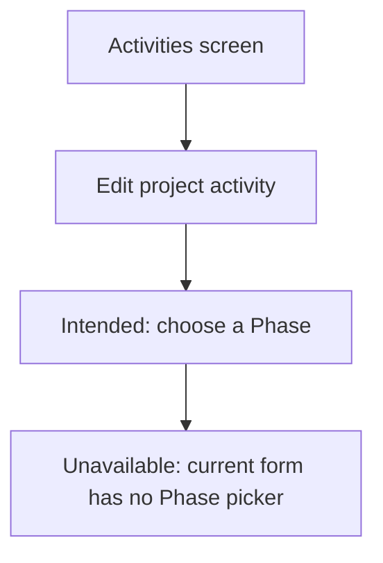
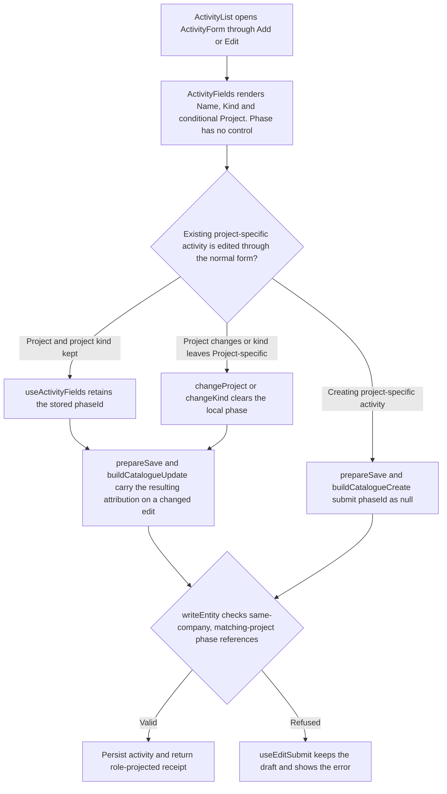

# US-ACT-02 — Assign an activity to a phase (optional; resets on project change)

As an Editor, I want to assign a project activity to a phase so that its stage is clear.

**Status:** Hidden — phase selection is absent from the current activity form; existing phase data remains.
**Access:** Editor and above (Editor, Admin, Owner)
**Entry:** Activities screen → No current control (hidden)
**Documentation:** [Guide](../../docs-src/using/activities.md)
**Source:** [ActivityList.tsx](../../apps/frontend/src/components/activities/ActivityList.tsx) · [ActivityForm.tsx](../../apps/frontend/src/components/activities/ActivityForm.tsx)

## Acceptance criteria

The following is the retained intended field, unavailable in the current UI.

| Field | Control | Required/default/conditions                                                                                  |
| ----- | ------- | ------------------------------------------------------------------------------------------------------------ |
| Phase | Picker  | Optional; the selected project's phases plus “— No phase —”. Changing Project resets this field to no phase. |

- Save records the chosen phase; an activity may also be saved without a phase.

## User flow

**Unavailable today:** The intended flow cannot be performed because the Activity form has no Phase picker. Existing project activity phase attribution can remain stored.

## Code flow

Owner, Admin and Editor can write planning data. Viewer and view-as-member lack write authority. Assigning a phase is unavailable in the list journey. Cancel discards local changes and a no-op edit sends no intent. The mutation API retains phase validation, including the stored-reference handling for an unchanged phase and project.

**Code references:** [ActivityList.tsx](../../apps/frontend/src/components/activities/ActivityList.tsx#L190) · [ActivityForm.tsx](../../apps/frontend/src/components/activities/ActivityForm.tsx#L154) · [ActivityForm.tsx](../../apps/frontend/src/components/activities/ActivityForm.tsx#L34) · [ActivityForm.tsx](../../apps/frontend/src/components/activities/ActivityForm.tsx#L67) · [planningIntents.ts](../../apps/frontend/src/data/planning/planningIntents.ts#L502) · [refs.ts](../../packages/shared/src/domain/assertions/refs.ts#L157) · [entity_write_service.ts](../../apps/backend/app/services/planning/entity_write_service.ts#L103) · [sendPlanningIntent](../../apps/frontend/src/store/slices/planningSessionSlice.ts#L139) · [Planning transport](../../apps/frontend/src/data/planning/planningTransport.ts#L64) · [Planning route](../../apps/backend/start/planning_routes.ts#L16) · [Mutation controller](../../apps/backend/app/controllers/planning_mutations_controller.ts#L19) · [Planning transaction](../../apps/backend/app/services/planning_service.ts#L222) · [Company write authority](../../apps/backend/app/services/planning/planning_access_service.ts#L31) · [Receipt and refresh](../../apps/frontend/src/data/planning/planningCache.ts#L469)
