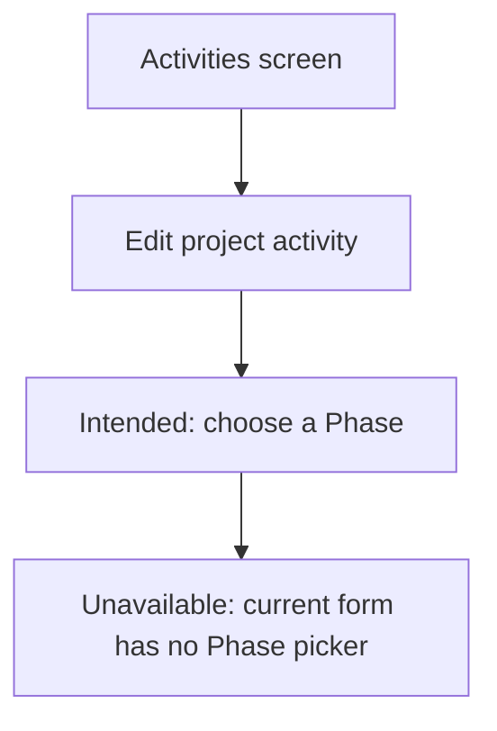
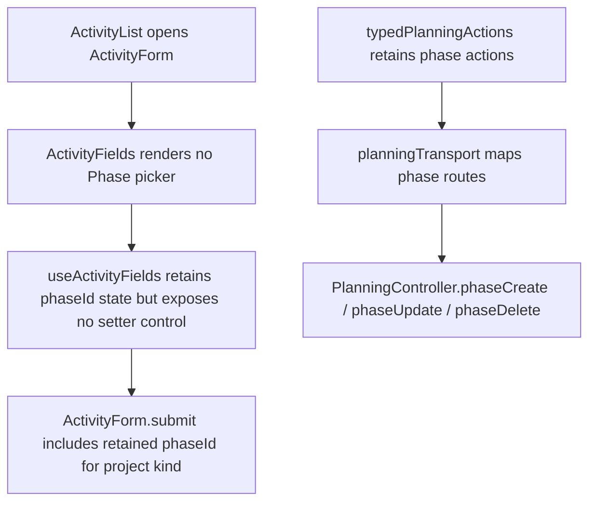

# US-ACT-02 — Assign an activity to a phase (optional; resets on project change)

As an Editor, I want to assign a project activity to a phase so that its stage is clear.

**Status:** Hidden — phase selection is absent from the current activity form; existing phase data remains.
**Access:** Editor and above (Editor, Admin, Owner)
**Entry:** Activities screen → No current control (hidden)
**Documentation:** [Guide](../../docs-src/using/activities.md)
**Source:** [ActivityList.tsx](../../apps/frontend/src/components/activities/ActivityList.tsx) · [ActivityForm.tsx](../../apps/frontend/src/components/activities/ActivityForm.tsx)

## Acceptance criteria

The following is the retained intended field, unavailable in the current UI.

| Field | Control | Required/default/conditions                                                                                  |
| ----- | ------- | ------------------------------------------------------------------------------------------------------------ |
| Phase | Picker  | Optional; the selected project's phases plus “— No phase —”. Changing Project resets this field to no phase. |

- Save records the chosen phase; an activity may also be saved without a phase.

## User flow

**Unavailable today:** The intended flow cannot be performed because the Activity form has no Phase picker. Existing project activity phase attribution can remain stored.

## Code flow

**Code references:** [ActivityList.tsx](../../apps/frontend/src/components/activities/ActivityList.tsx) · [ActivityForm.tsx](../../apps/frontend/src/components/activities/ActivityForm.tsx) · [typedPlanningActions.ts](../../apps/frontend/src/store/typedPlanningActions.ts) · [planningTransport.ts](../../apps/frontend/src/data/planning/planningTransport.ts) · [planning_routes.ts](../../apps/backend/start/planning_routes.ts) · [planning_controller.ts](../../apps/backend/app/controllers/planning_controller.ts)
