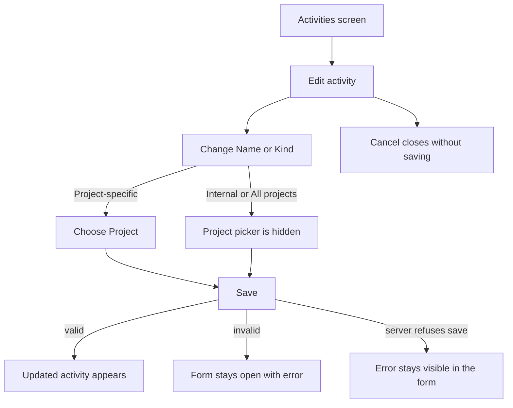
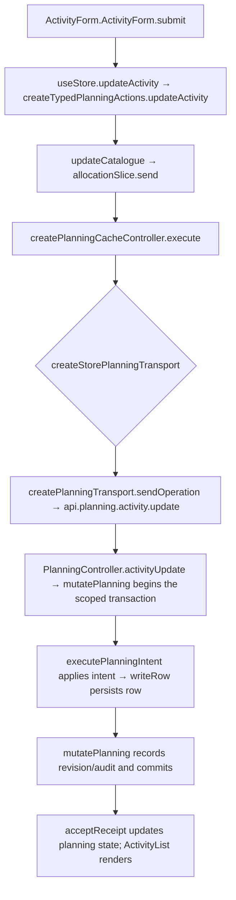

# US-ACT-03 — Edit an activity

As an Editor, I want to edit an activity name, kind or project so that its catalogue and schedule details stay current.

**Status:** Current
**Access:** Editor and above (Editor, Admin, Owner)
**Entry:** Activities screen → activity row → Edit
**Documentation:** [Guide](../../docs-src/using/activities.md)
**Source:** [ActivityList.tsx](../../apps/frontend/src/components/activities/ActivityList.tsx) · [ActivityForm.tsx](../../apps/frontend/src/components/activities/ActivityForm.tsx)

## Acceptance criteria

| Field   | Control          | Required/default/conditions                                                                                                                        |
| ------- | ---------------- | -------------------------------------------------------------------------------------------------------------------------------------------------- |
| Name    | Text field       | Required; current value prefilled                                                                                                                  |
| Kind    | Segmented choice | Current kind prefilled; options in order: Internal, All projects, Project-specific                                                                 |
| Project | Picker           | Shown and required for Project-specific only; active projects plus the current archived project if applicable; switching to another kind clears it |

- **Save** updates the activity. Invalid required values keep the form open with an error. **Cancel** closes without saving.

## User flow

## Code flow

**Code references:** [ActivityForm.tsx](../../apps/frontend/src/components/activities/ActivityForm.tsx) · [typedPlanningActions.ts](../../apps/frontend/src/store/typedPlanningActions.ts) · [allocationSlice.ts](../../apps/frontend/src/store/slices/allocationSlice.ts) · [planningCacheController.ts](../../apps/frontend/src/data/planning/planningCacheController.ts) · [storePlanningTransport.ts](../../apps/frontend/src/data/planning/storePlanningTransport.ts) · [planningTransport.ts](../../apps/frontend/src/data/planning/planningTransport.ts) · [planning_routes.ts](../../apps/backend/start/planning_routes.ts) · [planning_controller.ts](../../apps/backend/app/controllers/planning_controller.ts) · [planning.ts](../../apps/backend/app/services/planning.ts) · [execute.ts](../../apps/backend/app/services/planning/execute.ts) · [writer.ts](../../apps/backend/app/services/planning/writer.ts)
