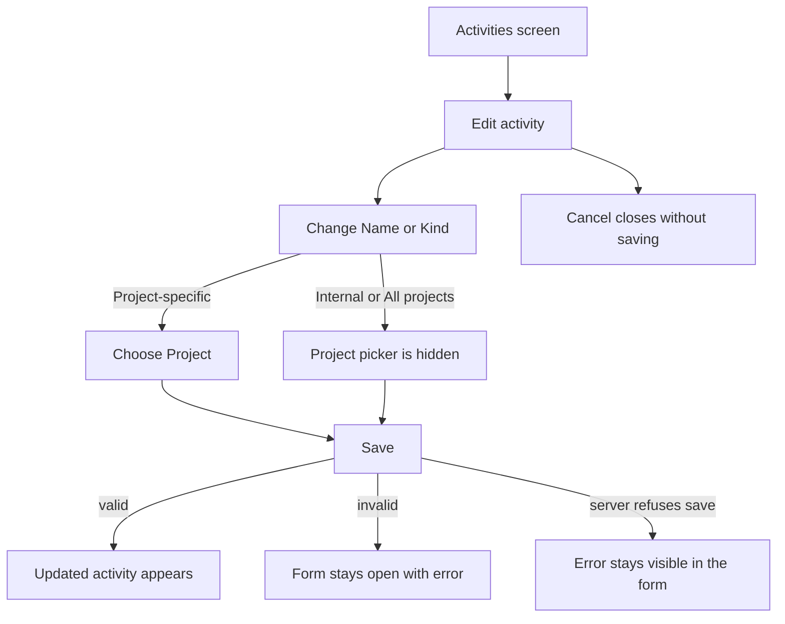
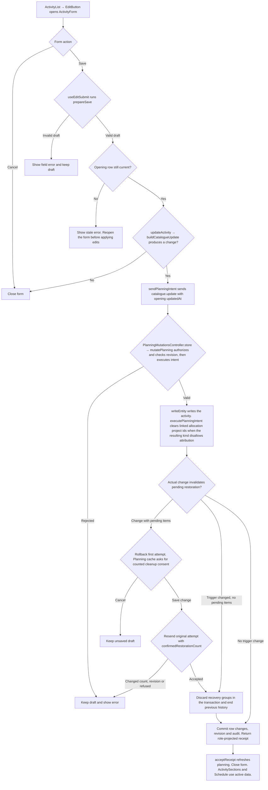

# US-ACT-03 — Edit an activity

As an Editor, I want to edit an activity name, kind or project so that its catalogue and schedule details stay current.

**Status:** Current
**Access:** Editor and above (Editor, Admin, Owner)
**Entry:** Activities screen → activity row → Edit
**Documentation:** [Guide](../../docs-src/using/activities.md)
**Source:** [ActivityList.tsx](../../apps/frontend/src/components/activities/ActivityList.tsx) · [ActivityForm.tsx](../../apps/frontend/src/components/activities/ActivityForm.tsx)

## Acceptance criteria

| Field   | Control          | Required/default/conditions                                                                                                                        |
| ------- | ---------------- | -------------------------------------------------------------------------------------------------------------------------------------------------- |
| Name    | Text field       | Required; current value prefilled                                                                                                                  |
| Kind    | Segmented choice | Current kind prefilled; options in order: Internal, All projects, Project-specific                                                                 |
| Project | Picker           | Shown and required for Project-specific only; active projects plus the current archived project if applicable; switching to another kind clears it |

- **Save** updates the activity. Invalid required values keep the form open with an error. **Cancel** closes without saving.

## User flow

## Code flow

Owner, Admin and Editor can write planning data. Viewer and view-as-member lack write authority. The write goes through `POST /api/v1/companies/:companyId/planning/mutations` with admitted company access. The planning cache refreshes on a stale revision and reconciles an uncertain write before another attempt. Footer Cancel closes the form, including during a pending save. The dispatched save can still settle. The form seeds the current project and phase. Changing the project clears the phase, and switching away from Project-specific clears both links. The active list excludes hidden ancestry. The write can refuse a change that would invalidate existing placeholder placements. Any actual kind change invalidates pending deleted-item recovery.

**Code references:** [ActivityList.tsx](../../apps/frontend/src/components/activities/ActivityList.tsx#L190) · [ActivityForm.tsx](../../apps/frontend/src/components/activities/ActivityForm.tsx#L154) · [refs.ts](../../packages/shared/src/domain/assertions/refs.ts#L157) · [domain.ts](../../apps/backend/app/services/planning/entity_validation/domain.ts#L43) · [projection.ts](../../packages/shared/src/domain/lifecycle/projection.ts#L36) · [planning_execution_service.ts](../../apps/backend/app/services/planning/planning_execution_service.ts#L255) · [restoration_pending_groups.spec.ts](../../apps/backend/tests/functional/planning/restoration_pending_batches.spec.ts#L124) · [Write controls](../../apps/frontend/src/components/common/crudButtons.tsx#L7) · [Cancel button](../../apps/frontend/src/components/common/FormButtons.tsx#L17) · [useEditSubmit.ts](../../apps/frontend/src/hooks/useEditSubmit.ts#L44) · [Row checks](../../apps/backend/app/services/planning/entity_write_service.ts#L91) · [typedPlanningActions.ts](../../apps/frontend/src/store/typedPlanningActions.ts#L194) · [planningIntents.ts](../../apps/frontend/src/data/planning/planningIntents.ts#L502) · [sendPlanningIntent](../../apps/frontend/src/store/slices/planningSessionSlice.ts#L139) · [Planning transport](../../apps/frontend/src/data/planning/planningTransport.ts#L64) · [Planning route](../../apps/backend/start/routes/planning.ts#L15) · [Mutation controller](../../apps/backend/app/controllers/planning_mutations_controller.ts#L19) · [Planning transaction](../../apps/backend/app/services/planning_service.ts#L222) · [Company write authority](../../apps/backend/app/services/planning/planning_access_service.ts#L31) · [Receipt and refresh](../../apps/frontend/src/data/planning/planningCache.ts#L469) · [usePrivateNameFields.ts](../../apps/frontend/src/components/common/usePrivateNameFields.ts#L27) · [restricted_fields.ts](../../apps/backend/app/services/planning/restricted_fields.ts#L21) · [mutation_changes.ts](../../apps/backend/app/services/planning/mutation_changes.ts#L74) · [Confirmation retry](../../apps/frontend/src/data/planning/planningCache.ts#L420) · [Role projection](../../apps/backend/app/transformers/state_transformer.ts#L46)
