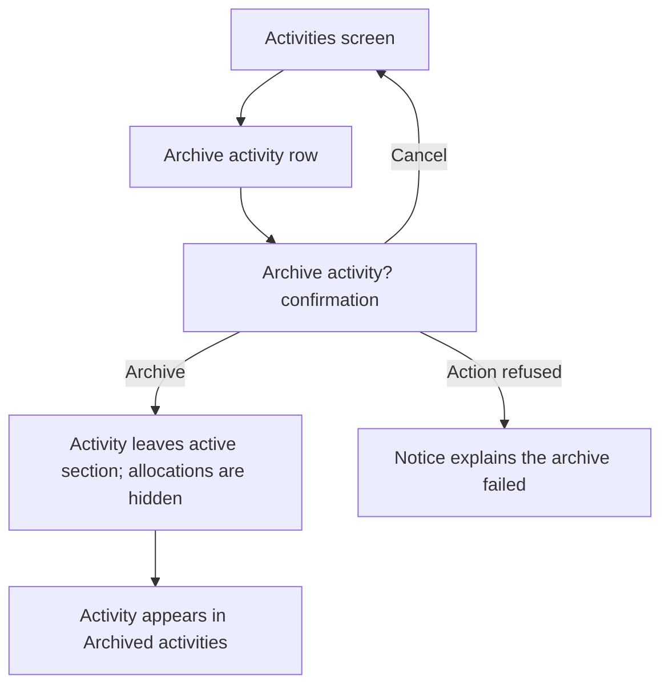
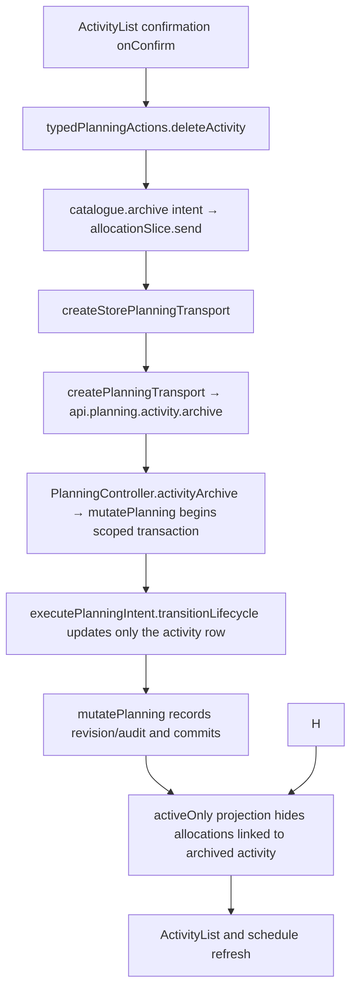

# US-ACT-04 — Archive an activity (allocations hidden)

As an Editor, I want to archive an activity so that its allocations leave active views while remaining restorable.

**Status:** Current
**Access:** Editor and above (Editor, Admin, Owner)
**Entry:** Activities screen → activity row → Archive {activity name}
**Documentation:** [Guide](../../docs-src/using/activities.md)
**Source:** [ActivityList.tsx](../../apps/frontend/src/components/activities/ActivityList.tsx) · [ArchivedEntitySection.tsx](../../apps/frontend/src/components/common/ArchivedEntitySection.tsx)

## Acceptance criteria

- Selecting **Archive {name}** opens **Archive activity?** with **Archive** and **Cancel** controls.
- After confirmation, the activity leaves its active section and its allocations are hidden. When allocations exist, the dialog states their count.
- **Cancel** closes the dialog without archiving. **Archive** archives the record.
- The archived record appears in its archived section with a **Restore** control.

## User flow

## Code flow

**Code references:** [ActivityList.tsx](../../apps/frontend/src/components/activities/ActivityList.tsx) · [typedPlanningActions.ts](../../apps/frontend/src/store/typedPlanningActions.ts) · [allocationSlice.ts](../../apps/frontend/src/store/slices/allocationSlice.ts) · [planningCacheController.ts](../../apps/frontend/src/data/planning/planningCacheController.ts) · [storePlanningTransport.ts](../../apps/frontend/src/data/planning/storePlanningTransport.ts) · [planningTransport.ts](../../apps/frontend/src/data/planning/planningTransport.ts) · [planning_routes.ts](../../apps/backend/start/planning_routes.ts) · [planning_controller.ts](../../apps/backend/app/controllers/planning_controller.ts) · [planning.ts](../../apps/backend/app/services/planning.ts) · [execute.ts](../../apps/backend/app/services/planning/execute.ts) · [useScopedData.ts](../../apps/frontend/src/store/useScopedData.ts)
