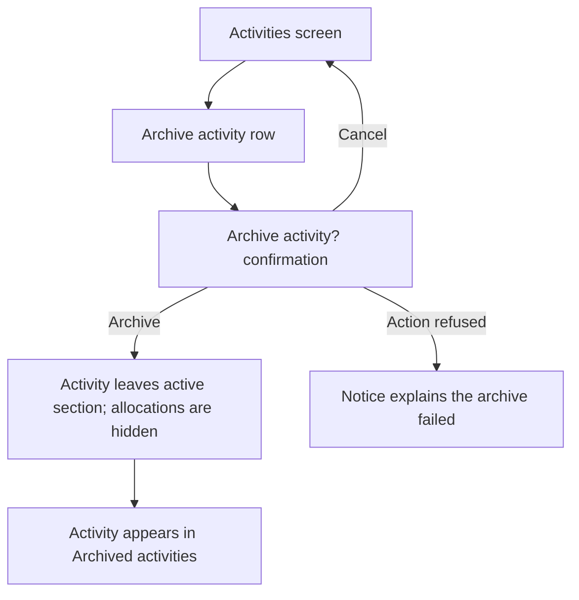
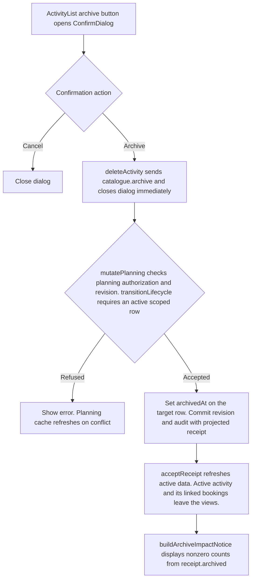

# US-ACT-04 — Archive an activity (allocations hidden)

As an Editor, I want to archive an activity so that its allocations leave active views while remaining restorable.

**Status:** Current
**Access:** Editor and above (Editor, Admin, Owner)
**Entry:** Activities screen → activity row → Archive {activity name}
**Documentation:** [Guide](../../docs-src/using/activities.md)
**Source:** [ActivityList.tsx](../../apps/frontend/src/components/activities/ActivityList.tsx) · [ArchivedEntitySection.tsx](../../apps/frontend/src/components/common/ArchivedEntitySection.tsx)

## Acceptance criteria

- Selecting **Archive {name}** opens **Archive activity?** with **Archive** and **Cancel** controls.
- After confirmation, the activity leaves its active section and its allocations are hidden. The dialog states no count; after **Archive**, a notice reports the hidden allocations when there are any.
- **Cancel** closes the dialog without archiving. **Archive** archives the record.
- The archived record appears in its archived section with a **Restore** control.

## User flow

## Code flow

Owner, Admin and Editor can write planning data. Viewer and view-as-member lack write authority. Archive data is read through the Editor recovery section or the Owner/Admin inactive section. The active projection determines descendant visibility from retained links. This action carries normal planning history. Its inverse can restore the activity through Schedule Undo while the corresponding history remains available. Archive reads refresh on planning revision. `ActivityList` starts the request with `deleteActivity`. A declined confirmation sends no intent. A missing local row causes no send. Only the activity is archived. `archiveImpact` measures newly hidden allocations for the receipt.

**Code references:** [ActivityList.tsx](../../apps/frontend/src/components/activities/ActivityList.tsx#L190) · [dialogs.tsx](../../apps/frontend/src/components/common/dialogs.tsx#L202) · [typedPlanningActions.ts](../../apps/frontend/src/store/typedPlanningActions.ts#L196) · [planning_execution_service.ts](../../apps/backend/app/services/planning/planning_execution_service.ts#L483) · [projection.ts](../../packages/shared/src/domain/lifecycle/projection.ts#L36) · [sendPlanningIntent](../../apps/frontend/src/store/slices/planningSessionSlice.ts#L139) · [Planning transport](../../apps/frontend/src/data/planning/planningTransport.ts#L64) · [Planning route](../../apps/backend/start/routes/planning.ts#L15) · [Mutation controller](../../apps/backend/app/controllers/planning_mutations_controller.ts#L19) · [Planning transaction](../../apps/backend/app/services/planning_service.ts#L222) · [Company write authority](../../apps/backend/app/services/planning/planning_access_service.ts#L31) · [Receipt and refresh](../../apps/frontend/src/data/planning/planningCache.ts#L469) · [Archive access split](../../apps/frontend/src/components/common/ArchivedEntitySection.tsx#L250) · [Editor recovery controls](../../apps/frontend/src/components/common/ArchiveRecoverySection.tsx#L27) · [Editor recovery read](../../apps/backend/app/services/planning_service.ts#L169) · [useInactiveCompanyData.ts](../../apps/frontend/src/hooks/useInactiveCompanyData.ts#L17) · [Inactive state authority](../../apps/backend/app/controllers/company_state_controller.ts#L32) · [Ancestor lookup](../../apps/frontend/src/components/common/archivedEntityRows.ts#L73) · [Editor recovery projection](../../packages/shared/src/domain/lifecycle/archiveRecovery.ts#L25) · [impact.ts](../../packages/shared/src/domain/lifecycle/impact.ts#L45) · [ActivityList.tsx](../../apps/frontend/src/components/activities/ActivityList.tsx#L248) · [inverse.ts](../../apps/backend/app/services/planning/inverse.ts#L78) · [archiveImpactCopy.ts](../../apps/frontend/src/lib/archiveImpactCopy.ts#L14)
