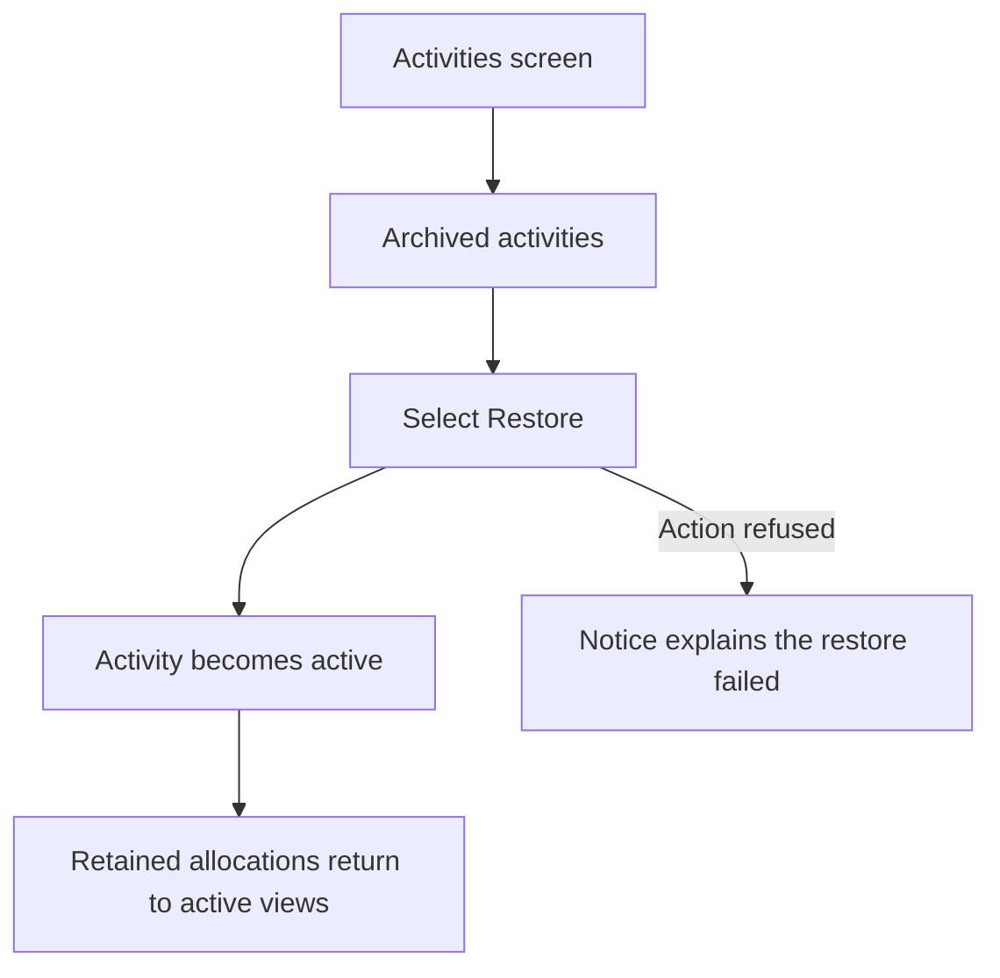
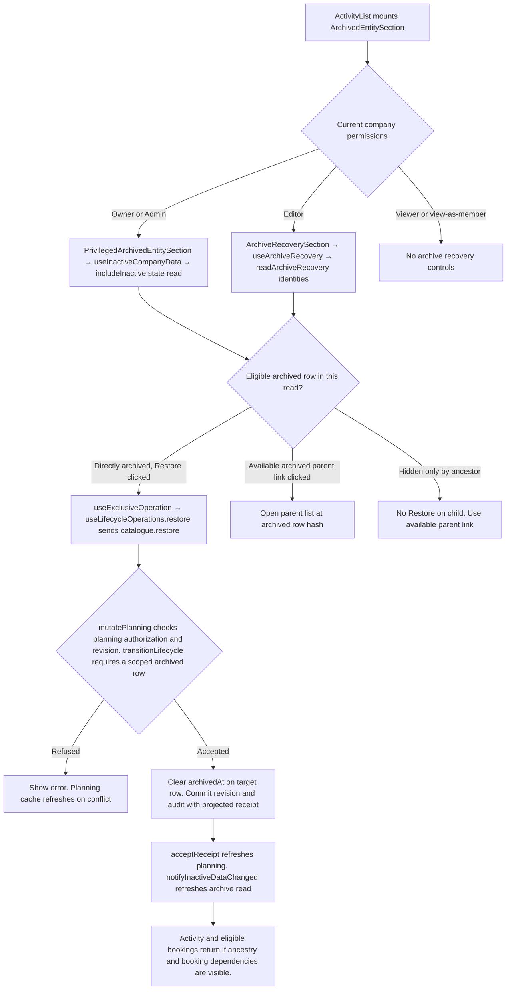

# US-ACT-05 — Restore an archived activity

As an Editor, I want to restore an archived activity so that its allocations return to active views.

**Status:** Current
**Access:** Editor and above (Editor, Admin, Owner)
**Entry:** Activities screen → Archived activities → Restore
**Documentation:** [Activities guide](../../docs-src/using/activities.md)
**Source:** [ActivityList.tsx](../../apps/frontend/src/components/activities/ActivityList.tsx) · [ArchivedEntitySection.tsx](../../apps/frontend/src/components/common/ArchivedEntitySection.tsx)

## Acceptance criteria

- A directly archived activity has an accessible **Restore** control. Selecting it returns the activity to active status and active views.
- A row hidden only by an archived parent reads **Hidden because {type} {name} is archived.** and offers **View archived parent**, which opens the parent’s archived row; restoring the parent reveals descendants that remain active. A row whose parent was permanently deleted reads **Hidden because {type} {name} is deleted.** with no link.

## User flow

## Code flow

The Editor archive read is sensitive and checks `planning:write`; it omits rows with deleted ancestry. The Owner/Admin inactive read checks `members:manage` and projects data for the effective role. An already active row is a server `NO_CHANGE`; a deleted row cannot be restored with this command. `endsHistory` omits the history id. A directly archived activity can offer both Restore and the archived-parent link. Privileged rows can show a resolved deleted-parent message; Editors receive recoverable identities. Restoring one row leaves archived ancestors archived.

**Code references:** [ActivityList.tsx](../../apps/frontend/src/components/activities/ActivityList.tsx#L190) · [Archive access split](../../apps/frontend/src/components/common/ArchivedEntitySection.tsx#L250) · [Editor recovery controls](../../apps/frontend/src/components/common/ArchiveRecoverySection.tsx#L27) · [Editor recovery read](../../apps/backend/app/services/planning.ts#L135) · [useInactiveCompanyData.ts](../../apps/frontend/src/hooks/useInactiveCompanyData.ts#L17) · [Inactive state authority](../../apps/backend/app/controllers/company_state_controller.ts#L13) · [Ancestor lookup](../../apps/frontend/src/components/common/archivedEntityRows.ts#L73) · [Editor recovery projection](../../packages/shared/src/domain/lifecycle/archiveRecovery.ts#L25) · [Editor query](../../apps/frontend/src/hooks/useArchiveRecovery.ts#L80) · [Privileged query](../../apps/frontend/src/data/fetchInactiveRecords.ts#L23) · [useLifecycleOperations.ts](../../apps/frontend/src/hooks/useLifecycleOperations.ts#L51) · [execute.ts](../../apps/backend/app/services/planning/execute.ts#L65) · [projection.ts](../../packages/shared/src/domain/lifecycle/projection.ts#L36) · [sendPlanningIntent](../../apps/frontend/src/store/slices/planningSessionSlice.ts#L139) · [Planning transport](../../apps/frontend/src/data/planning/planningTransport.ts#L64) · [Planning route](../../apps/backend/start/planning_routes.ts#L16) · [Mutation controller](../../apps/backend/app/controllers/planning_mutations_controller.ts#L9) · [Planning transaction](../../apps/backend/app/services/planning.ts#L198) · [Company write authority](../../apps/backend/app/services/planning/access.ts#L16) · [Receipt and refresh](../../apps/frontend/src/data/planning/planningCache.ts#L469) · [archive_recovery.spec.ts](../../apps/backend/tests/functional/planning/archive_recovery.spec.ts#L353)
