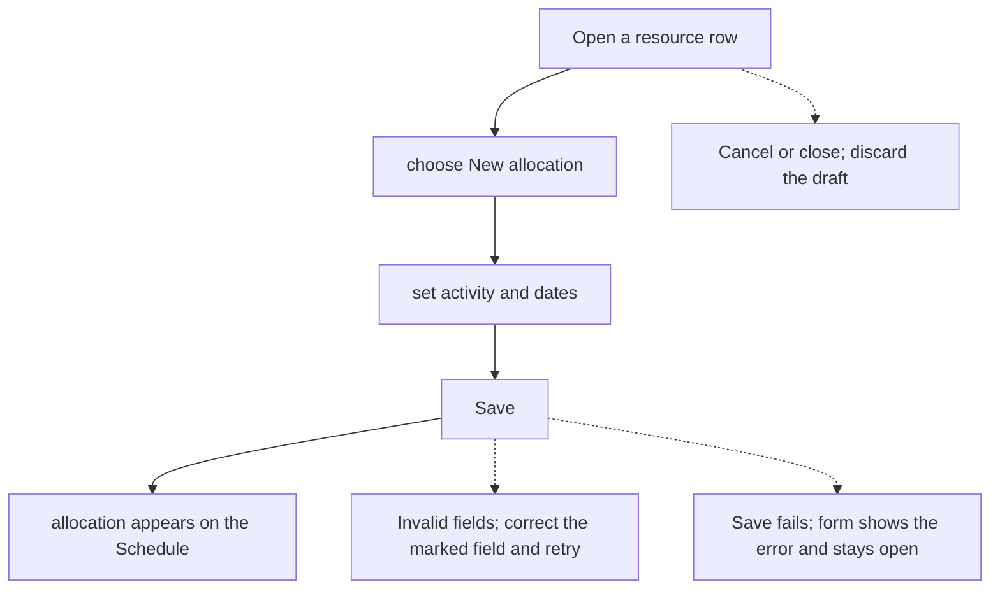
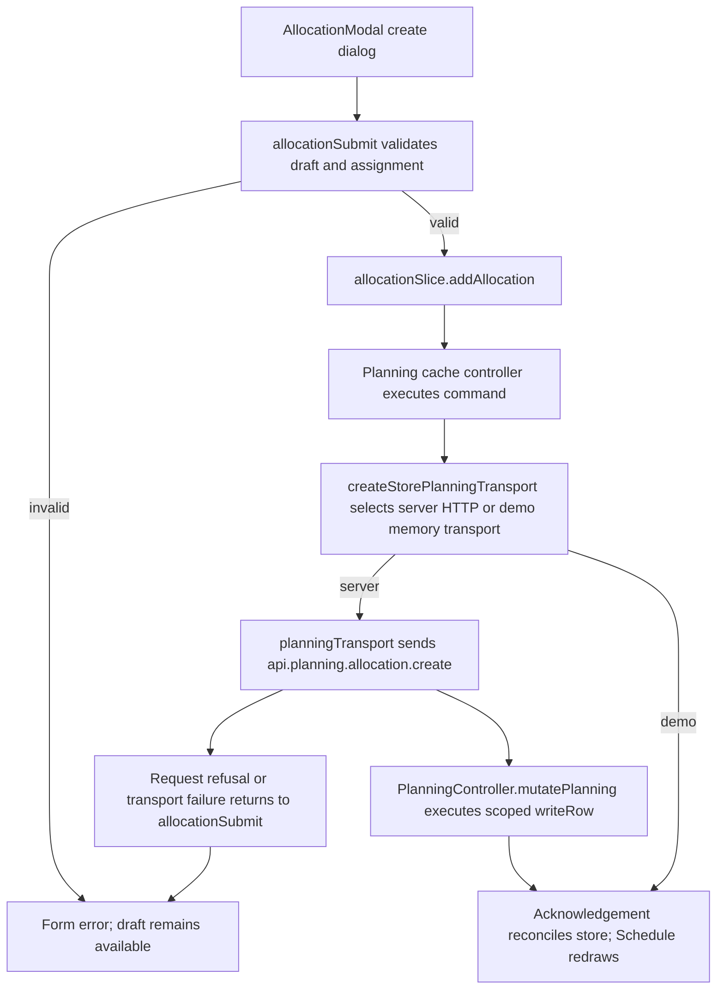

# US-ALL-01 — Create an allocation via the modal

As an Editor, I want to book an activity onto a resource for a date range so that the Schedule shows the assigned work and its capacity.

**Status:** Current
**Access:** Editor, Admin or Owner
**Entry:** Schedule (`/`)
**Documentation:** [schedule-work.md](../../docs-src/using/schedule-work.md)
**Source:** [AllocationModal.tsx](../../apps/frontend/src/components/scheduler/AllocationModal.tsx), [AllocationScheduleFields.tsx](../../apps/frontend/src/components/scheduler/AllocationScheduleFields.tsx)

## Acceptance criteria

| Field               | Control           | Required/default/conditions                                                                                                                                                                 |
| ------------------- | ----------------- | ------------------------------------------------------------------------------------------------------------------------------------------------------------------------------------------- |
| Assignee            | Resource context  | Required; fixed by the resource row or lane used to open create; create has no Assignee select.                                                                                             |
| Project             | Select            | Optional attribution; defaults to Internal unless a placeholder row fixes its bound project. Choices include No specific project and eligible projects.                                     |
| Activity            | Select            | Required; choices follow the selected project scope.                                                                                                                                        |
| Task                | Text input        | Optional; shown only when the company’s Show task field in schedule setting is enabled.                                                                                                     |
| Start               | Date input        | Required; defaults to today unless a date is supplied by the schedule entry point.                                                                                                          |
| End                 | Date input        | Required when the form uses a typed date range (Hours mode or an external resource); defaults to Start when no range is supplied. Hidden and derived from span fields in Days/Blocks modes. |
| Hours / day         | Select            | Hours mode for capacity-counting resources; options 1, 2, 4 or 8 hours. Hidden for external resources.                                                                                      |
| Days of work        | Number input      | Required in Days mode for capacity-counting resources; positive value, 0.5 step.                                                                                                            |
| Days over           | Number input      | Days and Blocks modes for capacity-counting resources; defaults to 1, optional, step 1, range capped by the supported span. Disabled when no effective working days are available.          |
| Repeat              | Select            | Create only; defaults to Doesn’t repeat; Weekly, Every 2 weeks, Every 3 weeks, Every 4 weeks or Monthly.                                                                                    |
| Repeat until        | Date input        | Create only; required when Repeat is enabled; limited to today/start through six calendar months after the start.                                                                           |
| Status              | Segmented control | Confirmed by default; Confirmed, Tentative or Completed.                                                                                                                                    |
| Note                | Text input        | Optional.                                                                                                                                                                                   |
| Ignore working days | Checkbox          | Unchecked by default; hidden for external resources; does not bypass time off or closures.                                                                                                  |

- Save creates the allocation and closes the form.

## User flow

## Code flow

**Code references:**

- [writer.ts](../../apps/backend/app/services/planning/writer.ts)

- [execute.ts](../../apps/backend/app/services/planning/execute.ts)

- [planning.ts](../../apps/backend/app/services/planning.ts)

- [storePlanningTransport.ts](../../apps/frontend/src/data/planning/storePlanningTransport.ts)
- [planningTransport.ts](../../apps/frontend/src/data/planning/planningTransport.ts)
- [volatilePlanningTransport.ts](../../apps/frontend/src/data/planning/volatilePlanningTransport.ts)
- [planning_controller.ts](../../apps/backend/app/controllers/planning_controller.ts)
- [AllocationModal.tsx](../../apps/frontend/src/components/scheduler/AllocationModal.tsx)
- [useAllocationModalState.ts](../../apps/frontend/src/components/scheduler/useAllocationModalState.ts)
- [allocationSubmit.ts](../../apps/frontend/src/components/scheduler/allocationSubmit.ts)
- [allocationSlice.ts](../../apps/frontend/src/store/slices/allocationSlice.ts)
- [planningCacheController.ts](../../apps/frontend/src/data/planning/planningCacheController.ts)
