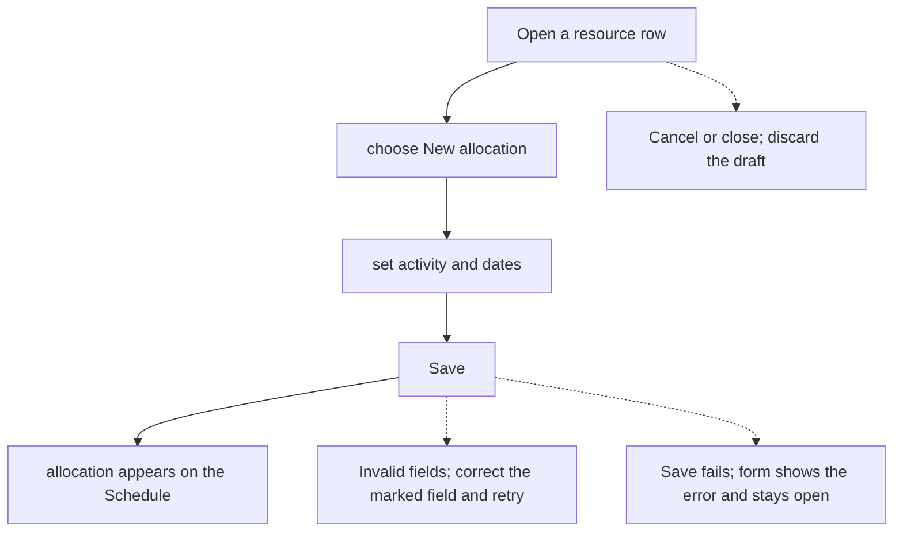
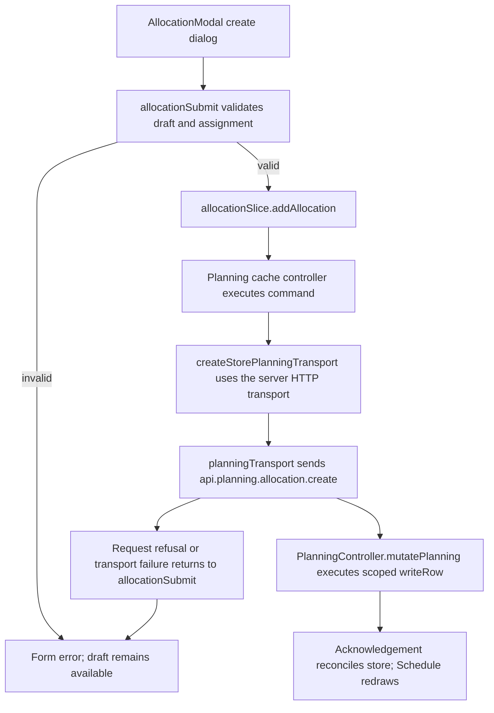

# US-ALL-01 — Create an allocation via the modal

As an Editor, I want to book an activity onto a resource for a date range so that the Schedule shows the assigned work and its capacity.

**Status:** Current
**Access:** Editor, Admin or Owner
**Entry:** Schedule (`/`)
**Documentation:** [schedule-work.md](../../docs-src/using/schedule-work.md)
**Source:** [AllocationModal.tsx](../../apps/frontend/src/components/scheduler/AllocationModal.tsx), [AllocationScheduleFields.tsx](../../apps/frontend/src/components/scheduler/AllocationScheduleFields.tsx)

## Acceptance criteria

| Field               | Control           | Required/default/conditions                                                                                                                                                                                        |
| ------------------- | ----------------- | ------------------------------------------------------------------------------------------------------------------------------------------------------------------------------------------------------------------ |
| Assignee            | Resource context  | Required; fixed by the resource row or lane used to open create; create has no Assignee select                                                                                                                     |
| Project             | Select            | Defaults to Internal, or to the bound project for a placeholder row; options: Internal, No specific project, then projects sorted by client and name; a placeholder limits the choice to its bound project         |
| Activity            | Select            | Required; choices follow the selected Project                                                                                                                                                                      |
| Task                | Text input        | Optional; up to 100 characters; shown only when the company enables Show task field in schedule                                                                                                                    |
| Start Date          | Date input        | Required; defaults to the entry point’s date, otherwise today                                                                                                                                                      |
| End                 | Date input        | Hours mode and external resources only; required; defaults to the entry point’s end date, otherwise today                                                                                                          |
| Hours / day         | Select            | Hours mode, not for external resources; 1 h, 2 h - quarter day, 4 h - half day or 8 h - full day; defaults from the entry point’s scheduled hours, otherwise 8 h                                                   |
| Days of work        | Number input      | Days mode, not for external resources; required; greater than 0; 0.5 step; defaults from the entry point’s span                                                                                                    |
| Days over           | Number input      | Days and Blocks modes, not for external resources; whole number from 1 to the supported maximum; defaults from the entry point’s span (1 for a single day); disabled when the person has no effective working days |
| Repeat              | Select            | Create only; defaults to Doesn’t repeat; Weekly, Every 2 weeks, Every 3 weeks, Every 4 weeks or Monthly                                                                                                            |
| Repeat until        | Date input        | Create only; required when repeating; suggested as the end of the second calendar month after Start; from the later of today and Start up to six calendar months after Start                                       |
| Status              | Segmented control | Confirmed by default; Confirmed, Tentative or Completed                                                                                                                                                            |
| Note                | Text input        | Optional                                                                                                                                                                                                           |
| Ignore working days | Checkbox          | Unchecked by default; hidden for external resources; never bypasses time off                                                                                                                                       |

- Save creates the allocation and closes the form.

## User flow

## Code flow

**Code references:**

- [writer.ts](../../apps/backend/app/services/planning/writer.ts)

- [execute.ts](../../apps/backend/app/services/planning/execute.ts)

- [planning.ts](../../apps/backend/app/services/planning.ts)

- [storePlanningTransport.ts](../../apps/frontend/src/data/planning/storePlanningTransport.ts)
- [planningTransport.ts](../../apps/frontend/src/data/planning/planningTransport.ts)
- [planning_controller.ts](../../apps/backend/app/controllers/planning_controller.ts)
- [AllocationModal.tsx](../../apps/frontend/src/components/scheduler/AllocationModal.tsx)
- [useAllocationModalState.ts](../../apps/frontend/src/components/scheduler/useAllocationModalState.ts)
- [allocationSubmit.ts](../../apps/frontend/src/components/scheduler/allocationSubmit.ts)
- [allocationSlice.ts](../../apps/frontend/src/store/slices/allocationSlice.ts)
- [planningCacheController.ts](../../apps/frontend/src/data/planning/planningCacheController.ts)
