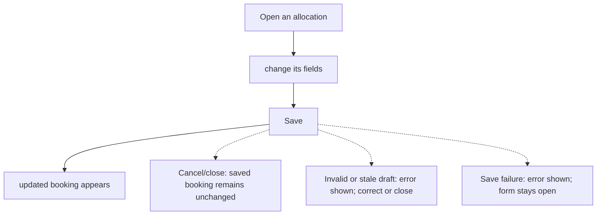
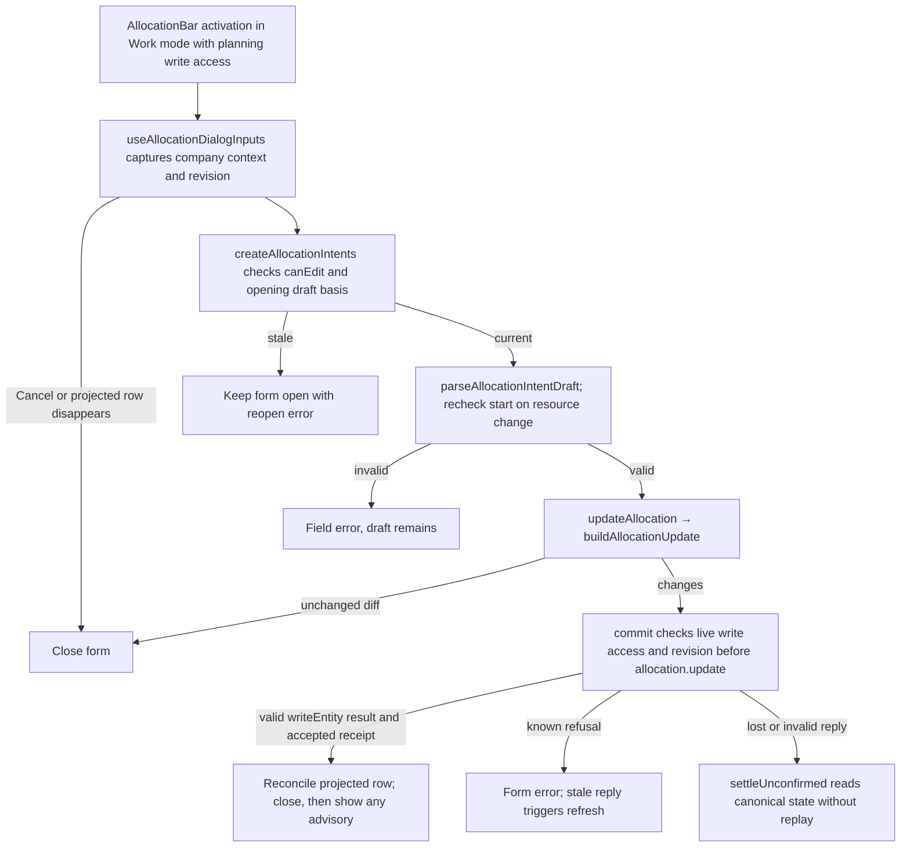

# US-ALL-02 — Edit an existing allocation

As an Editor, I want to change an allocation in place so that an updated plan keeps its existing booking.

**Status:** Current
**Access:** Editor, Admin or Owner
**Entry:** Schedule (`/`)
**Documentation:** [schedule-work.md](../../docs-src/using/schedule-work.md)
**Source:** [AllocationDialog.tsx](../../apps/frontend/src/components/scheduler/AllocationDialog.tsx), [AllocationScheduleFields.tsx](../../apps/frontend/src/components/scheduler/AllocationScheduleFields.tsx)

## Acceptance criteria

| Field               | Control           | Required/default/conditions                                                                                                                                                   |
| ------------------- | ----------------- | ----------------------------------------------------------------------------------------------------------------------------------------------------------------------------- |
| Assignee            | Select            | Required; prefilled with the current resource                                                                                                                                 |
| Project             | Select            | Prefilled with the saved project scope; options: Internal, No specific project, then projects sorted by client and name; a placeholder limits the choice to its bound project |
| Activity            | Select            | Required; prefilled with the current activity; choices follow the selected Project                                                                                            |
| Task                | Text input        | Optional; up to 100 characters; shown only when the company enables Show task field in schedule; prefilled                                                                    |
| Start Date          | Date input        | Required; prefilled with the saved start date                                                                                                                                 |
| End                 | Date input        | Hours mode and external resources only; required; prefilled with the saved end date                                                                                           |
| Hours / day         | Select            | Hours mode, not for external resources; prefilled; 1 h, 2 h - quarter day, 4 h - half day or 8 h - full day                                                                   |
| Days of work        | Number input      | Days mode, not for external resources; required; greater than 0; 0.5 step; prefilled                                                                                          |
| Days over           | Number input      | Days and Blocks modes, not for external resources; prefilled; whole number from 1 to the supported maximum; disabled when the person has no effective working days            |
| Status              | Segmented control | Prefilled with the saved status; Confirmed, Tentative or Completed                                                                                                            |
| Note                | Text input        | Optional; prefilled with the saved note                                                                                                                                       |
| Ignore working days | Checkbox          | Prefilled with the saved value; hidden for external resources                                                                                                                 |

- Save updates the existing allocation; Cancel leaves its saved values unchanged.

## User flow

## Code flow

The dialog submits two arguments to `updateAllocation`. The wire mutation carries the company base revision and omits `expectedUpdatedAt`. The [general edit decision](../../DECISIONS.md#data-and-company-separation) calls for the opening row timestamp. A same-assignee edit can retain an existing placement conflict.

**Code references:**

- [AllocationBar.tsx](../../apps/frontend/src/components/scheduler/AllocationBar.tsx#L183)
- [useAllocationDialogState.ts](../../apps/frontend/src/components/scheduler/useAllocationDialogState.ts#L54)
- [allocationSubmit.ts](../../apps/frontend/src/components/scheduler/allocationSubmit.ts#L177)
- [allocationSlice.ts](../../apps/frontend/src/store/slices/allocationSlice.ts#L138)
- [planningIntents.ts](../../apps/frontend/src/data/planning/planningIntents.ts#L177)
- [entity_write.ts](../../apps/backend/app/services/planning/entity_write.ts#L111)
- [planning_mutations_controller.ts](../../apps/backend/app/controllers/planning_mutations_controller.ts#L9)
- [planning.ts](../../apps/backend/app/services/planning.ts#L198)
- [planningCache.ts](../../apps/frontend/src/data/planning/planningCache.ts#L471)
- [AllocationDialog.edit.test.tsx](../../apps/frontend/src/components/scheduler/AllocationDialog.edit.test.tsx#L151)
