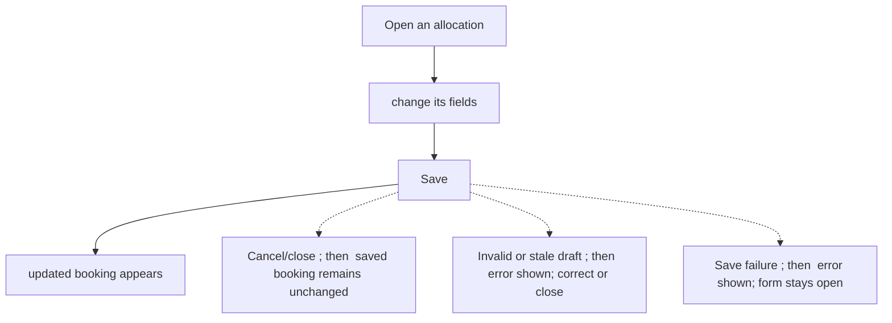
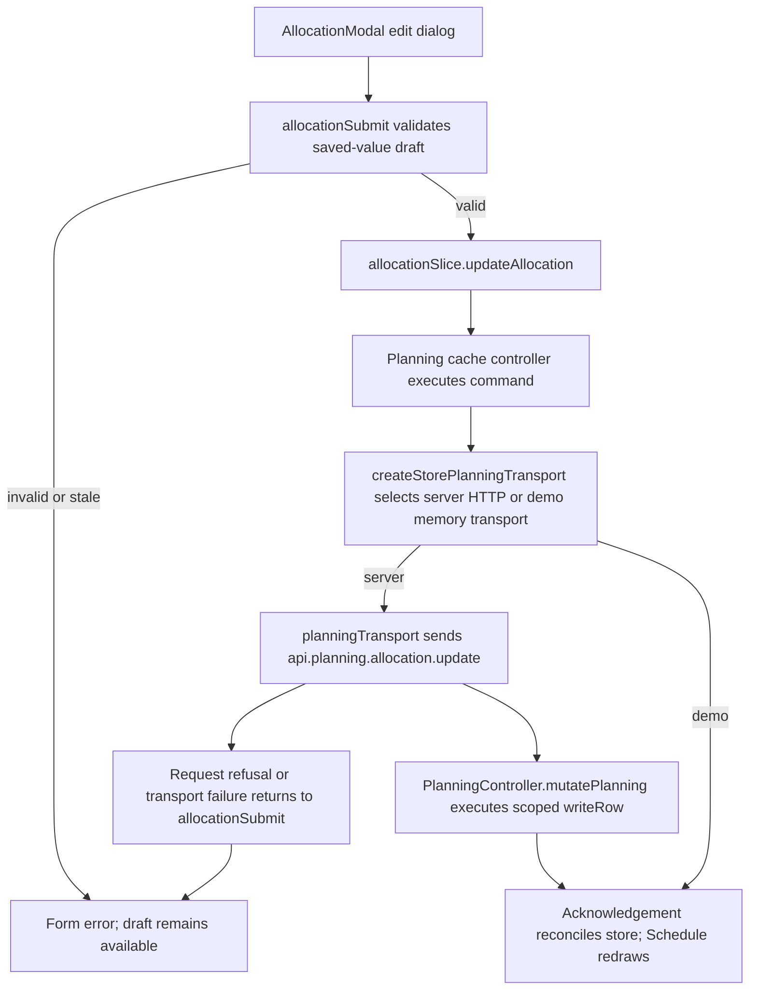

# US-ALL-02 — Edit an existing allocation

As an Editor, I want to change an allocation in place so that an updated plan keeps its existing booking.

**Status:** Current
**Access:** Editor, Admin or Owner
**Entry:** Schedule (`/`)
**Documentation:** [schedule-work.md](../../docs-src/using/schedule-work.md)
**Source:** [AllocationModal.tsx](../../apps/frontend/src/components/scheduler/AllocationModal.tsx), [AllocationScheduleFields.tsx](../../apps/frontend/src/components/scheduler/AllocationScheduleFields.tsx)

## Acceptance criteria

| Field               | Control           | Required/default/conditions                                                                                                   |
| ------------------- | ----------------- | ----------------------------------------------------------------------------------------------------------------------------- |
| Assignee            | Select            | Required; prefilled with the current resource.                                                                                |
| Project             | Select            | Prefilled with current scope; choices follow resource and activity constraints.                                               |
| Activity            | Select            | Required; prefilled with the current activity.                                                                                |
| Task                | Text input        | Optional; shown only when the company enables Show task field in schedule; prefilled when available.                          |
| Start               | Date input        | Required; prefilled with the saved start date.                                                                                |
| End                 | Date input        | Required in Hours mode and for external resources; otherwise derived from the span fields for capacity-counting resources.    |
| Hours / day         | Select            | Hours mode for capacity-counting resources; options 1, 2, 4 or 8 hours; hidden for external resources.                        |
| Days of work        | Number input      | Days mode for capacity-counting resources; required, positive value, 0.5 step.                                                |
| Days over           | Number input      | Days and Blocks modes for capacity-counting resources; optional, step 1; disabled if no effective working days are available. |
| Status              | Segmented control | Prefilled with the saved status; Confirmed, Tentative or Completed.                                                           |
| Note                | Text input        | Optional; prefilled with the saved note.                                                                                      |
| Ignore working days | Checkbox          | Prefilled with the saved value; hidden for external resources.                                                                |

- Save updates the existing allocation; Cancel leaves its saved values unchanged.

## User flow

## Code flow

**Code references:**

- [writer.ts](../../apps/backend/app/services/planning/writer.ts)

- [execute.ts](../../apps/backend/app/services/planning/execute.ts)

- [planning.ts](../../apps/backend/app/services/planning.ts)

- [storePlanningTransport.ts](../../apps/frontend/src/data/planning/storePlanningTransport.ts)
- [planningTransport.ts](../../apps/frontend/src/data/planning/planningTransport.ts)
- [volatilePlanningTransport.ts](../../apps/frontend/src/data/planning/volatilePlanningTransport.ts)
- [planning_controller.ts](../../apps/backend/app/controllers/planning_controller.ts)
- [AllocationModal.tsx](../../apps/frontend/src/components/scheduler/AllocationModal.tsx)
- [useAllocationModalState.ts](../../apps/frontend/src/components/scheduler/useAllocationModalState.ts)
- [allocationSubmit.ts](../../apps/frontend/src/components/scheduler/allocationSubmit.ts)
- [allocationSlice.ts](../../apps/frontend/src/store/slices/allocationSlice.ts)
- [planningCacheController.ts](../../apps/frontend/src/data/planning/planningCacheController.ts)
