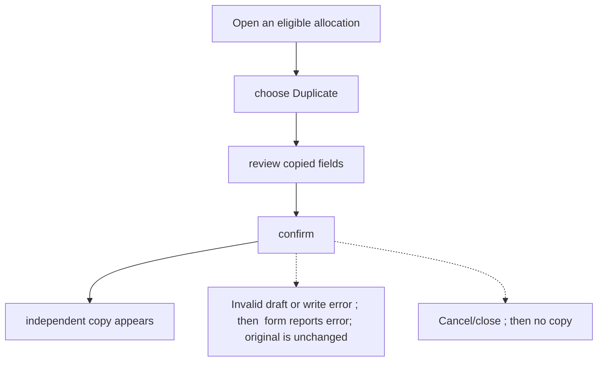
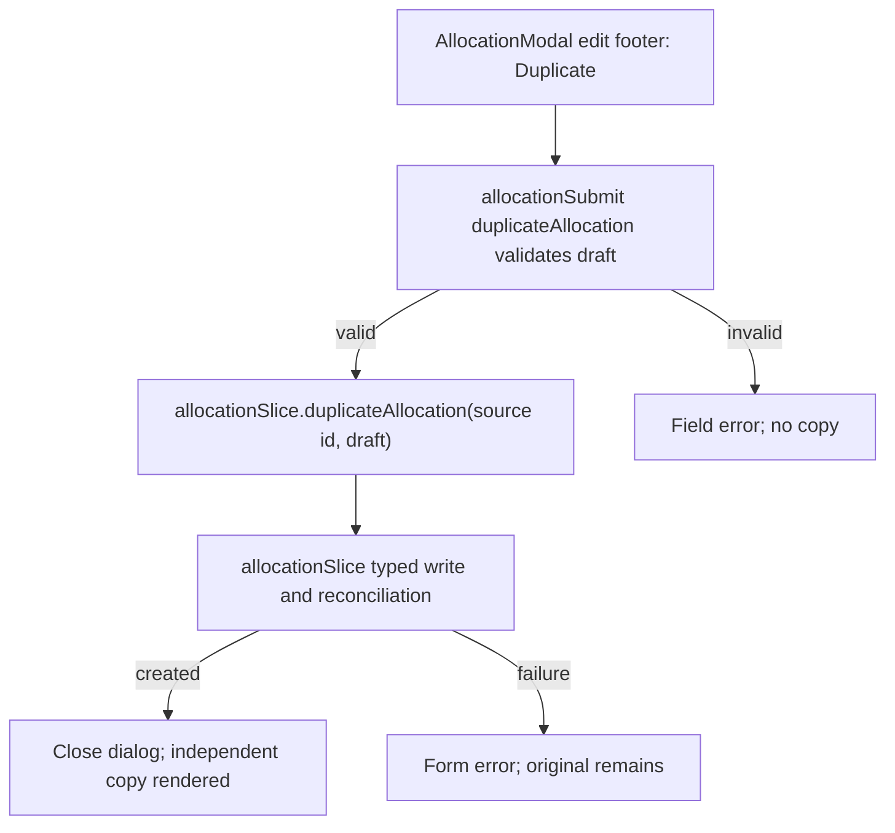

# US-ALL-03 — Duplicate an allocation

As an Editor, I want to duplicate an allocation so that I can reuse its resource, activity and dates without re-entering them.

**Status:** Current

**Access:** Editor, Admin or Owner

**Entry:** Schedule (`/`)

**Documentation:** [schedule-work.md](../../docs-src/using/schedule-work.md)

**Source:** [AllocationModal.tsx](../../apps/frontend/src/components/scheduler/AllocationModal.tsx)

## Acceptance criteria

- **Duplicate** creates an independent copy of an eligible allocation.
- Undo removes the copy; the original remains unchanged.

## User flow

## Code flow

**Code references:**

- [AllocationModal.tsx](../../apps/frontend/src/components/scheduler/AllocationModal.tsx)
- [AllocationFooter.tsx](../../apps/frontend/src/components/scheduler/AllocationFooter.tsx)
- [allocationSubmit.ts](../../apps/frontend/src/components/scheduler/allocationSubmit.ts)
- [allocationSlice.ts](../../apps/frontend/src/store/slices/allocationSlice.ts)
- [planningCacheController.ts](../../apps/frontend/src/data/planning/planningCacheController.ts)
