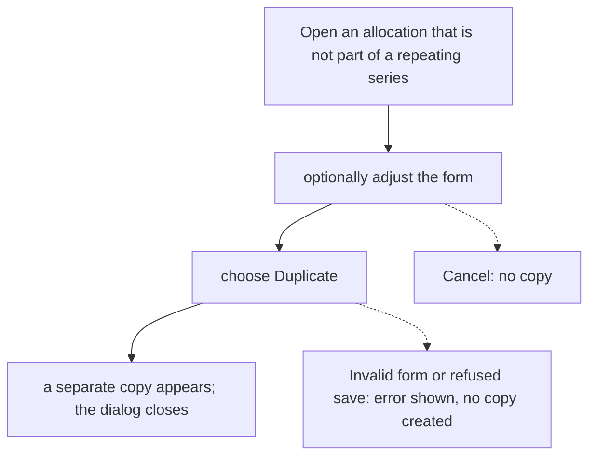
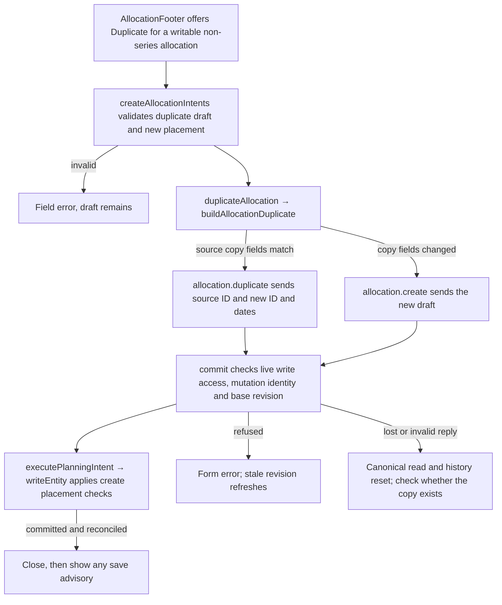

# US-ALL-03 — Duplicate an allocation

As an Editor, I want to duplicate an allocation so that I can reuse its resource, activity and dates without re-entering them.

**Status:** Current

**Access:** Editor, Admin or Owner

**Entry:** Schedule (`/`)

**Documentation:** [schedule-work.md](../../docs-src/using/schedule-work.md)

**Source:** [AllocationDialog.tsx](../../apps/frontend/src/components/scheduler/AllocationDialog.tsx)

## Acceptance criteria

- The Edit allocation dialog shows **Duplicate** only for an allocation that is not part of a repeating series.
- **Duplicate** immediately creates a separate allocation from the form’s current values and closes the dialog; the original allocation keeps its saved values.
- An invalid form or a refused save keeps the dialog open with an error and creates no copy. Undo removes a created copy.

## User flow

## Code flow

The server duplicate copies the scoped source fields and clears `seriesId`. The draft stays available before any acknowledged creation.

**Code references:**

- [AllocationFooter.tsx](../../apps/frontend/src/components/scheduler/AllocationFooter.tsx#L38)
- [allocationSubmit.ts](../../apps/frontend/src/components/scheduler/allocationSubmit.ts#L256)
- [allocationSlice.ts](../../apps/frontend/src/store/slices/allocationSlice.ts#L119)
- [planningIntents.ts](../../apps/frontend/src/data/planning/planningIntents.ts#L122)
- [execute.ts](../../apps/backend/app/services/planning/execute.ts#L249)
- [entity_write.ts](../../apps/backend/app/services/planning/entity_write.ts#L140)
- [planning_mutations_controller.ts](../../apps/backend/app/controllers/planning_mutations_controller.ts#L9)
- [planning.ts](../../apps/backend/app/services/planning.ts#L198)
- [planningCache.ts](../../apps/frontend/src/data/planning/planningCache.ts#L471)
- [http_contract.spec.ts](../../apps/backend/tests/functional/planning/http_contract.spec.ts#L579)
