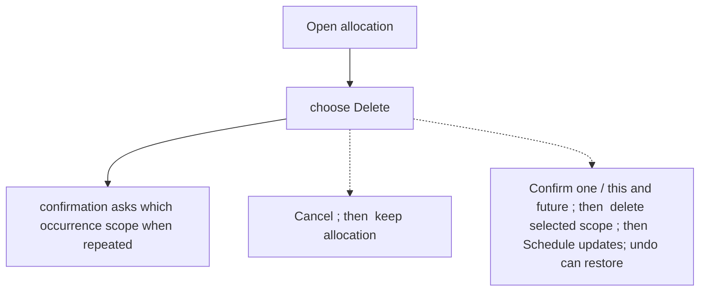
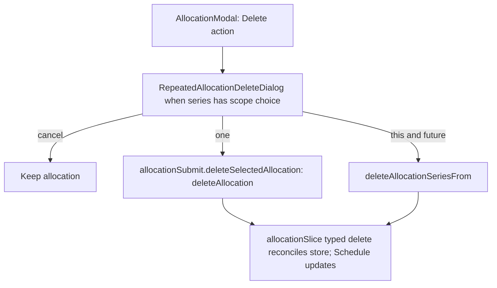

# US-ALL-04 — Delete an allocation

As an Editor, I want to delete a cancelled allocation safely so that I can restore it if the deletion was a mistake.

**Status:** Current

**Access:** Editor, Admin or Owner

**Entry:** Schedule (`/`)

**Documentation:** [schedule-work.md](../../docs-src/using/schedule-work.md)

**Source:** [AllocationModal.tsx](../../apps/frontend/src/components/scheduler/AllocationModal.tsx)

## Acceptance criteria

- **Delete** asks for confirmation; Cancel preserves the allocation.
- Confirming deletion removes the chosen allocation or permitted repeat tail; Undo restores it.

## User flow

## Code flow

**Code references:**

- [AllocationModal.tsx](../../apps/frontend/src/components/scheduler/AllocationModal.tsx)
- [AllocationFooter.tsx](../../apps/frontend/src/components/scheduler/AllocationFooter.tsx)
- [RepeatedAllocationDeleteDialog.tsx](../../apps/frontend/src/components/scheduler/RepeatedAllocationDeleteDialog.tsx)
- [allocationSubmit.ts](../../apps/frontend/src/components/scheduler/allocationSubmit.ts)
- [allocationSlice.ts](../../apps/frontend/src/store/slices/allocationSlice.ts)
- [planningCacheController.ts](../../apps/frontend/src/data/planning/planningCacheController.ts)
