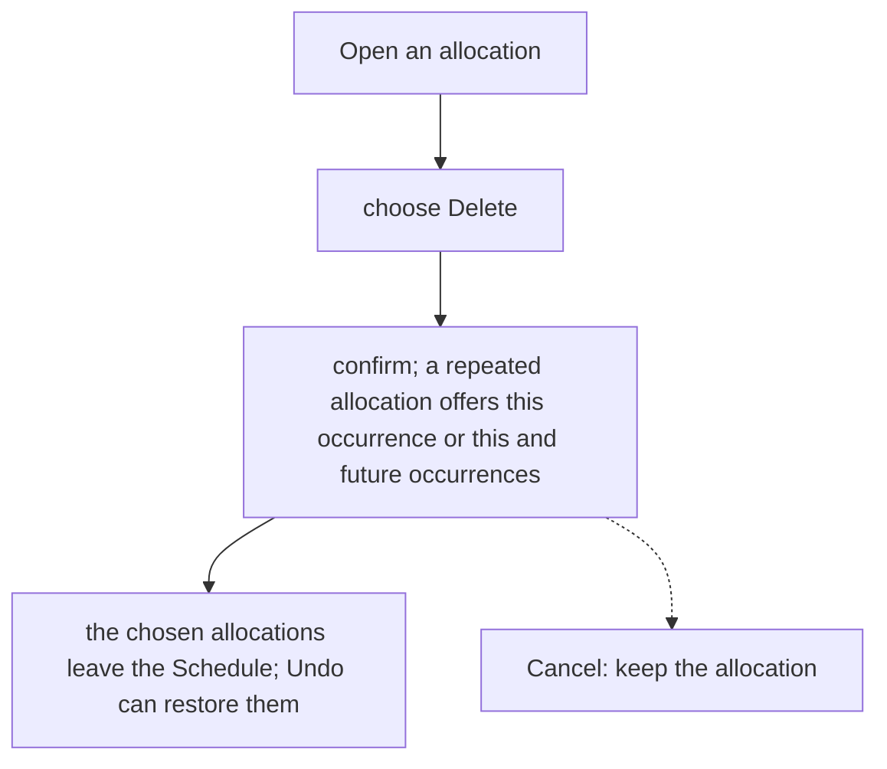
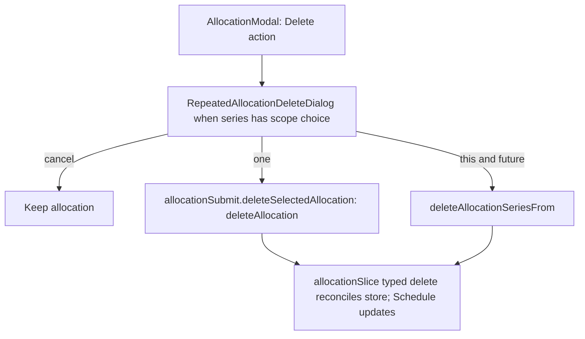

# US-ALL-04 — Delete an allocation

As an Editor, I want to delete an allocation that is no longer needed so that the Schedule stays current, with undo if I delete it by mistake.

**Status:** Current

**Access:** Editor, Admin or Owner

**Entry:** Schedule (`/`)

**Documentation:** [schedule-work.md](../../docs-src/using/schedule-work.md)

**Source:** [AllocationModal.tsx](../../apps/frontend/src/components/scheduler/AllocationModal.tsx)

## Acceptance criteria

- In the Edit allocation dialog, **Delete** opens **Delete allocation?** with **Delete** and **Cancel**.
- For an allocation in a repeating series it opens **Delete repeated allocation?** with **Delete this occurrence**, **Delete this and future occurrences** and **Cancel**.
- **Cancel** keeps the allocation. A confirmed deletion removes the chosen allocation, or it and the later occurrences in its series; ⌘Z / Ctrl+Z (or **Undo**) restores it.

## User flow

## Code flow

**Code references:**

- [AllocationModal.tsx](../../apps/frontend/src/components/scheduler/AllocationModal.tsx)
- [AllocationFooter.tsx](../../apps/frontend/src/components/scheduler/AllocationFooter.tsx)
- [RepeatedAllocationDeleteDialog.tsx](../../apps/frontend/src/components/scheduler/RepeatedAllocationDeleteDialog.tsx)
- [allocationSubmit.ts](../../apps/frontend/src/components/scheduler/allocationSubmit.ts)
- [allocationSlice.ts](../../apps/frontend/src/store/slices/allocationSlice.ts)
- [planningCacheController.ts](../../apps/frontend/src/data/planning/planningCacheController.ts)
