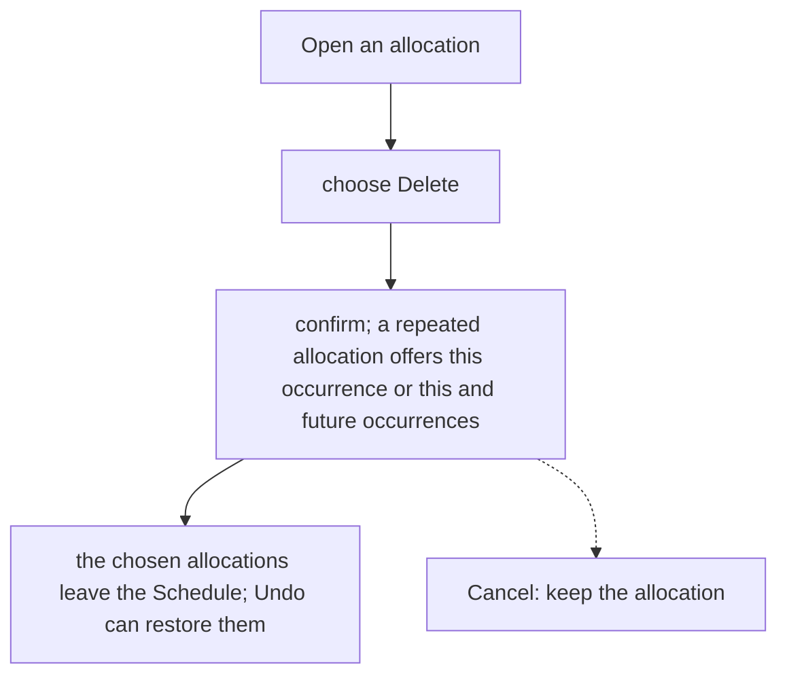
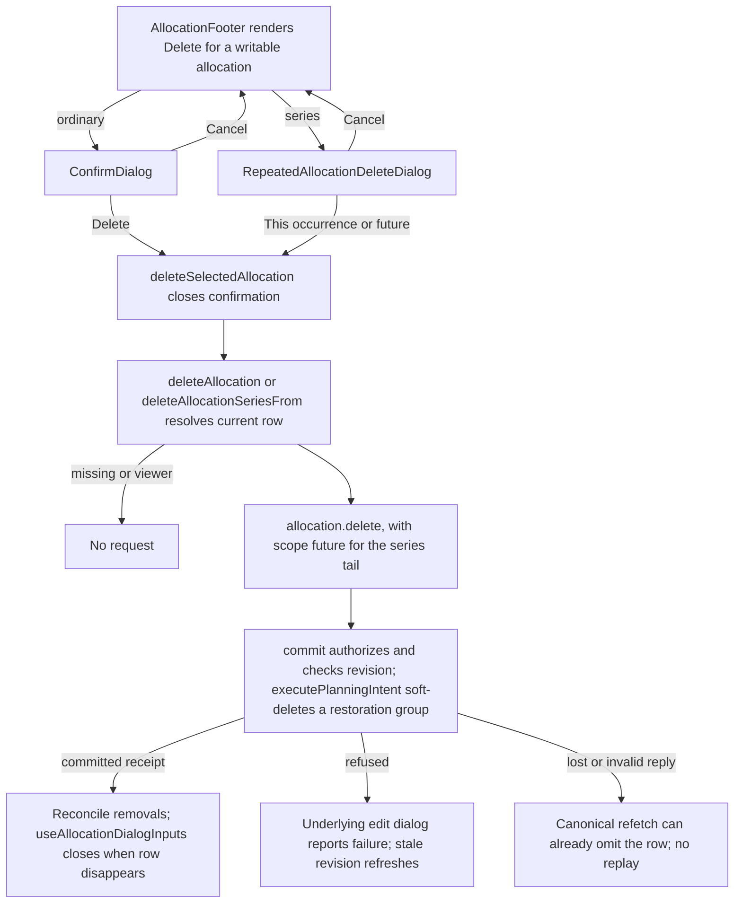

# US-ALL-04 — Delete an allocation

As an Editor, I want to delete an allocation that is no longer needed so that the Schedule stays current, with undo if I delete it by mistake.

**Status:** Current

**Access:** Editor, Admin or Owner

**Entry:** Schedule (`/`)

**Documentation:** [schedule-work.md](../../docs-src/using/schedule-work.md)

**Source:** [AllocationDialog.tsx](../../apps/frontend/src/components/scheduler/AllocationDialog.tsx)

## Acceptance criteria

- In the Edit allocation dialog, **Delete** opens **Delete allocation?** with **Delete** and **Cancel**.
- For an allocation in a repeating series it opens **Delete repeated allocation?** with **Delete this occurrence**, **Delete this and future occurrences** and **Cancel**.
- **Cancel** keeps the allocation. A confirmed deletion removes the chosen allocation, or it and the later occurrences in its series; ⌘Z / Ctrl+Z (or **Undo**) restores it.

## User flow

## Code flow

For future scope, `resolveSeriesFrom` selects rows in the same series beginning at or after the selected start. The transaction records a single recoverable deletion group for eligible Undo.

**Code references:**

- [AllocationFooter.tsx](../../apps/frontend/src/components/scheduler/AllocationFooter.tsx#L19)
- [allocationSubmit.ts](../../apps/frontend/src/components/scheduler/allocationSubmit.ts#L271)
- [allocationSlice.ts](../../apps/frontend/src/store/slices/allocationSlice.ts#L164)
- [execute.ts](../../apps/backend/app/services/planning/execute.ts#L50)
- [execute.ts](../../apps/backend/app/services/planning/execute.ts#L426)
- [useAllocationDialogState.ts](../../apps/frontend/src/components/scheduler/useAllocationDialogState.ts#L125)
- [planning_mutations_controller.ts](../../apps/backend/app/controllers/planning_mutations_controller.ts#L7)
- [planning.ts](../../apps/backend/app/services/planning.ts#L198)
- [planningCache.ts](../../apps/frontend/src/data/planning/planningCache.ts#L471)
- [restoration_allocations.spec.ts](../../apps/backend/tests/functional/planning/restoration_allocations.spec.ts#L77)
