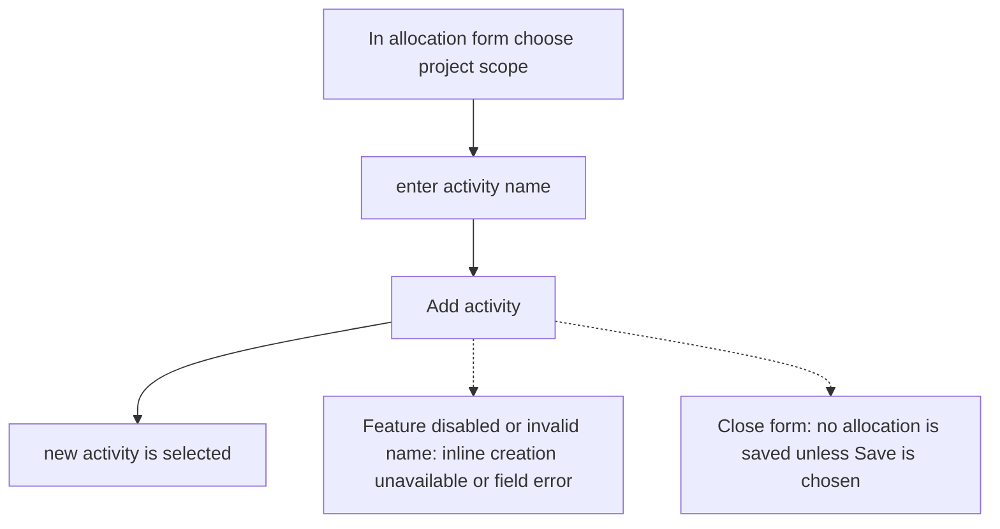
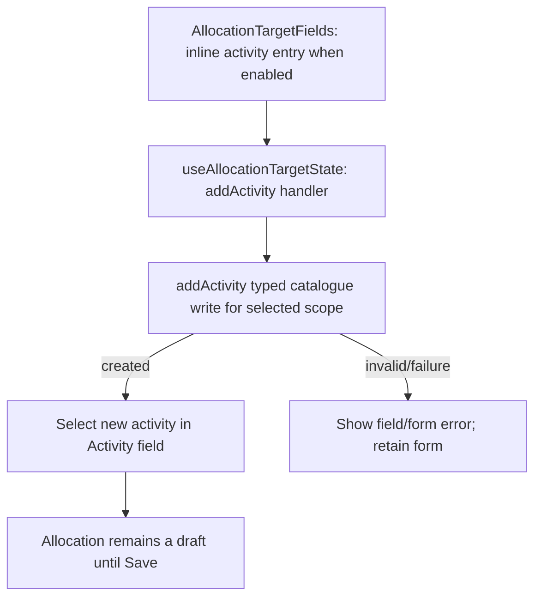

# US-ALL-05 — Add a new activity inline from the modal

As an Editor, I want to add an activity from the allocation form so that I can assign new work without leaving the Schedule.

**Status:** Current
**Access:** Editor, Admin or Owner
**Entry:** Schedule (`/`)
**Documentation:** [schedule-work.md](../../docs-src/using/schedule-work.md)
**Source:** [AllocationTargetFields.tsx](../../apps/frontend/src/components/scheduler/AllocationTargetFields.tsx), [AllocationScheduleFields.tsx](../../apps/frontend/src/components/scheduler/AllocationScheduleFields.tsx)

## Acceptance criteria

| Field             | Control    | Required/default/conditions                                                                    |
| ----------------- | ---------- | ---------------------------------------------------------------------------------------------- |
| New activity name | Text input | Required to add an activity; available only when the company enables inline activity creation. |

- **Add activity** (or Enter in the field) creates an activity matching the selected Project: Internal creates an internal activity, No specific project an all-projects activity, and a project a project-specific activity. The new activity is selected in the Activity control; the allocation is saved only by **Save**.

## User flow

## Code flow

**Code references:**

- [AllocationTargetFields.tsx](../../apps/frontend/src/components/scheduler/AllocationTargetFields.tsx)
- [useAllocationTargetState.ts](../../apps/frontend/src/components/scheduler/useAllocationTargetState.ts)
- [typedPlanningActions.ts](../../apps/frontend/src/store/typedPlanningActions.ts)
- [allocationSlice.ts](../../apps/frontend/src/store/slices/allocationSlice.ts)
