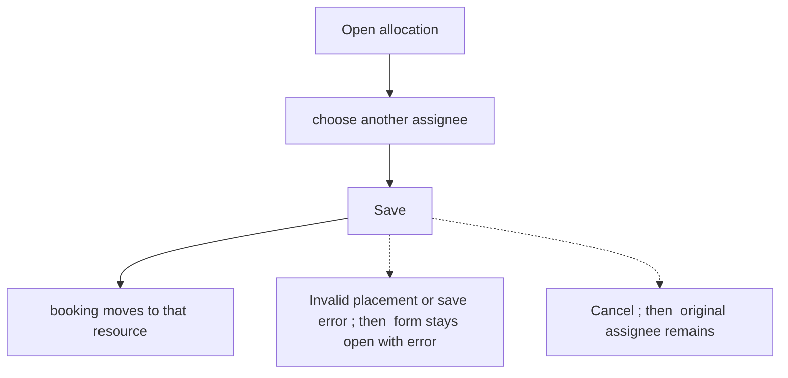
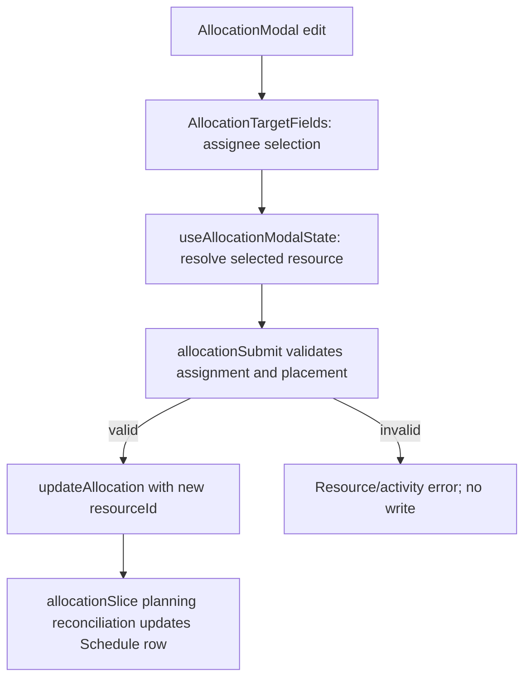

# US-ALL-06 — Change an allocation's assignee

As an Editor, I want to change an allocation’s assignee so that work can move to the resource who will do it.

**Status:** Current

**Access:** Editor, Admin or Owner

**Entry:** Schedule (`/`)

**Documentation:** [schedule-work.md](../../docs-src/using/schedule-work.md)

**Source:** [AllocationModal.tsx](../../apps/frontend/src/components/scheduler/AllocationModal.tsx)

## Acceptance criteria

| Field    | Control | Required/default/conditions                                                                                                 |
| -------- | ------- | --------------------------------------------------------------------------------------------------------------------------- |
| Assignee | Select  | Required; prefilled with the current resource. The other edit fields remain as described in [US-ALL-02](US-ALL-02-edit.md). |

## User flow

## Code flow

**Code references:**

- [AllocationModal.tsx](../../apps/frontend/src/components/scheduler/AllocationModal.tsx)
- [AllocationTargetFields.tsx](../../apps/frontend/src/components/scheduler/AllocationTargetFields.tsx)
- [useAllocationModalState.ts](../../apps/frontend/src/components/scheduler/useAllocationModalState.ts)
- [allocationSubmit.ts](../../apps/frontend/src/components/scheduler/allocationSubmit.ts)
- [planningCacheController.ts](../../apps/frontend/src/data/planning/planningCacheController.ts)
