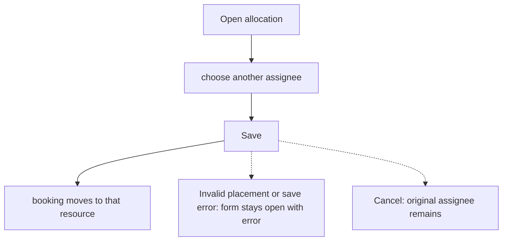
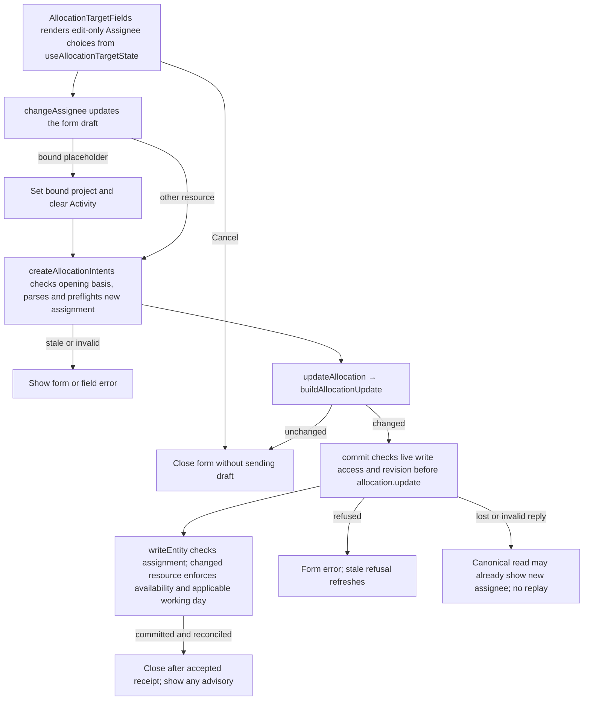

# US-ALL-06 — Change an allocation's assignee

As an Editor, I want to change an allocation’s assignee so that work can move to the resource who will do it.

**Status:** Current

**Access:** Editor, Admin or Owner

**Entry:** Schedule (`/`)

**Documentation:** [schedule-work.md](../../docs-src/using/schedule-work.md)

**Source:** [AllocationDialog.tsx](../../apps/frontend/src/components/scheduler/AllocationDialog.tsx)

## Acceptance criteria

| Field    | Control | Required/default/conditions                                                                                                 |
| -------- | ------- | --------------------------------------------------------------------------------------------------------------------------- |
| Assignee | Select  | Required; prefilled with the current resource. The other edit fields remain as described in [US-ALL-02](US-ALL-02-edit.md). |

## User flow

## Code flow

Ignore working days can bypass the working-day check for a reassignment. Availability dates, time off and applicable closures still constrain the new start. The pointer gesture uses [allocation.reassign](../scheduler/US-SCH-06-reassign-drag.md).

**Code references:**

- [AllocationTargetFields.tsx](../../apps/frontend/src/components/scheduler/AllocationTargetFields.tsx#L26)
- [useAllocationTargetState.ts](../../apps/frontend/src/components/scheduler/useAllocationTargetState.ts#L54)
- [useAllocationTargetState.ts](../../apps/frontend/src/components/scheduler/useAllocationTargetState.ts#L279)
- [allocationSubmit.ts](../../apps/frontend/src/components/scheduler/allocationSubmit.ts#L142)
- [planningIntents.ts](../../apps/frontend/src/data/planning/planningIntents.ts#L177)
- [entity_write_service.ts](../../apps/backend/app/services/planning/entity_write_service.ts#L134)
- [planning_mutations_controller.ts](../../apps/backend/app/controllers/planning_mutations_controller.ts#L9)
- [planning_service.ts](../../apps/backend/app/services/planning_service.ts#L222)
- [planningCache.ts](../../apps/frontend/src/data/planning/planningCache.ts#L471)
- [allocation_start_availability.spec.ts](../../apps/backend/tests/functional/planning/allocation_start_availability.spec.ts#L95)
