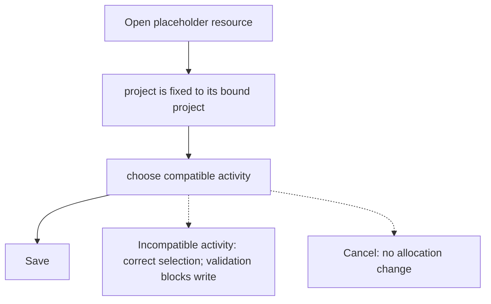
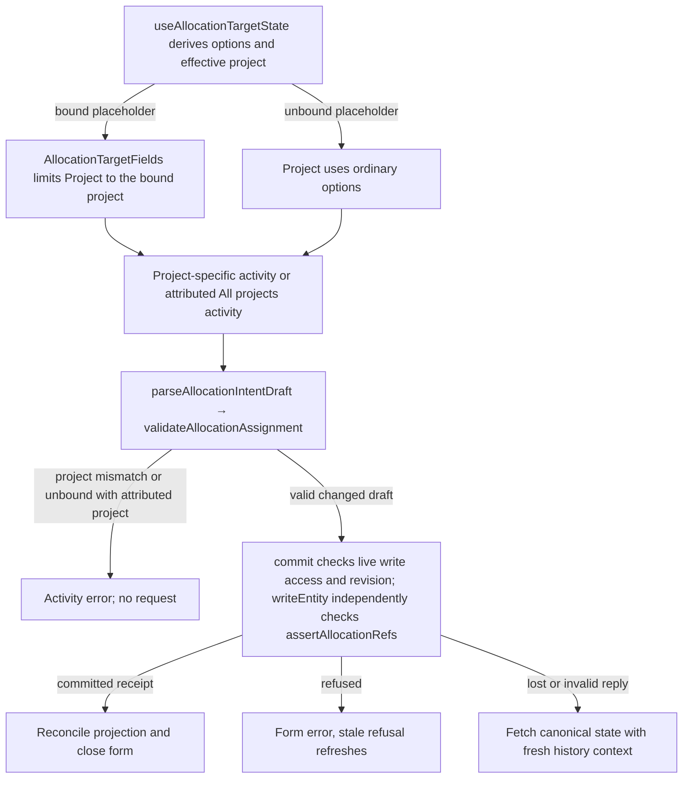

# US-ALL-07 — Placeholder assignee locks the project

As an Editor, I want a placeholder’s bound project and activities to stay selected so that placeholder work remains with its planned project.

**Status:** Current

**Access:** Editor, Admin or Owner

**Entry:** Schedule (`/`)

**Documentation:** [schedule-work.md](../../docs-src/using/schedule-work.md)

**Source:** [AllocationDialog.tsx](../../apps/frontend/src/components/scheduler/AllocationDialog.tsx)

## Acceptance criteria

| Field    | Control | Required/default/conditions                                                    |
| -------- | ------- | ------------------------------------------------------------------------------ |
| Project  | Select  | Locked to the selected placeholder’s bound project.                            |
| Activity | Select  | Required; offers compatible activities for the bound project and All projects. |

## User flow

## Code flow

A bound placeholder leaves the generic Project choices disabled. An unbound placeholder can save projectless work. Save requires an editable, current draft. Cancel and an unchanged edit close without dispatch.

**Code references:**

- [useAllocationTargetState.ts](../../apps/frontend/src/components/scheduler/useAllocationTargetState.ts#L74)
- [useAllocationTargetState.ts](../../apps/frontend/src/components/scheduler/useAllocationTargetState.ts#L162)
- [AllocationTargetFields.tsx](../../apps/frontend/src/components/scheduler/AllocationTargetFields.tsx#L26)
- [allocationDialogSelection.ts](../../apps/frontend/src/components/scheduler/allocationDialogSelection.ts#L28)
- [allocationSubmit.ts](../../apps/frontend/src/components/scheduler/allocationSubmit.ts#L43)
- [refs.ts](../../packages/shared/src/domain/assertions/refs.ts#L366)
- [integrity.ts](../../packages/shared/src/lib/integrity.ts#L126)
- [planning_mutations_controller.ts](../../apps/backend/app/controllers/planning_mutations_controller.ts#L9)
- [planning_service.ts](../../apps/backend/app/services/planning_service.ts#L222)
- [planningCache.ts](../../apps/frontend/src/data/planning/planningCache.ts#L471)
- [AllocationDialog.create.test.tsx](../../apps/frontend/src/components/scheduler/AllocationDialog.create.test.tsx#L320)
