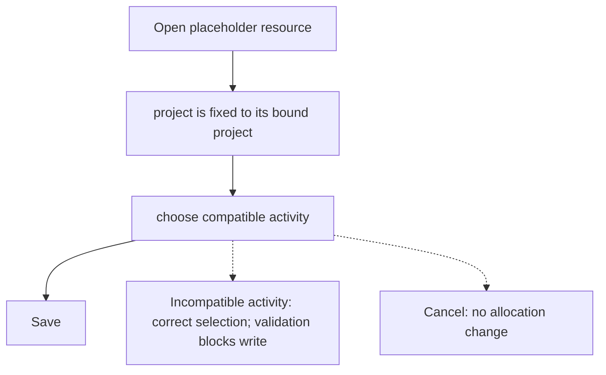
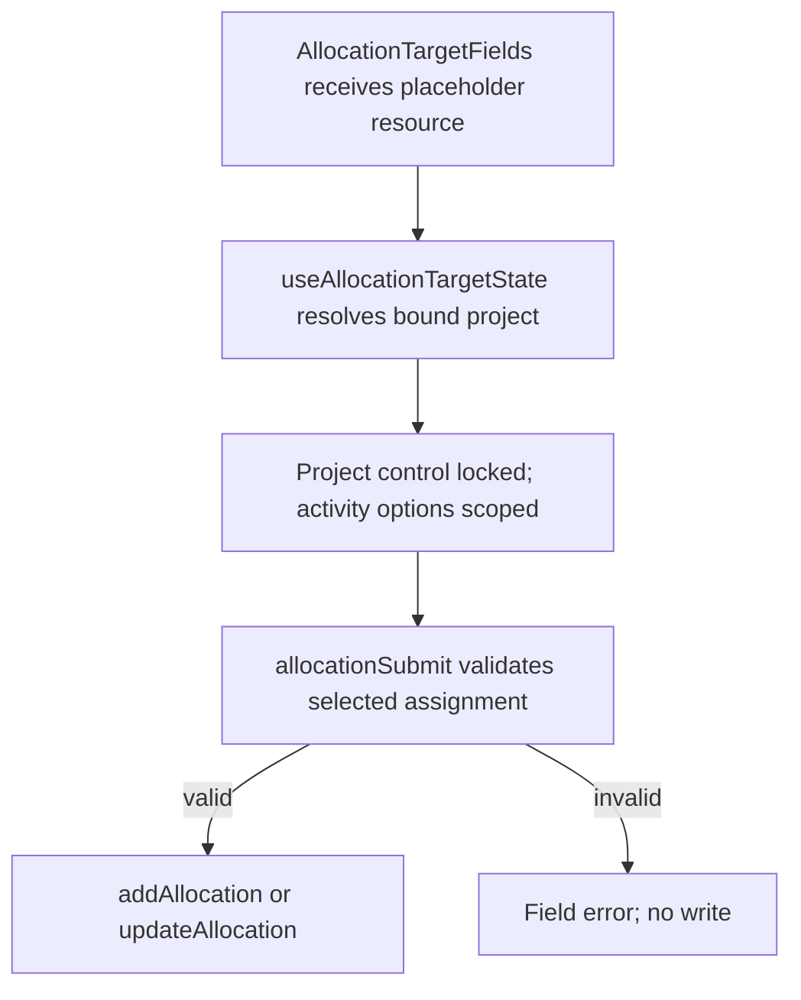

# US-ALL-07 — Placeholder assignee locks the project

As an Editor, I want a placeholder’s bound project and activities to stay selected so that placeholder work remains with its planned project.

**Status:** Current

**Access:** Editor, Admin or Owner

**Entry:** Schedule (`/`)

**Documentation:** [schedule-work.md](../../docs-src/using/schedule-work.md)

**Source:** [AllocationModal.tsx](../../apps/frontend/src/components/scheduler/AllocationModal.tsx)

## Acceptance criteria

| Field    | Control | Required/default/conditions                                                    |
| -------- | ------- | ------------------------------------------------------------------------------ |
| Project  | Select  | Locked to the selected placeholder’s bound project.                            |
| Activity | Select  | Required; offers compatible activities for the bound project and All projects. |

## User flow

## Code flow

**Code references:**

- [AllocationTargetFields.tsx](../../apps/frontend/src/components/scheduler/AllocationTargetFields.tsx)
- [useAllocationTargetState.ts](../../apps/frontend/src/components/scheduler/useAllocationTargetState.ts)
- [allocationSubmit.ts](../../apps/frontend/src/components/scheduler/allocationSubmit.ts)
- [refs.ts](../../packages/shared/src/domain/assertions/refs.ts)
