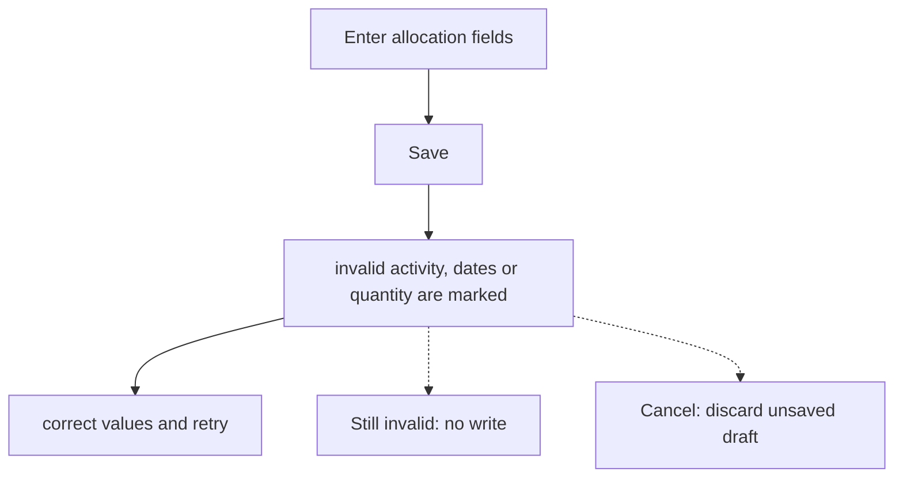
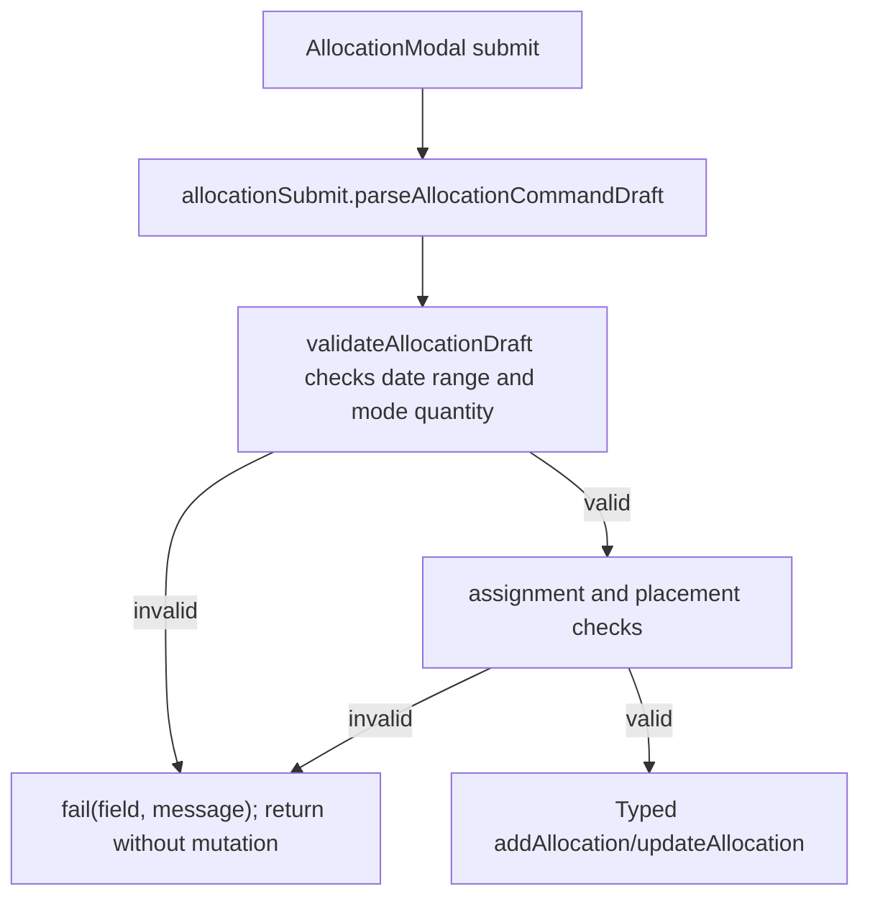

# US-ALL-08 — The modal rejects bad input

As an Editor, I want invalid allocation fields to be identified so that I can correct the booking before it is saved.

**Status:** Current

**Access:** Editor, Admin or Owner

**Entry:** Schedule (`/`)

**Documentation:** [schedule-work.md](../../docs-src/using/schedule-work.md)

**Source:** [AllocationModal.tsx](../../apps/frontend/src/components/scheduler/AllocationModal.tsx)

## Acceptance criteria

| Field        | Control      | Required/default/conditions                                                                                                  |
| ------------ | ------------ | ---------------------------------------------------------------------------------------------------------------------------- |
| Activity     | Select       | Required (“Choose (or add) an activity.”); for a placeholder, must belong to its bound project                               |
| Start Date   | Date input   | Required; a new or reassigned allocation must start on an effective working day of the person and not on their time off      |
| End          | Date input   | Hours mode and external resources: required; not before Start; span up to 36,500 calendar days                               |
| Hours / day  | Select       | Hours mode: greater than 0 and at most 24                                                                                    |
| Days of work | Number input | Days mode: greater than 0; at most 24 hours per day over Days over                                                           |
| Days over    | Number input | Days and Blocks modes: whole number from 1 to the supported maximum                                                          |
| Repeat until | Date input   | When repeating: required; not before today or Start; at most six calendar months after Start; must allow at least one repeat |

## User flow

## Code flow

**Code references:**

- [AllocationModal.tsx](../../apps/frontend/src/components/scheduler/AllocationModal.tsx)
- [allocationSubmit.ts](../../apps/frontend/src/components/scheduler/allocationSubmit.ts)
- [allocationDraft.ts](../../apps/frontend/src/components/scheduler/allocationDraft.ts)
