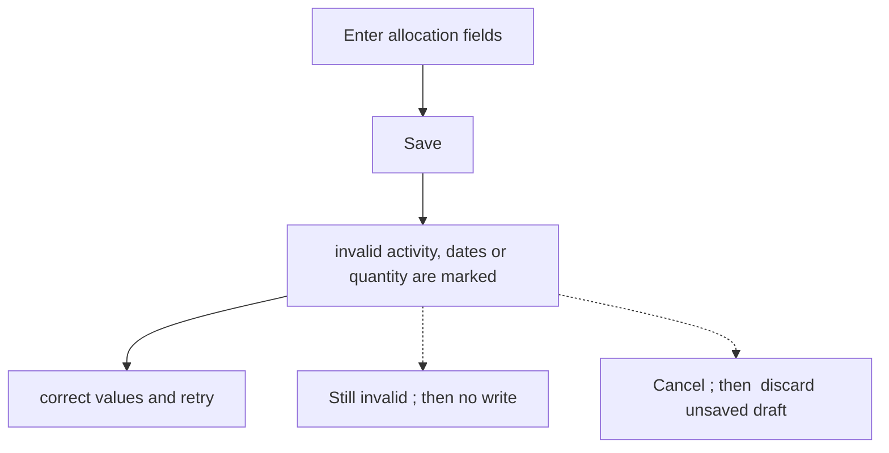
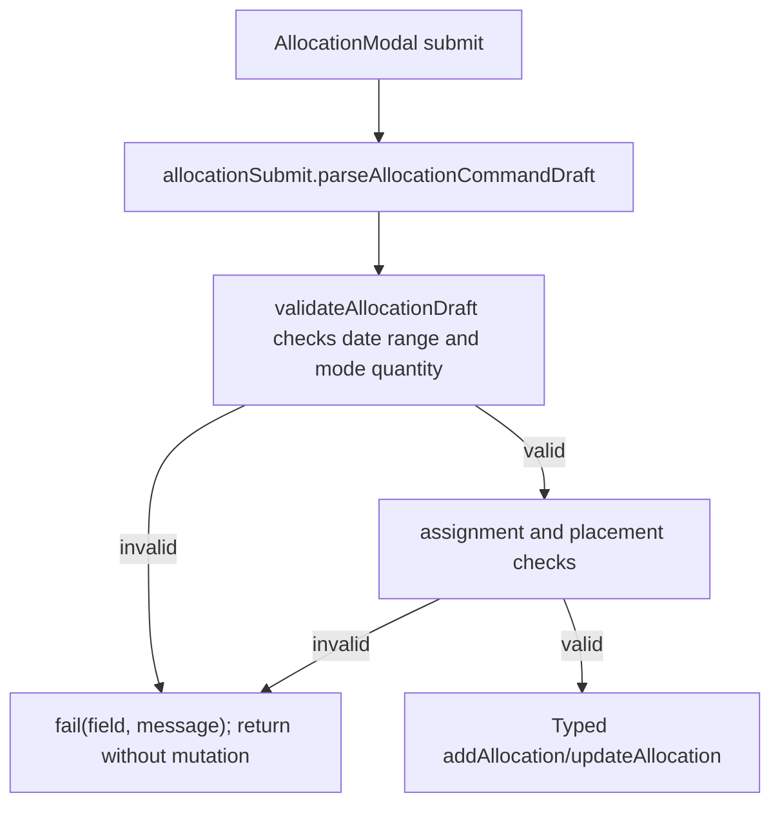

# US-ALL-08 — The modal rejects bad input

As an Editor, I want invalid allocation fields to be identified so that I can correct the booking before it is saved.

**Status:** Current

**Access:** Editor, Admin or Owner

**Entry:** Schedule (`/`)

**Documentation:** [schedule-work.md](../../docs-src/using/schedule-work.md)

**Source:** [AllocationModal.tsx](../../apps/frontend/src/components/scheduler/AllocationModal.tsx)

## Acceptance criteria

| Field        | Control      | Required/default/conditions                           |
| ------------ | ------------ | ----------------------------------------------------- |
| Activity     | Select       | Required.                                             |
| Start        | Date input   | Required; valid date.                                 |
| End          | Date input   | Required; same date or later than Start.              |
| Hours / day  | Select       | Required for capacity-based modes; greater than zero. |
| Days of work | Number input | Required in Days mode; greater than zero.             |

## User flow

## Code flow

**Code references:**

- [AllocationModal.tsx](../../apps/frontend/src/components/scheduler/AllocationModal.tsx)
- [allocationSubmit.ts](../../apps/frontend/src/components/scheduler/allocationSubmit.ts)
- [allocationDraft.ts](../../apps/frontend/src/components/scheduler/allocationDraft.ts)
