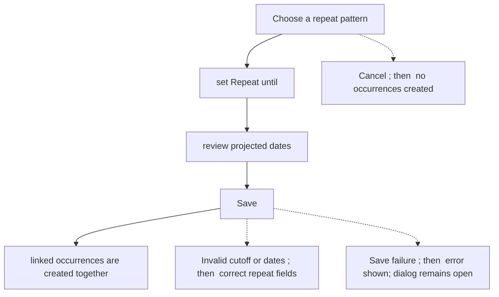
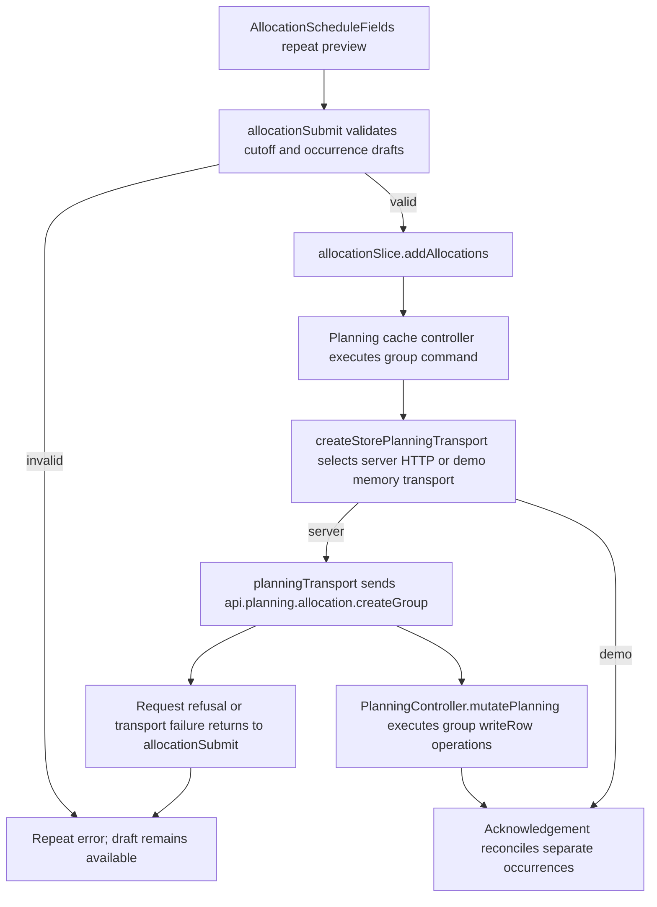

# US-ALL-09 — Create repeating weekly or monthly allocations

As an Editor, I want to create linked repeating allocations so that a recurring work pattern can be planned in one step.

**Status:** Current
**Access:** Editor, Admin or Owner
**Entry:** Schedule (`/`)
**Documentation:** [schedule-work.md](../../docs-src/using/schedule-work.md)
**Source:** [AllocationScheduleFields.tsx](../../apps/frontend/src/components/scheduler/AllocationScheduleFields.tsx), [useAllocationScheduleState.ts](../../apps/frontend/src/components/scheduler/useAllocationScheduleState.ts)

## Acceptance criteria

| Field        | Control    | Required/default/conditions                                                                                      |
| ------------ | ---------- | ---------------------------------------------------------------------------------------------------------------- |
| Repeat       | Select     | Create only; defaults to Doesn’t repeat; Weekly, Every 2 weeks, Every 3 weeks, Every 4 weeks or Monthly.         |
| Repeat until | Date input | Required when repeating; cutoff cannot precede today or Start and is limited to six calendar months after Start. |

- Save creates the previewed occurrences as one undoable action; each occurrence remains separately editable.

## User flow

## Code flow

**Code references:**

- [writer.ts](../../apps/backend/app/services/planning/writer.ts)

- [execute.ts](../../apps/backend/app/services/planning/execute.ts)

- [planning.ts](../../apps/backend/app/services/planning.ts)

- [storePlanningTransport.ts](../../apps/frontend/src/data/planning/storePlanningTransport.ts)
- [planningTransport.ts](../../apps/frontend/src/data/planning/planningTransport.ts)
- [volatilePlanningTransport.ts](../../apps/frontend/src/data/planning/volatilePlanningTransport.ts)
- [planning_controller.ts](../../apps/backend/app/controllers/planning_controller.ts)
- [AllocationScheduleFields.tsx](../../apps/frontend/src/components/scheduler/AllocationScheduleFields.tsx)
- [useAllocationScheduleState.ts](../../apps/frontend/src/components/scheduler/useAllocationScheduleState.ts)
- [allocationSubmit.ts](../../apps/frontend/src/components/scheduler/allocationSubmit.ts)
- [planningCacheController.ts](../../apps/frontend/src/data/planning/planningCacheController.ts)
