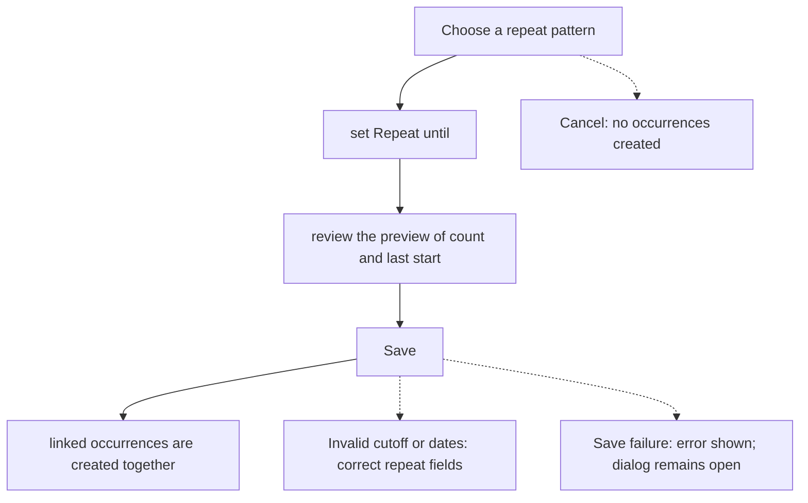
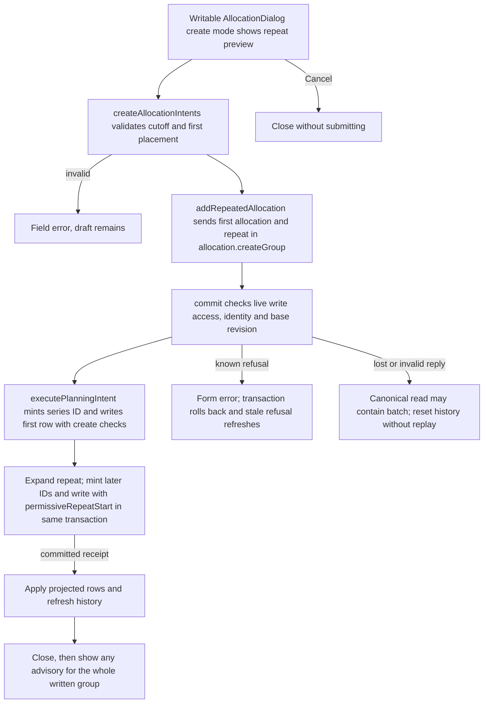

# US-ALL-09 — Create repeating weekly or monthly allocations

As an Editor, I want to create linked repeating allocations so that a repeating work pattern can be planned in one step.

**Status:** Current
**Access:** Editor, Admin or Owner
**Entry:** Schedule (`/`)
**Documentation:** [schedule-work.md](../../docs-src/using/schedule-work.md)
**Source:** [AllocationScheduleFields.tsx](../../apps/frontend/src/components/scheduler/AllocationScheduleFields.tsx), [useAllocationScheduleState.ts](../../apps/frontend/src/components/scheduler/useAllocationScheduleState.ts)

## Acceptance criteria

| Field        | Control    | Required/default/conditions                                                                                                                                |
| ------------ | ---------- | ---------------------------------------------------------------------------------------------------------------------------------------------------------- |
| Repeat       | Select     | Create only; defaults to Doesn’t repeat; Weekly, Every 2 weeks, Every 3 weeks, Every 4 weeks or Monthly                                                    |
| Repeat until | Date input | Required when repeating; suggested as the end of the second calendar month after Start; not before today or Start; at most six calendar months after Start |

- The form previews **Creates {count} linked allocations through {repeatUntil}. Last start: {lastStart}.**
- After Save, a warning notice reports how many occurrences exceed capacity, overlap time off or start on a non-working day. It never blocks the save.
- Save creates the previewed occurrences as one undoable action; each occurrence remains separately editable.

## User flow

## Code flow

The client mints the first ID. The advisory counts affected occurrences across the entire batch. Eligible Undo deletes the recorded group and Redo restores that deletion group.

**Code references:**

- [AllocationScheduleFields.tsx](../../apps/frontend/src/components/scheduler/AllocationScheduleFields.tsx#L201)
- [allocationSubmit.ts](../../apps/frontend/src/components/scheduler/allocationSubmit.ts#L195)
- [allocationDraft.ts](../../apps/frontend/src/components/scheduler/allocationDraft.ts#L144)
- [allocationSlice.ts](../../apps/frontend/src/store/slices/allocationSlice.ts#L91)
- [execute.ts](../../apps/backend/app/services/planning/execute.ts#L182)
- [save_advisory.ts](../../apps/backend/app/services/planning/save_advisory.ts#L16)
- [inverse.ts](../../apps/backend/app/services/planning/inverse.ts#L33)
- [inverse.ts](../../apps/backend/app/services/planning/inverse.ts#L138)
- [planning_mutations_controller.ts](../../apps/backend/app/controllers/planning_mutations_controller.ts#L9)
- [planning.ts](../../apps/backend/app/services/planning.ts#L198)
- [planningCache.ts](../../apps/frontend/src/data/planning/planningCache.ts#L471)
- [history.spec.ts](../../apps/backend/tests/functional/planning/history.spec.ts#L395)
