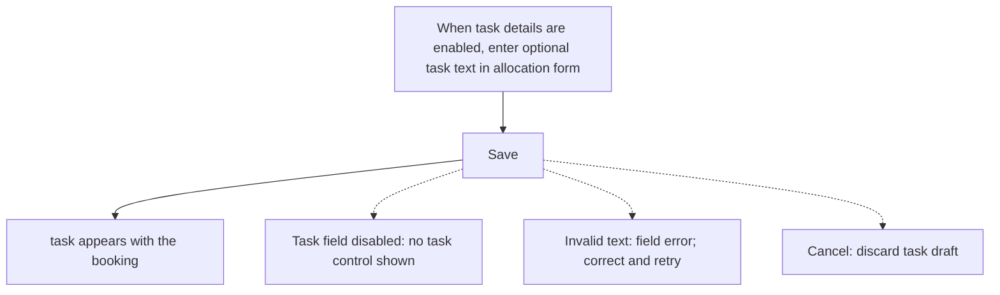
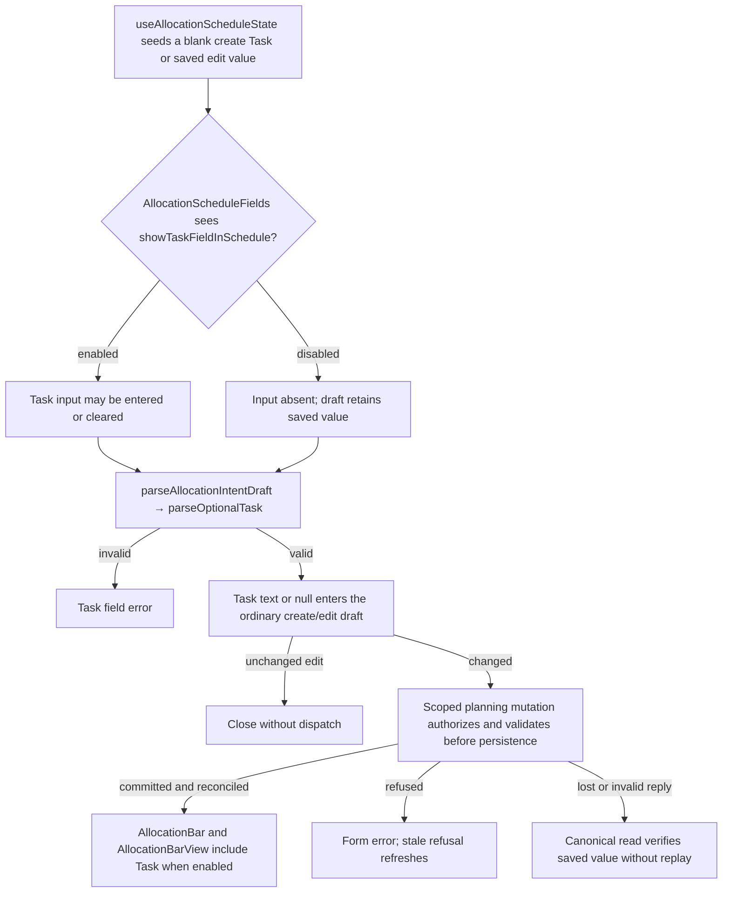

# US-ALL-10 — Add an optional task to an allocation

As an Editor, I want to add a short task description so that an allocation can carry context without replacing its activity.

**Status:** Current
**Access:** Editor, Admin or Owner
**Entry:** Schedule (`/`)
**Documentation:** [schedule-work.md](../../docs-src/using/schedule-work.md)
**Source:** [AllocationScheduleFields.tsx](../../apps/frontend/src/components/scheduler/AllocationScheduleFields.tsx), [AllocationTargetFields.tsx](../../apps/frontend/src/components/scheduler/AllocationTargetFields.tsx)

## Acceptance criteria

| Field | Control    | Required/default/conditions                                                                                                                        |
| ----- | ---------- | -------------------------------------------------------------------------------------------------------------------------------------------------- |
| Task  | Text input | Optional; up to 100 characters; shown only when the company enables Show task field in schedule. Hidden task text is kept when the setting is off. |

## User flow

## Code flow

Save follows the [create](US-ALL-01-create.md) or [edit](US-ALL-02-edit.md) validation and placement path. Cancel discards the unsent Task change.

**Code references:**

- [AllocationScheduleFields.tsx](../../apps/frontend/src/components/scheduler/AllocationScheduleFields.tsx#L45)
- [useAllocationScheduleState.ts](../../apps/frontend/src/components/scheduler/useAllocationScheduleState.ts#L109)
- [allocationSubmit.ts](../../apps/frontend/src/components/scheduler/allocationSubmit.ts#L69)
- [allocationSubmit.ts](../../apps/frontend/src/components/scheduler/allocationSubmit.ts#L127)
- [planningIntents.ts](../../apps/frontend/src/data/planning/planningIntents.ts#L177)
- [AllocationBar.tsx](../../apps/frontend/src/components/scheduler/AllocationBar.tsx#L72)
- [AllocationBarView.tsx](../../apps/frontend/src/components/scheduler/AllocationBarView.tsx#L214)
- [planning_mutations_controller.ts](../../apps/backend/app/controllers/planning_mutations_controller.ts#L9)
- [planning.ts](../../apps/backend/app/services/planning.ts#L198)
- [planningCache.ts](../../apps/frontend/src/data/planning/planningCache.ts#L471)
- [AllocationDialog.activity-and-task.test.tsx](../../apps/frontend/src/components/scheduler/AllocationDialog.activity-and-task.test.tsx#L259)
